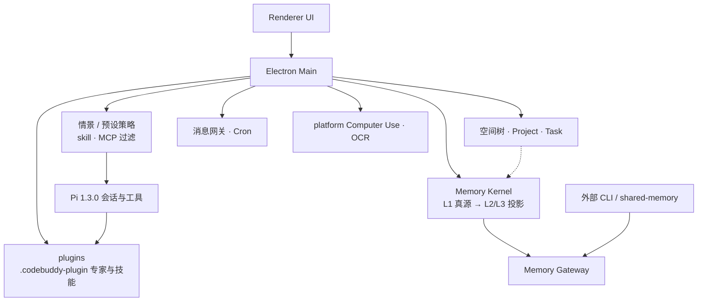

# MyBuddy (`wavealstra_harness`)

Electron 桌面 Agent，内核是 [Pi coding-agent 1.3.0](https://www.npmjs.com/package/@earendil-works/pi-coding-agent)。用**项目 / 空间树**组织工作，用**情景模式**收紧 skill 与 MCP，用**多层记忆**在桌面与外部 CLI 之间协同，并尽量兼容 WorkBuddy / CodeBuddy 那套插件目录。

版本 **0.1.62**，许可证 MIT。产品目录：`~/.mybuddy`。

## 为什么开源

当初想做一个 **WorkBuddy 的替代**：同一套「工作区 + 插件 + 桌面 Agent」思路，但按自己的项目制和 harness 边界来长。现在 WorkBuddy 已经起飞了，一个人继续硬扛完整产品不现实——所以把能公开的代码摊开，欢迎一起改。这不是对标宣战，是把半成品交出去。

## 产品要点

### 1. 空间文件夹 · 树形 · 项目制 · 记忆协同

工作不是平铺聊天窗口。Blueprint / Workspace 是**树**：空间可嵌套（`parentKey` + `children`），挂任务、文件、库绑定与 Gadget（见 `src/main/blueprint/`）。上面还有 **Project** 层（`src/main/project/`）：材料、事件、知识检索、与任务执行工作区正交。记忆按 **Project → Workspace → Task** 定作用域，跨范围写入要显式 promote，桌面会话和外部 CLI 走同一 Memory Gateway，避免各写一份 MEMORY.md。

### 2. 情景模式：限制 skill / MCP

欢迎三情景（`src/shared/mode-profile.ts`）：

| 模式 | 含义 |
|------|------|
| `working` | 日常办公（默认） |
| `coding` | 代码开发 |
| `bot` | Bot / 自动化 |

每个情景（以及标签预设）带 `skillPolicy` / `mcpPolicy`：黑名单 hide·deny、白名单 allow、MCP 还可 `hard` 直接不注入 adapter。会话创建时过滤，不是事后提醒。

### 3. 多层记忆

Memory Kernel 以 **L1 MemoryRecord** 为可寻址真源；对上投影 **L2 / L3** 紧凑上下文（Gateway 的 `context` 与 MCP 工具描述里写明）。另有回合抽取、技能学习 / 修订、语义检索等管道（`src/main/memory/`）。外部 CLI 用 `shared-memory` 技能 / `mybuddy-memory` 读同一库，不另起一套长期记忆。

### 4. 插件（WorkBuddy / CodeBuddy 兼容）

专家包按官方插件形安装：`.codebuddy-plugin/plugin.json` + `agents/*.md` + 可选 `avatars/`（`ExpertService`）。技能侧也会写出同结构元数据。插件与能力资产落在 `~/.mybuddy/plugins/`，鉴权仍在 `auth.json`，不跟插件目录混写。

### 5. 其它已实现能力

- Pi 会话、工具、子代理、专家绑定  
- 技能市场内置：`dimagent-debug` / `hello-buddy` / `weekly-summary`  
- Slack Socket Mode 等消息网关、Cron  
- Computer Use（Linux → computer-use-linux）；本地 OCR / Whisper 路径（≠ 整机离线）  
- 内嵌浏览器、远程配对、Artifact 预览  

和 ERP 一起用时：**ERP 只存事实；推送 / 提醒 / Slack / 日历走这个 harness。**

## 架构（示意）



## 边界（别误读）

- 没配本地模型就要云端 API / OAuth。  
- 表格预览不重算公式。  
- 各平台桌面控制不对等；Wayland 后台截图等会显式失败。  
- `pnpm test:all`（headless 棘轮）绿 ≠ GUI / 真 Slack / 真 OCR 已验收。  
- 「兼容 CodeBuddy 插件目录」≠ 官方生态的每一包都测过。

## 跑起来

需要 Node.js ≥ 24、pnpm 12.14.0（见 `packageManager`）、真实桌面；Linux 建议可用的 libsecret，避免 `safeStorage` 落到 `basic_text`。

```bash
pnpm install
pnpm dev
```

```bash
pnpm -s typecheck
pnpm -s test:all
pnpm -s pack:linux   # 或 pack:win / dist:*
```

## 仓库与数据

| 路径 | 作用 |
|------|------|
| `src/main/` | 主进程 |
| `src/renderer/` | UI |
| `shared/` · `src/shared/` | IPC / 契约 |
| `scripts/` | 测试与打包门禁 |
| `AGENTS.md` | 改仓约定 |

| `~/.mybuddy/...` | 内容 |
|------------------|------|
| `app.db` | 主库 |
| `auth.json` | 模型鉴权 |
| `plugins/` | 技能与专家插件 |
| `gateway/` · `logs/` | 网关与日志 |

大体积评测 runs 不要进 Git。

## 许可证

[MIT](LICENSE) © 2026 WaveAlstra / MyBuddy contributors
