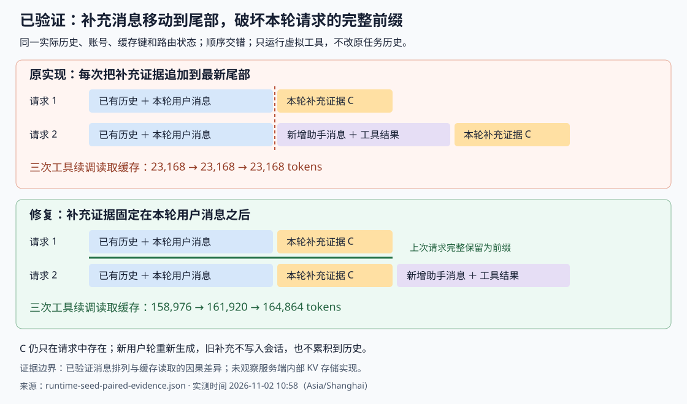

# 临时上下文投影导致缓存复用停滞

本次修复对应 Android 模型管理任务的低缓存命中问题。运行中的 MyBuddy 0.1.62 使用 Pi 1.3.0，经 Magpie 0.1.1788 的原生 Responses 路径调用模型。

## 已证实的触发机制

`EphemeralContextProjection` 为当前用户轮生成一份请求专用的补充证据。旧实现每次把它放到最新请求末尾。工具调用完成后，新增的助手消息和工具结果会占据上次补充证据的位置，补充证据再移到更后面。因此，新请求不能完整延伸上一请求。

在该任务的真实大上下文中，这个排列稳定复现了原来的 `23,168` tokens 缓存平台。把同一补充证据固定在当前 canonical user 后，下一次工具续调完整保留上次请求，再追加新增历史，缓存读取随历史增长。

这不是“普通共同前缀始终不增长”：尾部方案的共同前缀也增长，但本次上游仍只读取固定缓存。服务端内部为何没有利用这段增长前缀未被观察到；修复不依赖对其 KV 存储实现的假设。

## 严格配对结果

[脱敏逐项证据](runtime-seed-paired-evidence.json)共七次请求：一个共享首请求，加三组配对。配对保持相同账号、缓存键、逻辑 turn、路由状态和非 input 字段；使用相同用户文字、同一补充证据、相同历史输出及虚拟工具结果。两边 input 项的哈希多重集相同，删除补充项后数组逐项一致，唯一 input 排列干预是补充项的位置。顺序交错为 tail→anchor、anchor→tail、tail→anchor。

三组总输入分别为 `162,026`、`164,970`、`167,967` tokens。尾部排列的缓存读取三次都是 `23,168`；固定锚点分别读取 `158,976`、`161,920`、`164,864`。最后一组当次输入缓存率约从 `13.79%` 提升到 `98.15%`，不是整个任务累计百分比。

每次都是模型真实生成的单个虚拟 `cache_probe` 调用；工具结果由诊断程序生成，未执行真实工具。原任务聊天历史保持 130 条消息不变。原始种子仅在本机内存、CDP 和子进程 stdin 中传递，未保存请求正文、凭据或授权头。

运行 `node artifacts/cache-investigation/verify-paired.mjs` 可离线校验账号/键/字段一致、逐项哈希、补充位置和完整前缀延伸。此校验不联网、不读取凭据。

## 修复与回归

[投影实现](../../src/main/agent/EphemeralContextProjection.ts)按 canonical branch 最新真实用户消息的 timestamp 和完整 content，在 Pi 克隆后的请求消息中找到固定锚点。若压缩使该用户不在请求中，补充放到 conversation 起点；Pi 会恢复 leading system 消息。

补充仍不写入聊天历史。新用户轮重新生成；原有 memory/source 撤销检查、最终请求 guard、epoch、模型和 scope 校验及原生工具权限保留。

[真实 Pi 自主执行回归](../../scripts/pi-autonomous-execution-test.ts)新增同一用户轮的完整请求前缀断言。旧实现未通过，修复后通过；还检查第二用户轮不累积旧补充，以及原用户不在请求时的稳定回退。回退测试通过扩展过滤模拟该形状，未声称覆盖真实压缩的完整时序；来源文本恒定的跨轮测试证明不累积，未单独验证第二轮来源改变。

验证：定向测试 6/6 PASS；类型检查无新增错误；完整 headless 门禁 247/247 PASS、已知失败 0、新增回归 0。补丁版本为 0.1.64，Windows 包另经实际 packaged-payload 门禁验收后接受。

## 排除的解释与证据边界

原任务 38 次调用及后续网关实验使用同一可见最终账号，均单次 HTTP、200，无记录到账号切换或重试。前端累计公式不能解释底层固定的读取数。未发现压缩、未配对工具、历史消息改写或实际脱敏命中。

更换缓存键的改善后来不能稳定保持；完全重复请求曾达到高命中，但正常改变后又回落，故不能作为恢复证明。`x-codex-turn-state` 确实由上游返回，网关未保留；然而保留它的真实上下文实验仍停在 `23,168`，所以本次没有据此修改网关。小型合成上下文中移动补充也能正常缓存，说明触发与真实上下文路径有关，不能推广成所有模型必然失败。

配对采用同一新键下以锚点响应构建共同主干的分叉；此前独立尾部链也复现三次平台。它直接支持位置重排的因果效应，不单独估计供应商所有长期缓存策略。原始 38 次调用没有完整网络请求存档，历史归因依靠实际产物实现、当时非空补充旁证、同真实种子的复现和单变量干预闭环，并非原始请求逐字重放。

