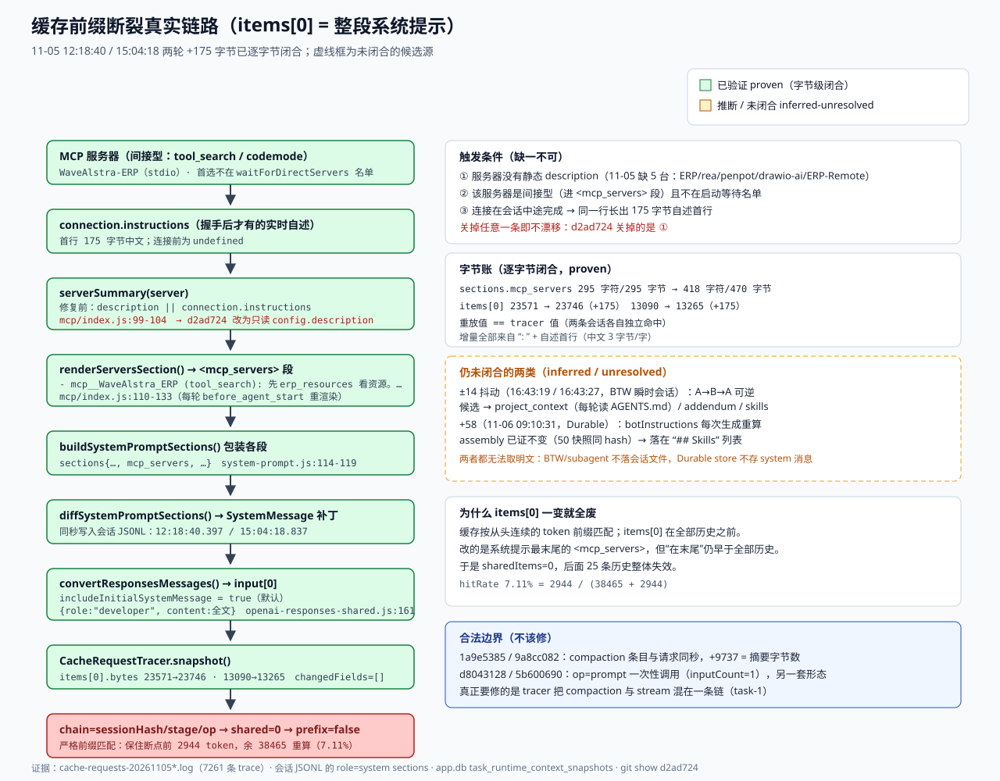
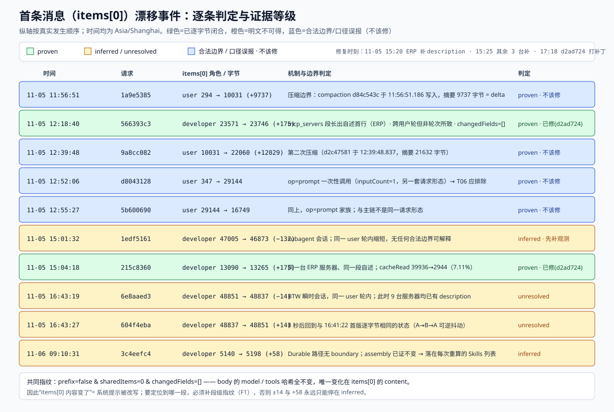

# 缓存前缀异常根因调查（复核报告 C 组 / T11–T14）

调查对象：`C:\Users\servi\.mybuddy\logs\cache-requests-2026110{5,6}*.log`（8 个文件、7261 条 cache-trace 事件）、Pi 会话文件、`~/.mybuddy/app.db`
调查方式：**只读**。没有改 src、package.json、日志、plugins，没有重启、没有 build、没有 git commit/push。
产物：本文件 + `prefix-root-cause-20261106.json`（逐事件机制表）+ `diagrams/prefix-break-chain.svg`、`diagrams/prefix-event-timeline.svg`。

---

## 0. 一句话结论

`items[0]` 就是**整段系统提示**（OpenAI Responses 的 `input[0] = {role:"developer", content:<全文>}`，`includeSystemPrompt` 默认 true）。系统提示末尾的 `<mcp_servers>` 段由 Pi **每轮重新渲染**，其中 `serverSummary()` 在服务器没有静态 `description` 时回退去读**实时** `connection.instructions`。MCP stdio 服务器是异步连接的：首轮只有标题行，连接完成后同一行长出服务器自述，`sections.mcp_servers` 变化 → Pi 追加一条 system 补丁 → 下一轮 `items[0]` 内容改变 → 严格前缀从第 0 项就断，后面全部历史失效。

**+175 字节 = WaveAlstra-ERP（当时唯一缺 `description` 的可见服务器）的实时自述首行**，两轮样本各自逐字节闭合。该路径已由 commit `d2ad724`（11-05 17:18）在 Pi 侧修掉，回归用例本次实跑 5/5。

报告里 T13 的假设（`serverSummary` 吃 `description`）**成立**；`mcp-cache.json` 不是本次的上游数据源（那是工具目录缓存，mtime 2026-09-24，与 11-05 事件无关）。

补一处容易读错的口径：11-05 12:18 / 15:04 两个时刻缺 `description` 的共 **5 台**（WaveAlstra-ERP、rea、penpot、drawio-ai、WaveAlstra-ERP-Remote[disabled]）。用户 15:20 先给 ERP 补上（`mcp.json.bak-before-cache-fix-20261105-152008`），15:25 又给其余 3 台 + Remote 补上（`mcp.json.bak-before-desc-all-20261105-152507`）。所以在 general-office 场景（可见集合 = WaveAlstra-ERP + slack）里，事件发生那一刻 **ERP 是唯一缺 description 的可见服务器**，这与「+175 字节对得上 ERP 自述首行」是两件事的同一结论。

---

## 1. 逐类异常判定

| 异常 | 事件 | 结论 | 证据等级 | 该不该修 |
|---|---|---|---|---|
| **+175 ×2** | 566393c3（11-05 12:18:40）、215c8360（15:04:18） | `<mcp_servers>` 段长出自述首行；与用户轮无关的内容漂移 | **proven** | 已修（d2ad724）；要补门禁，不要重复改 |
| **−132 ×1** | 1edf5161（15:01:32，subagent 会话） | 同一 user 轮内系统提示缩短，无合法边界可解释；明文不可得 | **inferred** | 先补段级可观测，不要盲改 |
| **±14 抖动** | 6e8aaed3（16:43:19，−14）→ 604f4eba（16:43:27，+14） | 同一 user 轮内 A→B→A 可逆抖动；明文不可得 | **unresolved** | 先补段级可观测 |
| **+58 ×1** | 3c4eefc4（11-06 09:10:31，Durable） | Durable 每轮重算 `botInstructions`；assembly 已证不变 → 落在 `## Skills` 列表 | **inferred** | 该修：Durable 系统提示要冻结（F3） |
| **首条 user 项替换 ×2** | 1a9e5385（11:56:51）、9a8cc082（12:39:48） | **压缩边界**，摘要字节数与 delta 精确闭合 | **proven** | **不该修** |
| **op=prompt 误报 ×2** | d8043128、5b600690 | `inputCount=1` 的一次性调用，另一套请求形态 | **proven** | **不该修**（口径排除） |

证据等级定义：`proven` = 日志哈希/字节数 + 系统提示明文逐字节闭合（重放值 == tracer 值）；`inferred` = 机制在代码中可定位、时间与指纹吻合但明文不可得；`unresolved` = 明文与会话文件均不可得，只能给候选并排除。





---

## 2. 调查方法：这次为什么能拿到明文

复核报告把 T11–T14 卡在“需要明文 dump / 写记忆 / 重启”。本次不需要那些操作，因为**明文早就在磁盘上**：

1. **Pi 会把系统提示分段持久化。** 会话 JSONL 的第 6 行是 `role=system` 消息，带 `sections` 字段（`preamble / tools / rules / docs / addendum / project_context / skills / cwd / mcp_servers`），之后**每段变化就追加一条只含变化 section 的补丁消息**（`diffSystemPromptSections`）。补丁时间戳精确到毫秒，并与请求同秒。
2. **可以逐字节复算。** `buildSystemPromptSections()` 把非 preamble 段包成 `<name>\n…\n</name>`，`getSystemMessageText` 用 `\n\n` 拼接；`items[0]` 的字节数就是 `Buffer.byteLength(JSON.stringify({role:"developer",content:全文}))`。离线重放该拼接后，与 tracer 记录的 `items[0].bytes` **逐字节相等**。
3. **会话可归属。** `sessionHash = sha256(sessionId)`（非 HMAC），用会话文件头的 id 反查即可命中；再经 `tasks.session_file` 映射到 taskId，从而取到 `task_runtime_context_snapshots` 的 `resolved_instructions_json`，用来**排除 assembly**。
4. **组件稳定性可证伪。** 若 assembly 变了，快照的 `assembly_hash` 会变；实测这三个 task 的全部快照 hash 恒定，因此变化只能落在 assembly 之外的段。

字节账（会话 01a1a9ea，事件 566393c3）：

| 量 | 值 |
|---|---|
| 初始系统提示（12:14:51.114 写入的 system 消息） | 重放 `items[0].bytes = 23571` |
| tracer 记录（12:17:24 的 504911d7） | `items[0].bytes = 23571` ✅ |
| 补丁系统消息（12:18:40.397，只含 `mcp_servers`） | 重放 `items[0].bytes = 23746` |
| tracer 记录（12:18:40.680 的 566393c3） | `items[0].bytes = 23746` ✅ |
| `sections.mcp_servers` | 295 字符 / 295 字节 → 418 字符 / **470 字节**（+175） |

会话 01a1aa7e（事件 215c8360）同法得到 13090 → 13265，Δ=+175，与 commit `d2ad724` 里写的实测值一致。

**新增出来的文字（原文）**：

```
<mcp_servers>
MCP servers whose tools are not declared to you. Load the tools of `tool_search` servers with `tool_search`.
- mcp__slack (tool_search): Slack official MCP server for messages, channels, files, Canvas, Lists and workspace actions.
- mcp__WaveAlstra_ERP (tool_search): 先 erp_resources 看资源。常用 erp_list / erp_get / erp_create / erp_update / erp_delete / erp_action。目录外接口用 erp_call。写操作走现有业务服务。
</mcp_servers>
```

变化的就是 `- mcp__WaveAlstra_ERP (tool_search)` 之后长出的 `: ` + 首行自述。中文 3 字节/字 → 123 字符 / 175 字节。

无法取明文的三类（本次的硬边界）：

- **subagent 会话不落 session 文件**：`usage_events` 里 `source_kind=subagent` 的 `session_file` 为 `NULL`；`b45b140e…` 在 `~/.mybuddy` 全树（6095 个候选文件）里搜不到。
- **BTW 瞬时会话不落 session 文件**：`task btw-mw3aqh5n-0-o0j5aj` 在 `tasks` 表里已不存在，`usage_events` 中 `source_kind=btw` 的 `session_file` 为 `NULL`。
- **Durable 不写 role=system**：对 `~/.mybuddy/durable/ea2c1f53…/main.jsonl` 的 1544 条记录做扫描，system 记录 **0 条**；且 11-06 09:10:31 那次生成（generation 173）**没有** runtime snapshot（该 task 最早快照是 generation 241 @09:12:49）。

---

## 3. 逐事件机制表（含边界判定）

判定口径：取异常请求与其 `previous.request` 的 boundary。`leaf` 前进是同一 user 轮里的正常步骤；`user` 变化才是新用户轮；`compaction` 变化是压缩边界。**“是否为合法边界”看的是“该变化是否由边界语义必然导出”**——用户轮换了但系统提示没理由变，仍属漂移。

| 请求 | 时间 | 会话 | items[0] | Δ | 边界对比 | 判定 | 等级 |
|---|---|---|---|---|---|---|---|
| 566393c3 | 12:18:40.680 | 854d31e0（主会话） | developer 23571→23746 | +175 | user `951bfdf4`→`edf52e85`（新轮）、leaf 变 | mcp_servers 段长出自述，**非轮次所致**（若提示不变，前 16 项本可全共享） | proven |
| 215c8360 | 15:04:18.911 | cfb8cef5（主会话） | developer 13090→13265 | +175 | user `d18fca55`→`dcdd843f`（新轮）、leaf 变 | 同上（同一台 ERP、同一段文字） | proven |
| 1edf5161 | 15:01:32.481 | b45b140e（subagent） | developer 47005→46873 | −132 | user `1318acd4`=前值、仅 leaf 前进 | **同一 user 轮内漂移**，无边界可解释 | inferred |
| 6e8aaed3 | 16:43:19.306 | 3894a8e2（BTW） | developer 48851→48837 | −14 | user `89f27b9f`=前值、仅 leaf 前进 | 同一 user 轮内漂移 | unresolved |
| 604f4eba | 16:43:27.181 | 3894a8e2（BTW） | developer 48837→48851 | +14 | user `89f27b9f`=前值、仅 leaf 前进 | 镜像回退，内容哈希回到 16:41:22 首版（`adf12977…`） | unresolved |
| 3c4eefc4 | 11-06 09:10:31.001 | c672d2be（Durable） | developer 5140→5198 | +58 | **无 boundary**（`fb393b2` 之后 Durable 未带 boundary，task-1 负责）；`changedFields=[]`、`prefixStable=false` | Durable 每轮重算 `botInstructions`；assembly 已证不变 → Skills 列表 | inferred |
| 1a9e5385 | 11:56:51 | 01a1a9ae（主会话） | user 294→10031 | +9737 | compaction `null`→`76f3827f`，leaf 同步 | 压缩边界；`d84c543c.summary` 正好 9737 字节 | proven |
| 9a8cc082 | 12:39:48 | 01a1a9ae（主会话） | user 10031→22060 | +12029 | compaction `76f3827f`→`6a993f82` | 二次压缩；`d2c47581.summary` 21632 字节 | proven |
| d8043128 | 12:52:06 | ee15ea48（主会话） | user 347→29144 | — | op=`prompt`、`inputCount=1`、leaf 独立 | 一次性调用，与 stream 主链不同形态 | proven |
| 5b600690 | 12:55:27 | ee15ea48（主会话） | user 29144→16749 | — | 同上 | 同上 | proven |

共同指纹：`prefix=false & sharedItems=0 & changedFields=[]`。`changedFields=[]` 说明 **body 的 `model` / `tools` 等字段哈希全未变**，唯一变化在 `items[0].content`；它不是“顶层 tools 扩表”那类（后者 `changedFields` 会非空）。

---

## 4. 代码链路：哪一段是非确定性的

已核实（含文件:行）：

| # | 位置 | 作用 | 是否本次根因 |
|---|---|---|---|
| 1 | `node_modules/@earendil-works/pi-coding-agent/dist/extensions/mcp/index.js:99-104` | `serverSummary()`：`config.description?.trim() \|\| connection?.instructions \|\| ""` | **是**（修复前） |
| 2 | 同文件 `:110-133` | `renderServersSection()` 每轮在 `before_agent_start` 重渲染 → `- mcp__X (reach): <summary>` | **是**（承载变化的段） |
| 3 | 同文件 `:1085-1092` | `sections[MCP_SERVERS_SECTION] = renderServersSection(servers)` | 是（写入口） |
| 4 | `…/pi-coding-agent/dist/core/system-prompt.js:114-119` | 每段包 `<name>…</name>`；`:139-150` `diffSystemPromptSections` 变化即入 transcript | 是（传导） |
| 5 | `…/pi-ai/dist/api/openai-responses-shared.js:161,180-200` | `includeInitialSystemMessage = options?.includeSystemPrompt ?? true` → 系统提示进 `input[0]`，role 取 `developer`（reasoning 模型） | 是（放大） |
| 6 | `src/main/mcp/NativeMcpConfig.ts:63-64` | `description` 有则透传、无则不补 → 缺 description 的服务器留给 Pi 回退 | 是（数据侧成因） |
| 7 | `src/main/mcp/McpRuntimeService.ts:86-107` | `createMcpExtension({loadConfig: () => structuredClone(config)})` | 否（只是接线） |
| 8 | `src/main/agent/PromptAssembly.ts:311-541` + `AgentService.ts:1437-1448` | assembly 每会话一次、带缓存键与 fingerprint；`task_runtime_context_snapshots` 里 hash 恒定 | **否**（本次已证不变） |
| 9 | `src/main/agent/AgentService.ts:1337-1349` → `durable/DurableBotService.ts:273` → `durable/DurableBotRuntime.ts:994` | Durable 系统提示 = `appendParts` + `## Skills` 列表，**每次生成重算**（`resolveSkillsForContext`），且 assembly 缓存键不含 skills 列表 | 是（+58 的候选路径，F3） |
| 10 | `src/main/agent/CacheRequestTracer.ts:126-132` | `chain = sessionHash/stage/operation??'unbound'`；`prefix = shared === previous.inputCount` | 是（观测侧：compaction 与 stream 混链，task-1） |
| 11 | `src/main/capabilities/subagent/context.ts:38-93,124-133` | 子代理系统提示 = 角色 body + Context Contract，**派发时生成一次** | 待验证（−132） |
| 12 | `…/pi-coding-agent/dist/core/system-prompt.js:25-29,99` | `project_context` 段每轮读 AGENTS.md；`skills` 段由 skills 列表渲染 | 候选（±14） |

被**排除**的其它猜测：

- `mcp-cache.json`（`~/.mybuddy/plugins/mcp/mcp-cache.json`，现 916 KB，mtime 2026-09-24 16:17）存的是工具/资源目录，**不参与系统提示**；其中 `instructions` 字段确实存在，但 Pi 走的是活连接对象，不读这个文件。
- memory / context-ledger 投影：`EphemeralContextProjection` 注入的是 **`role:"custom"` 的 context-capsule 消息**（作为普通 item 插在锚点后），不在 `items[0]`；本次三个异常事件的 `items[0].role` 全是 `developer`。
- `RuntimeContextResolver` / `RuntimeAssemblyFingerprint`：只做策略解析与 fingerprint，不参与每轮文本生成。

---

## 5. 明确“不该修”的部分

1. **压缩轮（1a9e5385 / 9a8cc082）的 `prefix=false & sharedItems=0`。** compaction 条目与请求同秒（11:56:51.186 / 12:39:48.837），`d84c543c.summary` 字节数 9737 与 delta +9737 **精确相等**。压缩本来就要重建前缀，这是语义要求。要修的是 tracer 把 `compaction` 与 `stream` 混在一条链上（task-1），而不是让压缩“不破缓存”。报告的 T01/T05 把它们当系统提示改写，是口径错。
2. **op=prompt 一次性调用（d8043128 / 5b600690）。** `inputCount=1`、`items[0].role=user`、另一套 API 路径。它们与 stream 主链根本不是同一请求形态，按 T06（`op=prompt AND (inputCount=1 OR items[0].role=user)`）排除即可。
3. **不要把 `<mcp_servers>` 段彻底冻结成常量。** `d2ad724` 的取舍（只读 `config.description`）已经到位：既消除了连接期抖动，又保留“模型能看见服务器自述”的能力。再冻结会让新装服务器的描述永远不可见。

---

## 6. 修复建议（按“可证明 / 低风险 / 能消除漂移”排序，交 Lead）

### F1（P1，低风险）把“系统提示段变化”变成可观测事实
现在一次系统提示改写只能看到「`items[0].content` 变了」，段名与字节差都看不到——这正是 T11–T14 卡住的直接原因。

- 位置：`src/main/agent/CacheRequestTracer.ts:76-95`（`snapshot()`）、`:133-146`（previous 比较）
- 改法：`capture()` 时若 payload 对应一条 `role=system` 的 `sections` 视图，输出 `systemSections: {name: bytes}`（只存段名与字节数/段级 digest，**不存明文**），并在 previous 比较里给出 `changedSections: string[]`。
- 验收：异常轮记录里直接出现 `changedSections:["mcp_servers"]` 与 delta；11-06 的 Durable 路径同样生效。
- 说明：本次四项里 3 项（−132 / ±14 / +58）就卡在“拿不到段名”，落地 F1 后当场可定性。

### F2（P2，低风险）MCP 段稳定性从“纯函数用例”升级为“反向可证伪”
- 现有：`scripts/mcp-section-stability-test.ts`（`:131-144` 那组断言）。本次实跑 **5/5**，`connected` 与 `disconnected` 的 section sha256 都是 `c21c0121…3b74`。
- 补：会话内连续两次 `buildSystemPrompt` 的 `sections.mcp_servers` 必须逐字节相同（连接前后），失败时打印两个版本首行。
- 反向证据：把 `node_modules` 回退到未打补丁实现，用例必须失败（`d2ad724` 已人工验证过，应固化进 CI）。
- 为什么必要：根因靠 `patches/@earendil-works__pi-coding-agent@1.5.0.patch` 的 `serverSummary` hunk；升级 Pi 时补丁可能悄悄失效。

### F3（P3，中风险）Durable 路径冻结系统提示：把 skills 列表纳入 assembly 版本键
- 位置：`src/main/agent/AgentService.ts:1337-1349`（`botInstructions`）、`:1437-1448`（`durableAssembly` 缓存键）、`src/main/agent/RuntimeAssemblyFingerprint.ts:22-35`
- 改法（二选一）：(a) 把 `resolveSkillsForContext` 的结果并入 `durableAssembly` 的 key 并缓存文本；(b) 把 skills 列表挪进 `assembly.segments`，让 `fingerprintRuntimeAssembly` 变化强制新会话。
- 验收：同一 task 同一 assembly key 下连续两次 `botInstructions()` 逐字节相同；skills 目录变化时 `assembly_hash` 变化并在快照/UI 可见。
- 依据：`local-1793926984527-19` 的 50 个快照 `assembly_hash` 恒为 `c1100d9b5a`、segments 恒为 `soul:33/mode:1543/skillCatalog:356/memoryRules:229/workspace:73` → assembly 没变，而系统提示变了 58 字节。

### F4（P4，低风险）Durable 补 `CacheTraceBoundary`（与 task-1 重叠，此处只记归因价值）
- 位置：`src/main/agent/durable/DurableBotRuntime.ts`（task-1 已列 917-934）、`src/main/agent/ModelInvocationAdmission.ts:86-92`
- 价值：`3c4eefc4` 只能标 `inferred`，一半原因是没有 boundary（无法判断“是否合法边界”）。补齐后 11-06 型事件才能被 op 过滤与链归因。

> 不建议的改法：给 `items[0]` 加“变化就重开会话”、或把系统提示整体提到 `instructions` 字段。前者会让用户在长会话里被静默打断；后者改变缓存可复用范围（`instructions` 不参与 cached prefix），需要整套重测。

---

## 7. 仍未解决（附关闭条件）

| # | 项 | 为什么没闭合 | 怎么关闭 |
|---|---|---|---|
| U1 | ±14 抖动（6e8aaed3→604f4eba）来源 | BTW 瞬时会话不落盘；tracer 无段级指纹。已排除 ERP 175 字节路径（16:43 时 9 台服务器均已有 description，回退分支不可达） | 落地 F1 后复现同类抖动，直接读 `changedSections` |
| U2 | −132（1edf5161，subagent）方向相反的变化 | subagent 会话不落盘；同一 user 轮内缩短，不能直接套 +175 的根因 | F1 + 让子代理会话至少保留段级指纹 |
| U3 | +58（3c4eefc4）的具体文本 | Durable doc store 无 system 消息；generation 173 无快照 | F3 落地后要么消失，要么被 `assembly_hash` 变化显式记录 |
| U4 | Pi 升级后补丁失效 | 上游未合并 `serverSummary` 修复 | CI 里固化 F2 的反向断言 |
| U5 | 报告“11-05 首请求 121 条” | 本次独立解析得 90 条，与复核报告一致、与原 121 不符 | 需要原始作者补口径（与本次无关） |

---

## 8. 复现方式与只读声明

只读操作（全部在仓库外或只读打开）：

```powershell
# 1) 解析 8 个日志文件，按 (request, stage) 对齐并读 boundary / items[0]
#    （内联 Node 脚本，落在 %TEMP%\cacherc，未写入仓库）
node parse1.mjs            # 输出目标请求的完整 cache-trace 记录
node timeline.mjs          # 每个 session 的逐请求时间线（boundary + items[0] + previous）

# 2) 重放会话 JSONL 的 system sections，并与 tracer 的 items[0].bytes 逐字节比对
node runreplay.mjs         # 01a1a9ea 23571→23746 ; 01a1aa7e 13090→13265

# 3) app.db 只读（better-sqlite3, readonly:true）
node db5.mjs  # task_runtime_context_snapshots 逐 segment 与 assembly_hash
node db10.mjs # 11-06 Durable task 的 50 个快照
node db12.mjs # task_request_diagnostics 里 3c4eefc4 的 prefixStable/changedFields
```

验证（按用户 2026-11-06 的口径，只跑相关测试，未 build）：

```
pnpm -s test:mcp-section-stability   →  {"passed":5,"failed":0,"networkRequests":0}
```

未做：typecheck（本次零 src 改动，无新增类型面）；任何 build / dev / 打包 / 重启。

写入范围自检：本次只写 `artifacts/cache-investigation/prefix-root-cause-20261106.md`、`.json`、`diagrams/prefix-break-chain.svg`、`diagrams/prefix-event-timeline.svg`。仓库内其它未提交改动（含 task-1 正在改的 `src/main/agent/*`）未触碰。
