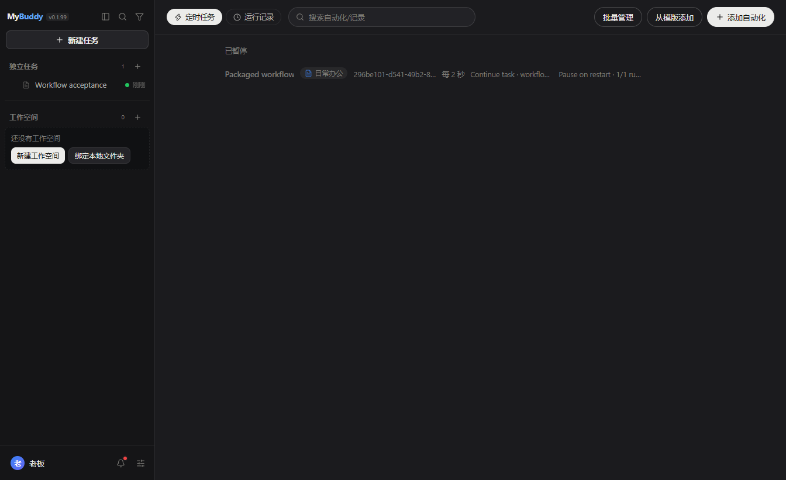

# pstack 本地适配交付

MyBuddy 0.1.99 提供本地任务调度与模型独占交互终端，不提供 Cursor 云端执行。

实现提交为 `d732e277d0d9e49aa12c57663798ab5e4705ad0f`。Windows 验收程序为 `release/win-unpacked/MyBuddy.exe`。当前正在执行任务的开发实例没有重启，新工具需在正常重启后使用。

## 功能

| 能力 | 行为与代码位置 |
|---|---|
| `automation_exec` | 创建、查询、运行记录、暂停、恢复、取消。可继续当前任务或创建新任务。`src/main/cron/` 负责 SQLite 持久化、真实间隔、忙碌跳过、次数与截止限制、重启策略和取消竞态。 |
| `terminal_exec` | 打开、列表、读屏、输入、尺寸调整、关闭。`src/main/terminal/` 复用 PTY，解析 ANSI 与 alternate screen，通过任务、terminalId、sessionId 约束所有权。任务停止只清理模型终端。 |
| 原生角色选择 | `src/main/capabilities/subagent/selection.ts` 解析显式候选，不用外部脚本决定模型。继承父模型必须显式传 `inherit-parent` 或 `auto`。diverse 至少两项任务，候选不足就报错，按模型名去重路由别名。 |
| 技能名单 | `src/shared/runtime-policy.ts` 区分身份硬名单与关键词推荐。硬名单子串匹配必须显式使用 `keyword:`。`bro` 不会再因 description 命中 `ego-browser`。 |
| Automation 页面 | 显示来源任务、继续或新建目标、重启行为和运行次数。编辑保留执行设置。 |

调度要求本地应用保持运行。关闭或休眠期间不执行，恢复后不补跑错过的触发。取消不打断已经开始的回合。readonly 禁止创建计划与控制终端，终端能力开关仍生效。

新任务使用既有任务工作区解析器。不会为了沿用来源 cwd 而绕过任务目录隔离。

## 已执行验收

以下发行门禁针对已提交源码执行，没有夹带工作区原有的未提交 Pi settings-lock 修改。

| 命令或检查 | 结果 |
|---|---|
| `pnpm -s typecheck` | 通过。没有新增错误；脚本检查仍有历史基线错误。 |
| `pnpm -s test:all` | 287 通过，0 失败，0 已知失败放行。 |
| `node scripts/test-all.mjs --audit` | 分类自检通过。 |
| `pnpm -s test:subagent-selection`、`test:runtime-skill-loader`、`test:mode-preset` | 通过。 |
| `pnpm -s test:cron-scheduling` | 真实 SQLite、重开数据库与短定时器通过。覆盖忙碌、准备期间取消、次数、截止时间和重启。此用例的 agent 是夹具。 |
| `pnpm -s test:local-workflow` | 真实注册工具、定时器、AgentService、Pi 会话、本地 HTTP 模型夹具与持久化输出通过。未使用生产凭据。 |
| `pnpm -s test:task-terminal:live` | Windows ConPTY 的 TUI 读屏、输入、resize、Ctrl-C、退出、活跃子进程终止和用户终端保留通过。 |
| `pnpm -s test:subagent-pstack-execution` | 注册工具和真实 Pi worker 对本地模型夹具执行通过。包含模型与推理回读、隔离、保留产物和父模型选择。 |
| `pnpm -s pack:win` | 通过。根 package.json 完整性检查通过。 |
| `pnpm -s verify:packaged -- --app-dir release/win-unpacked` | 通过。595 个 unpacked 条目无缺失，打包 worker 启动并报告 Pi 1.3.0。 |
| `node scripts/validate-local-workflow-package.cjs release/win-unpacked/MyBuddy.exe` | 实际安装包在隔离用户目录运行，完成 13 个工具步骤、一次定时续聊及次数停用，Automation 页面断言通过。 |
| 桌面与开始菜单快捷方式 | 已回读目标、工作目录、图标和 `com.mybuddy.app` 身份，均指向验收通过的程序。 |

完整日志在 `out/diagnostics/pstack-native-entry/release-gate.txt`。实际包工具回执在 `out/tests/local-workflow-package/results.json`。快捷方式回执在 `out/tests/chat-attachment-acp/deployment/0.1.99/shortcuts.json`。

安装包 SHA-256：

- `MyBuddy.exe` 为 `4ef1ac6760c187684ea54a303c4b248423b589969543153ef852a956911e2498`。
- `resources/app.asar` 为 `8e4539f9c6cbc0413315c6142505b89cad6b550fff8dac14829240b9df397650`。

## 本机 pstack 指令

已修改以下既有文件，没有另建重复技能。

- `~/.mybuddy/plugins/skills/poteto-mode/SKILL.md`。
- `~/.mybuddy/plugins/skills/poteto-mode/playbooks/authoring-a-skill.md`。
- `~/.mybuddy/plugins/skills/poteto-mode/playbooks/autonomous-run.md`。
- `~/.agents/pstack-models.md`。

指令要求先确认工具实际可用，区分本地调度与云端执行，禁止用长时间 sleep 冒充持久调度，保留 main-only、Meta Skill 评估和新技能默认停用语义。`deslop` 的代码清理与 `unslop` 的文字清理分开。没有替用户改变 `subagent.json` 的候选模型。

原始字节及安装后 hash 位于 `out/diagnostics/pstack-native-entry/installed-backup/manifest.json`。已验证备份 hash、技能 frontmatter 和相对文档链接。

## thermos 审查

已触发并执行父模型审查，问题按严重度处理：

- P1，修正 `@xterm/headless` 发布包错误入口。通过依赖元数据补丁统一 ESM、CommonJS 和打包器加载，未保留多套 import 回退。
- P1，修正 ConPTY 子进程枚举与关闭的竞态，并释放已退出 shell 的原生句柄。真实子进程清理验证通过。
- P1，调度异步准备后重新核对 revision、任务状态与忙碌状态。取消、错误、仅入队和没有新增模型输出不能记作成功。
- P2，关闭操作幂等，重开前释放旧 PTY，删除技能 matcher 的同形对象包装。

没有新增跨过 1000 行阈值的文件。已有大文件的新增逻辑限于对应领域入口和组装。详细审查记录在 `out/diagnostics/pstack-native-entry/thermos.md`。

独立代理审查未完成。Gemini 的显式 reasoning 被拒，使用默认 reasoning 的 worker 以 code=1 退出；其他探测超时。这些失败没有被算作多模型评审通过。

## 边界与回滚

- Linux PTY 尚未实机验收，本次 Windows 结果不能替代它。
- 本机商业模型的在线独立评审及真实上游多样性未验证。不同 provider 或返回的模型别名不足以证明不同上游模型。
- 没有运行完整 GUI 套件；本次执行的是实际包相关功能验收。
- 旧硬名单若有意依赖关键词，需明确改成 `keyword:<词>`；不自动猜测用户原意。
- 应用退出会停止本地调度。这不是云端常驻服务。
- 回滚源码前先暂停本功能创建的计划，再回滚实现提交并重建。保留用户数据库，不删除新增列或用户数据。技能文件可按备份 manifest 恢复；恢复前核对安装后 hash，避免覆盖后续修改。
- 原有无关源码、Pi patch、锁文件修改和诊断资料已恢复并保留。发行包没有依赖这些未提交修改，也没有中断当前用户任务。
