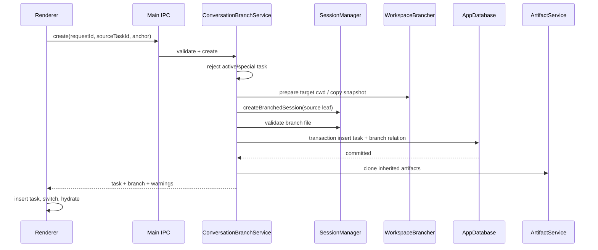

# MyBuddy 对话分支（Branch in new task）详细实施规划

> 文档状态：实施前规划，尚未修改功能代码  
> 基线日期：2026-09-02  
> 适用仓库：`C:\Users\servi\Desktop\mybuddy`  
> 目标版本：先完成可发布的 V1，再逐步补充分支树与高级文件策略

> **评审裁决摘要（2026-09-02 复审落库，实施前必读）：**
> ① 分支锚点必须用**稳定的 Pi entry id**，`userMessageIndex` 只作风降/展示——因为 `loadTaskHistoryFromSession` 会过滤空/纯附件 user 消息，UI 序号与 Pi 原始序号天然可能偏移（§7.1）；
> ② `conversation_branches` 增加 `request_id TEXT NOT NULL UNIQUE` 作为持久幂等键，`source_user_message_index` 降为辅助（§5.1/5.4）；
> ③ child 的 usage 会因为继承段复用同一 `entry_id` 命中 `usage_events` 全局主键，必须提前定"跳过继承前缀或不写"，否则少计且可能报 `UNIQUE constraint failed`（§7.4）；
> ④ "分支点之前"的 Artifact 剪裁只能由主进程按 Pi entry 顺序判定，UI 的合并消息不暴露 tool call id、无法判定（§9.2）；
> ⑤ history loader 必须接受 cwd override 并让 artifact/tool 相对路径用 override 解析，否则 child 历史仍指向 parent root（§7.3）；
> ⑥ commit 前清理需要一个"requestId 决定的临时目录锚点"，否则无法验证 exact path、只能留 orphan（§10.2）。

## 1. 结论先行

MyBuddy 的“创建分支”应定义为：

> 用户从当前任务的一条消息出发，创建一个新的、可独立继续的 Task。新 Task 继承截至该消息的有效会话上下文，但原 Task 的当前分支、标题、状态和后续消息完全不变。

它不是 Git 分支，也不是现有的“复制为办公/编码/设计任务”，更不是在原 Task 内执行“重新生成”。

推荐的 V1 形态：

1. 在每条普通聊天消息的“更多”菜单中增加“从这里创建分支”。
2. 点击后由主进程校验源 Task 和分支点，在新的 session JSONL 中物化选中路径。
3. 新建独立 Task，并立即切换到该 Task；不自动发送消息。
4. 新 Task 继承 Project、Space、模式、模型、权限、专家、Tag/Preset 和已激活连接器，但不继承临时运行状态、审批、终端实例和额外写入授权。
5. 在新 Task 标题区显示“来自：原任务”入口；原任务可看到其直接分支。
6. 对话上下文严格截至所选消息；文件状态则遵循本规划第 8 节，绝不宣传为“回到该消息时的磁盘状态”。

OpenAI 对 ChatGPT 功能的公开描述是：从消息的“More actions”选择“Branch in new chat”，在不丢失原对话的情况下，从该点开始一段独立对话。MyBuddy 对齐这项用户语义，不照搬 ChatGPT 未公开的内部存储实现。参考：[ChatGPT Release Notes - Branch conversations on web](https://help.openai.com/en/articles/6825453-chatgpt-guide)、[Projects in ChatGPT - Branching Chats](https://help.openai.com/en/articles/10169521-projects-in-chatgpt)。

## 2. 本次仓库核查得到的现状

### 2.1 Task 只保存会话入口，不保存消息表

`src/main/db/AppDatabase.ts` 的 `tasks` 表保存：

- `id`、`title`、`status`、`updated_at`
- `space_id`、`project_id`
- `session_file`、`cwd`
- `welcome_mode`、`model_id`、`permission_mode`
- `expert_id`、`mode_preset_id`
- 归档、排序、收藏和上下文用量等字段

聊天消息没有单独的 MyBuddy `messages` 表。持久会话真相主要位于 Pi session JSONL，`Task.sessionFile` 只是指针。

### 2.2 历史恢复链路

当前恢复链路为：

```text
Task.sessionFile
  -> AgentService.loadTaskHistory(taskId)
  -> loadTaskHistoryFromSession(sessionFile)
  -> SessionManager.open(...).buildSessionContext()
  -> TaskHistoryDto
  -> appStore.setActiveTask()
  -> ChatMessage[]
  -> MessageItem
```

关键文件：

- `src/main/agent/session-history.ts`
- `src/main/agent/AgentService.ts`
- `src/shared/agent-ipc.ts`
- `src/preload/index.ts`
- `src/renderer/src/store/appStore.ts`
- `src/renderer/src/components/chat/MessageItem.tsx`

### 2.3 Pi session 已经是树结构

当前依赖 `@earendil-works/pi-coding-agent` 的 `SessionManager` 已具备：

- append-only session entry
- `parentId` 链
- `getBranch()` / `getTree()`
- `branch()` / `resetLeaf()`
- `createBranchedSession(leafId)`
- `SessionManager.forkFrom(...)`
- `AgentSession.navigateTree(...)`

因此不需要复制文本、重新拼 prompt 或伪造历史消息。正确方向是让 Pi session 负责会话路径，MyBuddy 负责 Task、血缘、工作区和 Artifact 的产品语义。

### 2.4 现有三个相似功能都不能代替本功能

| 现有功能 | 当前行为 | 为什么不是对话分支 |
|---|---|---|
| `regenerate()` | 在同一个 session 文件内导航到旧节点，再生成新回复 | 会改变原 Task 的 active leaf，不创建独立 Task |
| `deleteUserMessage()` | 在同一 session 中切叶子，并追加删除 marker | 原 Task 后续上下文被移除，不保留两个可见任务 |
| `duplicateTaskWithMode()` | 复制部分配置，`messages=[]`，不复制 `sessionFile` | 只是干净新任务，没有历史上下文 |
| `createRelatedTask()` | 把源任务摘要作为引用 prompt 发送到另一任务 | 是“引用另一任务”，不是原生会话树分支 |

### 2.5 当前消息菜单是最合适入口

`MessageItem.tsx` 已有 `MessageActionBar` 和“更多”菜单。用户消息已有“复制全文”“删除此消息”，助手消息已有复制/重试等操作。对话分支应放在消息级菜单，而不是只放到侧栏 Task 菜单，因为分支点属于某条消息。

### 2.6 工作区和 Artifact 不是普通聊天产品的问题

MyBuddy 的 Task 还绑定：

- `Space.path` 或内部 `TaskExecutionWorkspace`
- task-scoped Artifact Domain
- task-scoped 写入授权
- task-scoped 连接器选择、运行时快照、终端和内存证据

所以“复制一段对话”不等于功能完成。若不显式定义这些对象的继承边界，会出现以下问题：

- 新对话能看到“文件已生成”的文字，但文件/图片打不开。
- 新 Task 继续修改了原 Task 的目录，却让用户误以为两个分支隔离。
- 新 Task 获得原 Task 的外部写入授权，扩大权限。
- 新 session 的 header cwd 与 Task 的 canonical cwd 不一致，重启后恢复漂移。

## 3. 产品语义冻结

### 3.1 名称

用户文案统一使用：

- 菜单：`从这里创建分支`
- 成功 Toast：`已创建对话分支`
- 新任务关系：`来自「{sourceTitle}」`
- 子分支入口：`查看分支（N）`

代码领域名统一使用 `ConversationBranch`，避免与 Git branch、Workspace Tree、Pi 内部 branch 混淆。

### 3.2 “从这里”的精确定义

V1 同时支持用户消息和助手消息：

- 从用户消息创建：新 Task 的 session 路径包含该用户消息，不包含它之后的助手回复。
- 从助手消息创建：新 Task 的 session 路径包含这一整个助手回合，包括这个回合中属于模型上下文的 tool call / tool result / assistant entry。
- 选中消息之后的所有原对话内容都不进入新 Task 的 active branch。
- 原 Task 不移动 leaf，不追加 marker，不释放 session，不改变任何消息。
- 新 Task 创建后只打开 Composer，不自动重放选中消息，也不自动调用模型。

### 3.3 V1 可用范围

允许：

- 普通本地聊天 Task
- 已持久化且存在 `sessionFile` 的 Task
- 已完成/空闲状态的消息分支
- Project 内 Task、Space 内 Task、独立 Task

V1 禁止：

- 当前 Task 仍在 streaming、排队、等待工具审批或等待外部写入审批
- BTW 临时会话
- Gateway 镜像聊天
- Cron 自动化执行 Task
- session 文件不存在、损坏或目标消息不在当前 active branch
- 已进入回收区的 Task

禁止时菜单应 disabled，并给出可理解原因，而不是点击后静默失败。

### 3.4 新 Task 继承矩阵

| 对象 | V1 行为 | 说明 |
|---|---|---|
| 截至分支点的会话上下文 | 继承 | 通过新 session JSONL 物化，不拼接文本 |
| `projectId` | 继承 | Project 是长期目标/指令/资源/策略 |
| `spaceId` | 继承 | 保持工作空间上下文；文件语义见第 8 节 |
| `welcomeMode` | 继承 | 不在分支动作中切模式 |
| `modelId` | 继承 | 创建后用户仍可修改 |
| `permissionMode` | 继承 | 仅继承模式，不继承一次性审批 |
| `expertId` | 继承 | 保持人物/专家上下文 |
| `modePresetId` | 继承 | 保持 Tag/Preset |
| task connector IDs | 继承 | 用正式 SettingsStore API 复制到新 taskId |
| 标题 | 派生 | 默认 `{原标题}（分支）`，重名递增 |
| 收藏/固定 | 不继承 | 新分支默认不收藏 |
| 归档/回收状态 | 不继承 | 新分支为 active |
| 开始/截止日期 | 不继承 | 避免复制项目排期含义 |
| `status` | 派生 | 结束于助手消息为 `completed`，结束于用户消息为 `pending` |
| context usage 快照 | 不继承 | 下次运行重新计算 |
| streaming / pending approval | 不继承 | 绝不复制运行态 |
| Terminal PTY | 不继承 | 新 Task 首次打开时按需创建 |
| 外部写入 grants | 不继承 | 安全边界，必须重新授权 |
| runtime audit snapshots | 不继承 | 它们属于原执行事实 |
| memory turns / extraction evidence | 不复制 | 避免把同一历史重复计为两次对话证据 |
| Project/Workspace/Global Memory | 正常解析 | 因继承 Project/Space，自然继续可见 |
| task-scoped Library references | 复制引用 | 只复制引用关系，不复制 Library 内容 |
| Artifact | 按第 9 节选择性克隆 | 不能跨 task 直接借用 descriptor |

## 4. 用户流程

### 4.1 创建

1. 用户悬停一条消息。
2. 打开“更多”。
3. 点击“从这里创建分支”。
4. 前端立即将该动作置为 loading，防止重复点击。
5. 主进程验证 source Task、运行状态和分支点。
6. 主进程创建目标工作区（如需要）、目标 session、Task 行和血缘记录。
7. Renderer 把返回的完整 `TaskDto` 插入 store，切换到新 Task。
8. 恢复新 Task 历史，Composer 聚焦。
9. Toast 告知文件策略，例如：
   - `已创建对话分支；文件继续使用“项目 A”工作空间。`
   - `已创建对话分支；独立文件目录复制自当前状态。`

### 4.2 查看关系

V1 最小关系展示：

- 新 Task 标题下方显示 `来自「原任务」`。
- 点击可打开原 Task；若原 Task 已删除，则显示 `来源任务已删除`，新 Task 仍可继续。
- 原 Task 标题区显示 `查看分支（N）`，弹层列出直接子分支。
- 侧栏 TaskItem 可显示一个轻量分支图标，但不改变现有树形层级和排序。

V1 不把分支 Task 强制嵌套到侧栏树中。Workspace Tree 继续表达 Workspace 层级，Conversation Branch 只表达会话血缘，二者不能混成一个树。

### 4.3 标题规则

主进程生成标题，Renderer 不负责防重：

```text
源标题：修复登录问题
第一个分支：修复登录问题（分支）
第二个同级分支：修复登录问题（分支 2）
第三个同级分支：修复登录问题（分支 3）
```

创建后沿用当前重命名功能。

## 5. 建议的数据模型

### 5.1 新增表 `conversation_branches`

不建议把所有字段直接塞进 `tasks`。Task 是实体，分支是 Task 与 Task 之间的一条有属性关系。

建议 DDL：

```sql
CREATE TABLE IF NOT EXISTS conversation_branches (
  child_task_id            TEXT PRIMARY KEY,
  parent_task_id           TEXT NOT NULL,
  root_task_id             TEXT NOT NULL,
  parent_title_snapshot    TEXT NOT NULL,
  source_session_file      TEXT NOT NULL,
  source_leaf_entry_id     TEXT NOT NULL,      -- 分支点真实的 Pi entry id（唯一可信锚点）
  source_user_message_index INTEGER NOT NULL,   -- 仅用于展示/检索，不用于定位（见 §7.1B）
  request_id               TEXT NOT NULL UNIQUE,-- 幂等键，来自 Renderer，永不暴露为 Task ID
  source_position          TEXT NOT NULL
    CHECK (source_position IN ('after_user', 'after_reply')),
  workspace_strategy       TEXT NOT NULL
    CHECK (workspace_strategy IN ('shared_space', 'current_snapshot', 'conversation_only')),
  created_at               INTEGER NOT NULL,
  FOREIGN KEY (child_task_id) REFERENCES tasks(id) ON DELETE CASCADE
);

CREATE INDEX IF NOT EXISTS idx_conversation_branches_parent
  ON conversation_branches(parent_task_id, created_at);

CREATE INDEX IF NOT EXISTS idx_conversation_branches_root
  ON conversation_branches(root_task_id, created_at);
```

设计说明：

- `child_task_id` 一对一，保证一个 Task 只有一个直接来源。
- `parent_task_id` 和 `root_task_id` 不加 FK，保证来源 Task 被永久删除后，后代仍能保留可审计的来源 ID 和标题快照。
- 只让 `child_task_id` 随本 Task 删除而清理。
- `source_session_file` 只用于审计/修复，不允许 Renderer 传入。
- `source_leaf_entry_id` 是最终物化到新 session 的真实 Pi entry ID。
- `source_user_message_index + source_position` 保存用户可理解的分支点。
- 不使用现有 Work Graph 作为唯一真相。后续如需统一图谱，可投影一条 `task DERIVED_FROM task`，但不能双写两套权威关系。

### 5.2 数据库版本风险

当前 `AppDatabase.ts` 的开发契约是：文件数据库 `PRAGMA user_version` 只要不等于 `CURRENT_DATABASE_SCHEMA_VERSION`，打开前会被删除并重建。直接把版本从 27 提升到 28 会清掉现有 `app.db`，这对本功能不可接受。

本功能推荐策略：

1. 把 `conversation_branches` 作为幂等 additive table，通过新的 `ensureConversationBranchTables()` 创建。
2. 本里程碑不要仅为了这张表提升 `CURRENT_DATABASE_SCHEMA_VERSION`。
3. 在 `scripts/db-migration-test.ts` 增加“已有 current-version DB 保留 tasks 且补出 branch 表”的测试。
4. 将“建立真正的 27 -> 28 保留数据迁移机制”列为独立数据库治理任务；完成前禁止以升版本方式发布本功能。

这是发布阻断项，不是可忽略的文档备注。

### 5.3 新增 DTO

建议新建 `src/shared/conversation-branch.ts`：

```ts
export type ConversationBranchPosition = "after_user" | "after_reply";
export type ConversationBranchWorkspaceStrategy =
  | "shared_space"
  | "current_snapshot"
  | "conversation_only";

export interface CreateConversationBranchRequest {
  sourceTaskId: string;
  userMessageIndex: number;
  position: ConversationBranchPosition;
  /** 只有主进程预检要求用户选择时才允许传入。 */
  workspaceStrategy?: ConversationBranchWorkspaceStrategy;
  requestId: string;
}

export interface ConversationBranchInfoDto {
  childTaskId: string;
  parentTaskId: string;
  rootTaskId: string;
  parentTitle: string;
  sourceUserMessageIndex: number;
  sourcePosition: ConversationBranchPosition;
  workspaceStrategy: ConversationBranchWorkspaceStrategy;
  createdAt: number;
  parentExists: boolean;
}

export interface CreateConversationBranchResult {
  task: TaskDto;
  branch: ConversationBranchInfoDto;
  warnings: string[];
  inheritedArtifactCount: number;
  skippedArtifactCount: number;
}
```

请求中禁止出现：

- `sessionFile`
- `cwd`
- `parentTitle`
- `rootTaskId`
- `sourceLeafEntryId`
- 任意 Project/Space policy 文本

这些全部由主进程从可信 Task 和 session 解析。

### 5.4 幂等键

Renderer 为每次点击生成 `requestId`。主进程维护短期或持久化幂等记录：

- 相同 `requestId` 再次到达时返回同一个 child Task。
- 不能因为 IPC 超时/Renderer 重载生成两个分支。
- `requestId` 不参与标题，不暴露为 Task ID。

V1 可在 `conversation_branches` 增加唯一 `request_id`；若不持久化，至少在主进程服务中用 bounded map，且测试重载边界。推荐持久化。

> 评审裁决：`request_id` 持久化为 `TEXT NOT NULL UNIQUE`（见 §5.1 建表）。注意 SQLite 的 `UNIQUE` 列若允许 NULL，多个 NULL 不互斥；必须 `NOT NULL` 才能真正防重。同时它不是 Task ID，不参与标题，永不暴露给用户。

## 6. IPC 与权限边界

### 6.1 IPC 位置

推荐增加独立常量：

```ts
export const ConversationBranchIpc = {
  preview: "conversationBranch:preview",
  create: "conversationBranch:create",
  getInfo: "conversationBranch:getInfo",
  listChildren: "conversationBranch:listChildren",
} as const;
```

Preload 暴露：

```ts
window.api.conversationBranch.preview(request)
window.api.conversationBranch.create(request)
window.api.conversationBranch.getInfo(taskId)
window.api.conversationBranch.listChildren(taskId)
```

不要把 `SessionManager`、session 文件路径或任意文件复制 API 暴露给 Renderer。

### 6.2 主进程校验顺序

创建入口严格按以下顺序校验：

1. `sourceTaskId` 非空，Task 存在且未 trashed。
2. 不是 Gateway/Cron/BTW 特殊 Task。
3. registry 中没有 streaming、pending assistant turn、tool approval、external-write approval。
4. `sourceTask.sessionFile` 存在且位于允许的 Pi session 目录或可验证历史路径。
5. `userMessageIndex` 为非负整数。
6. `position` 与所点击消息角色一致。
7. 使用 source session 当前 active branch 重新定位分支点。
8. 分支点确实位于 active branch，而不是 JSONL 中已放弃的旧支路。
9. 解析目标工作区策略并完成路径边界检查。
10. 最后才创建 child Task 和副本。

错误消息需要可操作，例如：

- `当前任务仍在运行，请先停止生成后再创建分支。`
- `所选消息已不在当前对话分支中，请刷新后重试。`
- `源会话文件不存在，无法创建分支。`
- `独立文件目录超过复制限制，请选择仅分支对话或先保存到工作空间。`

## 7. Session 分支算法

### 7.1 不直接使用 Renderer message ID

当前历史消息 ID 是 `hist-user-{index}-{timestamp}` / `hist-asst-{index}-{timestamp}` 的 UI 恢复 ID，不是 Pi session entry ID。它不能作为持久分支点。

**评审裁决（锚点口径，必须遵守）：**

1. `loadTaskHistoryFromSession` 对 user 消息做过滤——无文本且无附件且无 taskReference 的 user 消息会被 `continue` 丢弃（`session-history.ts`），因此 UI 的 `messages` 序号是**过滤后的序号**，与 Pi session 原始 user entry 序号**天然可能偏移一位或以上**。任何"以第 N 条 user 消息定位"的做法，一旦历史中存在空提示 / 纯附件 / 空 taskReference 的 user 消息，分支点就会落到错消息或越界。这是确定性 bug，不是测试边界。

2. 因此 V1 的分支锚点**主键 = 稳定 entry id**，`userMessageIndex` 只作风降/展示：

   ```text
   主锚点：Renderert 随点击传入所选消息的 Pi user entry entryId（须通过
            loadTaskHistory 返回的元数据透传到 UI，见下）。
   辅助：  userMessageIndex + position 仅用于跨 UI/Pi 的一致性校验和可读性展示，
            不作为唯一定位依据。
   ```

3. 主进程定位逻辑：以 entryId 在 `SessionManager.getBranch()` 的 active path 中定位，确认该 entry 存在且位于 active branch；再校验 `position` 与 entry 角色一致。若因历史久远 entry 不存在，回退到 `userMessageIndex` 并强校验，且报"所选消息已不在当前对话分支中"。

4. `loadTaskHistoryFromSession` 必须为每条 user/assistant 消息透传其真实 Pi entry id（新增 DTO 字段，例如 `ChatMessageDto.entryId`），这条链路在 Phase 1 就要打通，否则 UI 拿不到稳定锚点。

5. **同步风险**：`deleteUserMessage` 与 `regenerate` 目前与 `createConversationBranch` 使用相同的"第 N 条 user 消息"口径（`deleteUserMessage` 在 `AgentService.ts` 用 `userEntries[req.userMessageIndex]`）。若本功能把锚点口径改为 entryId，必须评估是否同步升级这两处，避免三处功能再次分叉。评审建议：V1 若只改本功能，务必在 Phase 0 为 delete/regenerate 补 characterization，证明它们不与新口径冲突；在未确认之前，不得宣称三类功能共用同一稳定锚点。

```text
V1 沿用当前 regenerate/delete 已采用的“第 N 条用户消息”定位方式，并增加 position：

userMessageIndex = 当前 UI 中，此消息所属回合之前出现的 user 消息数量 - 1

position=after_user
  -> leaf = 第 N 条 user session entry

position=after_reply
  -> leaf = 第 N 条 user entry 之后、下一条 user entry 之前的最后一个有效 entry
```

主进程必须从 `SessionManager.getBranch()` 的 active path 重新计算，不能信任 Renderer 提供 entry ID。

（注：上一段"第 N 条用户消息"口径**已被本裁决第 1-4 条取代**，仅保留作回退与兼容说明，不作为 V1 主定位方式。）

### 7.2 分支物化

建议新增 `src/main/agent/session-branch.ts`，提供纯服务函数：

```ts
resolveConversationBranchLeaf(sessionManager, anchor)
createConversationBranchSession(sourceSessionFile, sourceCwd, targetCwd, anchor)
```

流程：

1. 用独立 `SessionManager.open(...)` 打开源文件；不复用或修改 registry 中的 live session manager。
2. 从 active branch 解析目标 `leafEntryId`。
3. 调用 `createBranchedSession(leafEntryId)` 创建只包含 root -> leaf 路径的新 session 文件。
4. 验证新文件：
   - 新文件路径与源文件不同；
   - `parentSession` 指向源文件；
   - `getBranch()` 最后一个 entry ID 等于目标 leaf；
   - 目标后的 source entries 不存在于新文件；
   - `buildSessionContext()` 可成功执行。
   - **after_reply 边界**：`after_reply` 的 leaf 定义为"该 user entry 之后、下一条 user entry 之前的最后一个有效 entry"，但必须明确从该区间**排除** MyBuddy 自写的能力 marker（如 `mybuddy_deleted_user_message`）、pi label 与 branch_summary 等非"模型上下文"条目，并对这些条目在被分支后是否仍会进入 child 上下文给出明确语义，否则 child 会继承一段源会话被删除消息后才该裁掉的尾巴（评审裁决：需 Phase 0 补"源会话曾删除过消息"的 characterization）。
5. 返回新文件路径和实际 leaf ID。

### 7.3 cwd 差异

`createBranchedSession()` 会保留源 session header 中的 cwd；而独立 Task 可能拥有另一个 canonical cwd。

当前 `AgentService.createSession()` 已用：

```ts
SessionManager.open(opts.sessionFile, undefined, opts.cwd)
```

显式覆盖 cwd。因此 V1 应：

1. 修改 `loadTaskHistoryFromSession(sessionFile, cwdOverride?)`，由 `AgentService.loadTaskHistory()` 传入数据库中的 canonical `row.cwd`。
2. 所有 branch session 的运行和历史读取都使用 child Task 的可信 cwd override。
3. `TaskHistoryDto.cwd` 返回 override 后的 cwd，禁止 Renderer 被旧 header cwd 回写污染。
4. **关键延伸（评审裁决）**：`loadTaskHistoryFromSession` 当前**签名不接受 cwd**，且内部 `artifactFromToolCall(..., cwd, ...)` 统一用 header cwd 解析相对路径；即便上层传入 override，历史内部每个 artifact/tool 的相对路径仍按旧 header 解析。因此必须：
   - 让 `artifactFromToolCall`/tool 解析在 override 存在时改用 override 解析相对路径；
   - 增加 contract test，覆盖"header cwd=source，但 child Task cwd=target"时，历史内 artifact 相对路径指向 target root。
5. 新增一条验收标准：child 会话的**所有文件路径解析一律以 child canonical cwd 为基准**（包括 Artifact materialize、`TaskFileAccessPolicy`、写授权路径校验），并配套一条自动化测试，而不是只测"重启恢复"。
6. 添加 contract test，覆盖"header cwd=source，但 child Task cwd=target"的重启恢复。

后续若 Pi 提供“按 leaf + target cwd 创建新 session”的公共 API，再替换这一兼容层。V1 不直接手工改写 Pi JSONL header。

### 7.4 压缩和 branch summary

分支必须从 active entry path 创建，而不是从 UI 文本重建，因此：

- 已存在的 compaction / branch_summary 保持 Pi 原生语义。
- usage 记录继续按 session entry 统计；创建分支本身不产生模型费用。
- 新 Task 的后续费用只统计新 session 后续新增 entry，历史 usage 不能再次写成一次新模型调用。

**评审裁决（usage 全局主键冲突，必须先定机制）：**

`usage_events.entry_id` 是**全局 PRIMARY KEY**（`AppDatabase.ts` 中 `CREATE TABLE usage_events (entry_id TEXT PRIMARY KEY, ...)`），跨任务、跨 session 唯一。`createBranchedSession()` 复制历史 entry 时**保留原始 entry_id**（Pi 实现为浅拷贝 `{...entry}`）。于是：

- 若对 child 的新 session 文件执行 `usageStats.backfillSession(sessionFile)`（AgentService 在会话释放时调用），继承段 entry 会以**相同 entry_id 命中全局主键冲突**——插入失败被静默跳过或报 `UNIQUE constraint failed`，child 历史 usage 计不进去，`SUM(usage_events)` 按 task_id 汇总整体偏小。这不是"重复计费"问题，而是**少计 + 报错**，比文档 §7.4 假设更严重。

V1 必须二选一，且写入 Phase 1 服务逻辑：

1. **child 侧跳过继承前缀**：物化 child session 时记录"继承段最后一个 entry id"，child 的 backfill `last_entry_id` 从该处起算，只统计 child 创建后新增 entry（推荐，保留 child 后续真实用量）；
2. **child 历史 usage 归零**：child 不写任何继承 usage，统一由 parent 计（简单，但 child 的用量卡片对该段无数据）。

无论选哪种，都**不要**尝试改写 Pi JSONL 中继承 entry 的 usage 字段（破坏 append-only 语义）。

- `memory_turns` / `memory_evidence`：child 作为新 Task 继续运行后，会走正常 memory 提取链路，把继承上下文里的事实**再提取一次**进入同一 Project memory，产生重复记忆记录。规划 §"不复制历史 memory turns" 只覆盖了拷贝，没有覆盖"重跑提取"。V1 默认接受现有去重机制的结果，但必须在 Phase 5 加一条验收：child 继承上下文首次运行后，Project memory 不出现双倍关键事实；若达不到，需为 child 首次提取打血缘标记。

## 8. 文件工作区语义

### 8.1 必须明确：对话时间点不等于磁盘时间点

MyBuddy 当前只在回合前后做文件快照以计算 changed files，没有保存每条消息时完整可恢复的文件系统版本。因此从旧消息创建分支时，无法诚实地把文件恢复到当时状态。

V1 文案必须说明：

> 对话将从所选消息继续；文件使用创建分支时的当前状态。此操作不会创建 Git 分支，也不会把文件恢复到该消息发生时。

### 8.2 Space 绑定任务：`shared_space`

若源 Task 的 `spaceId` 最终解析到有效 `Space.path`：

- child 继承同一 `spaceId`。
- child 和 parent 继续使用同一真实目录。
- 不复制目录。
- UI 成功提示明确“文件仍共用该工作空间”。
- Artifact descriptor 仍按 task 隔离，不能因为文件目录相同就跨 task 读取。

这是当前 MyBuddy 已有的 Space 语义，不另建隐藏 Space。

### 8.3 独立任务：`current_snapshot`

若源 Task 没有有效 Space path，使用内部隔离目录：

- 为 child 创建新的 canonical `TaskExecutionWorkspace`。
- 在创建时复制源 Task 当前文件快照到 child 目录。
- 排除 `.mybuddy-task.json` 和 MyBuddy 内部临时文件；child 目录保留自己的 manifest。
- 不跟随逃逸源 root 的 symlink / Junction。
- 复制前预检文件数、总大小、不可读项和 reparse point。
- 小型目录直接复制；超过阈值先返回 preview，要求用户选择：
  - `复制当前文件并创建分支`
  - `仅分支对话`
  - `取消`

建议初始阈值：

- 100,000 个文件
- 2 GiB 逻辑大小
- 任一阈值超出必须确认，不静默跳过

复制行为需要新增 `src/main/task/TaskWorkspaceBrancher.ts`，复用 `TaskExecutionWorkspace` 的 manifest、路径比较和 realpath 防护，不能在 Renderer 用 `fs.cp`。

### 8.4 仅对话：`conversation_only`

用户明确选择仅分支对话时：

- child 使用新的空 canonical task workspace。
- session 上下文仍保留历史文字和工具记录。
- 旧文件路径可能不可访问，UI 显示常驻提示。
- 不伪装成完整代码状态分支。

### 8.5 Git 仓库

V1 不运行任何 `git branch`、`git checkout`、`git worktree`、`stash` 或 reset。

原因：

- 用户要的是聊天分支，不等于授权改变 Git 状态。
- 旧消息不一定对应 commit。
- 工作区可能是 dirty。
- Space 目录可能被多个 Task 共用。

“同时创建 Git worktree”可以成为后续显式高级选项，但必须是单独规划、单独授权。

## 9. Artifact 与附件

### 9.1 不能直接跨 task 复用 Artifact ID

当前 Artifact Domain 明确要求：

- `ArtifactDescriptor.taskId` 必须存在。
- message ref 是 task-scoped。
- Artifact hydration 按 taskId 获取。
- 跨 task 不能只凭 artifactId 读取。

因此 child Task 不能把 parent 的 artifact IDs 直接塞进自己的消息。

### 9.2 V1 克隆规则

新增 `ArtifactService.cloneForConversationBranch(...)`：

1. 从新 session 的继承路径收集 tool call IDs。
2. 选择 `createdByToolCallId` 位于继承路径的 parent artifacts。
3. 再结合 parent 的 `artifact_message_refs`，只选择能证明发生在分支点之前的 artifact。
4. `workspace-file`：
   - `shared_space`：child 创建新 descriptor，指向同一文件路径；使用新 artifact ID。
   - `current_snapshot`：按 source root 相对路径映射到 child root；文件不存在则跳过并告警。
5. `managed-content`：读取 source 内容，在 child 的 ArtifactStorage 下重新 materialize；使用新 artifact ID。
6. 新 descriptor：
   - `taskId=childTaskId`
   - `createdByToolCallId` 可保留，因为 tool call entry 被复制
   - `createdByMessageId` 在没有稳定映射时清空
   - capabilities 增加 `branchedFromArtifactId`、`branchedFromTaskId`
7. 文件依赖必须重新映射并重新做 root boundary 校验。
8. 无法证明发生在分支点之前的 legacy artifact 不自动复制，返回 warning。

**评审裁决（"分支点之前"的剪裁必须下沉到主进程）：**

`created_by_tool_call_id` 已经在 ArtifactRepository 持久化（来自 Pi 真实 `producerToolCallId`），所以"按 tool call id 筛选 artifacts"在**服务端数据层是成立的**。但 UI 侧的 `loadTaskHistoryFromSession` 会把 思考→工具→继续思考→最终答复 合并成一个 `hist-asst`，tool 与 artifact 混在同一消息里，且按 name 去重——**前端不具备判断"这条 tool call 属于分支点之前/之后"的能力**。

因此 cut-off 判定必须以 **Pi active path 的 entry 顺序**为准（所有 `entry.id <= leafEntryId` 的 tool call 才算分支点之前），输入是"分支点 leafEntryId + 继承 path 的 entry 集合"，输出"应克隆的 artifactId 集合"。**只让主进程做这个判定**，UI 只负责展示 `inheritedArtifactCount` / `skippedArtifactCount`，不要在 UI 层重建该逻辑。

同时，`createdByToolCallId` 依赖继承段 entry 被完整复制——这与 §9.1 一致，不影响 child hydration 的 task scope。

### 9.3 图片恢复

本功能必须回归当前 inline image 规则：

- Markdown 图片按 child task scope hydrate。
- 不能让 child 的 `ChatImageScope` 查询 parent task。
- 未被正文引用的生成图片 fallback 仍按稳定 `createdByToolCallId` 关联。
- 不允许 raw local disk path 直接进入 ``。

### 9.4 附件和 Library 引用

- session prompt 内已有的附件展示元数据随 session 继承。
- `task_library_references` 复制引用关系到 child taskId，Library item 本体不复制。
- 若附件位于 child 无权读取的外部路径，不复制原 Task 的 write grant；首次访问仍走现有授权流程。
- Project resources 不复制，因为 child 继承同一 `projectId` 后自然解析。

## 10. 创建事务与失败恢复

文件系统和 SQLite 无法做一个真正的 ACID 事务，所以服务必须有明确 commit point。

### 10.1 推荐顺序



SQLite transaction提交 `tasks + conversation_branches + task library refs` 后，child Task 即视为创建成功。

Artifact 克隆失败不删除已经可用的对话分支，但必须：

- 返回 warning 和 skipped count。
- 不留下错误的跨 task descriptor。
- 允许用户稍后执行“修复分支产物”。

### 10.2 commit 前失败

若工作区或 session 创建失败：

- 不插入 Task。
- 仅清理本次 requestId 创建的、经过 exact path + manifest 校验的临时目录/文件。
- 不能递归删除 source workspace、source session 或共享 Space.path。
- 清理失败写 orphan 诊断，启动时可审计，不扩展删除范围。

**评审裁决（清理锚点前置条件）：** `TaskExecutionWorkspace` 的目录名由 `child taskId` 经 `getTaskDirectoryName()` 稳定推导（`readable + sha256(taskId前16位)`），manifest 也以 taskId 为准。而在 commit 前 child taskId 可能尚未生成，此时"exact path + manifest 校验"没有可靠锚点。因此 commit 前为一次性创建预留一个**由 requestId 决定的临时目录名**（或临时的 child taskId），使清理时能验证"确属本次创建"；否则 cleanup 无法识别该目录是否自己创建，只能跳过，留下 orphan。两者必须写进 Phase 1。

### 10.3 commit 后 Renderer 失败

若主进程已提交但 Renderer 超时/崩溃：

- 相同 requestId 重试返回已创建 child。
- 应用重启后 `listTasks()` 能看到 child。
- 打开 child 时从 sessionFile 恢复历史。
- 不因 UI 未收到结果而回滚已提交 Task。

## 11. 服务拆分

### 11.1 新文件

| 文件 | 责任 |
|---|---|
| `src/shared/conversation-branch.ts` | DTO、枚举、结果和错误码；含 `ChatMessageDto.entryId` 的透传定义 |
| `src/main/agent/session-branch.ts` | active branch 定位、leaf 解析、session 物化和验证；**按真实 entryId 定位（§7.1）** |
| `src/main/agent/ConversationBranchService.ts` | 编排校验、Task 创建、继承、幂等、警告；**usage 主键去重（§7.4）** |
| `src/main/task/TaskWorkspaceBrancher.ts` | 独立工作区预检和安全快照复制；**commit 前 requestId 锚定清理（§10.2）** |
| `src/renderer/src/components/chat/ConversationBranchChip.tsx` | 来源/子分支入口 |
| `src/renderer/src/components/chat/ConversationBranchDialog.tsx` | 大目录策略选择、错误和进度 |
| `scripts/conversation-branch-test.ts` | 主进程领域与 session 测试；**含 §7.1/7.3/7.4/10.2 新增验收项** |
| `scripts/conversation-branch-ui-test.ts` | store/menu/交互契约测试；**验证 entryId 透传不污染 UI 行为** |
| `scripts/conversation-branch-e2e.ts` | Electron 真实重启恢复冒烟 |

### 11.2 修改文件

| 文件 | 计划修改 |
|---|---|
| `src/main/db/AppDatabase.ts` | additive branch table、repository 方法、原子插入 Task+branch、查询 lineage |
| `src/shared/agent-ipc.ts` | 若保留统一 API，只补 Task/History 必要字段；branch DTO 优先放独立文件 |
| `src/main/agent/session-history.ts` | 支持可信 cwd override；补分支回合定位所需元数据 |
| `src/main/agent/AgentService.ts` | 提供运行态检查、session release/查询的窄接口；不要把整个分支流程继续堆入大类 |
| `src/main/index.ts` | 注册 ConversationBranch IPC handlers，实例化服务 |
| `src/main/AppSettingsStore.ts` | feature flag 的持久化与默认值 |
| `src/preload/index.ts` | 暴露最小 branch API |
| `src/preload/index.d.ts` | 同步 window API 类型 |
| `src/renderer/src/types.ts` | Task 的可选 branch summary / UI loading state |
| `src/renderer/src/store/appStore.ts` | preview/create/switch/hydrate；请求幂等和错误态 |
| `src/renderer/src/components/chat/MessageItem.tsx` | 用户/助手消息菜单增加创建分支 |
| `src/renderer/src/components/chat/ChatView.tsx` | 标题区显示来源和子分支 |
| `src/renderer/src/components/sidebar/TaskItem.tsx` | 可选轻量 branch 标识，不做结构嵌套 |
| `src/renderer/src/styles/global.css` | 复用现有菜单/dialog/token，增加最少样式 |
| `src/main/artifact/ArtifactRepository.ts` | branch clone 所需的 provenance 查询/事务 helper |
| `src/main/artifact/ArtifactService.ts` | cloneForConversationBranch |
| `src/main/library/LibraryService.ts` | cloneTaskReferences（只复制引用） |
| `package.json` | 增加三类 branch 测试脚本 |

注意：规划时 `src/renderer/src/store/appStore.ts` 和 `src/renderer/src/utils/streamingSend.ts` 已存在用户未提交修改。实施前必须先查看 diff；只在 `appStore.ts` 的 branch 相关区域做窄修改，不得覆盖现有变化。`streamingSend.ts` 预计无需修改。

## 12. 分阶段实施

### Phase 0：契约和 characterization tests

目标：先冻结现状，避免把 regenerate/delete/duplicate 行为改坏。

- [ ] 为现有 `regenerate()` 增加“同 session、源 Task leaf 会变化”的 characterization。
- [ ] 为 `deleteUserMessage()` 增加 active branch 截断测试。
- [ ] 为 `duplicateTaskWithMode()` 增加“新任务无 sessionFile/messages”的测试。
- [ ] 验证 Pi `createBranchedSession()`：源文件不变，新文件只含目标路径。
- [ ] 验证 source session 含 compaction、tool call、tool result、旧弃用分支时的行为。
- [ ] 冻结 V1 继承矩阵和文案。

完成条件：所有测试先在未实现功能时证明现状，不改产品行为。

### Phase 1：数据库、DTO、session 领域

- [ ] 新增 `conversation-branch.ts`（含 `ChatMessageDto.entryId` 透传定义）。
- [ ] 新增 additive `conversation_branches` 表和索引（**含 `request_id TEXT NOT NULL UNIQUE`**）。
- [ ] 新增 `AppDatabase.createConversationBranchTask()` 单事务方法。
- [ ] 新增 `getConversationBranchInfo()` / `listConversationBranchChildren()`。
- [ ] 新增 requestId 持久幂等（与 §5.1 `request_id` 列一致，not null + unique）。
- [ ] 实现 `resolveConversationBranchLeaf()`（**按真实 entryId 定位，§7.1**）。
- [ ] 实现 `createConversationBranchSession()`（**排除删除 marker/label/branch_summary 的 after_reply 边界，§7.2**）。
- [ ] 修改 history loader 接收 cwd override（**并让 artifact/tool 相对路径用 override 解析，§7.3**）。
- [ ] 实现 usage 继承段去重（**child 跳过继承前缀或不写，§7.4**）。
- [ ] 覆盖 parent 删除、child 删除、root 多级分支语义。
- [ ] 补 §13.1 的锚点口径 / 删除 marker / label / usage / cwd 测试。

完成条件：无需 Renderer，即可在临时 DB/session 中创建 A -> B -> C，A/B 源文件保持不变，B/C 分别继续追加消息；分支点按 entryId 精确定位，过滤型 user 消息不导致错位。

### Phase 2：主进程服务与最小 UI

- [ ] 实现 `ConversationBranchService`。
- [ ] 接入 IPC/preload 类型。
- [ ] MessageItem 用户/助手菜单增加操作。
- [ ] 禁用 streaming/approval/special task。
- [ ] appStore 创建成功后插入完整 TaskDto 并切换。
- [ ] ChatView 加来源 chip 和直接子分支列表。
- [ ] 复用现有 ConfirmDialog/Popup 样式，不改整体 UI 设计。
- [ ] 标题防重由主进程完成。

完成条件：纯文本 Task 可从任意已完成回合创建分支，原 Task 不变，重启后两个 Task 都能独立继续。

### Phase 3：工作区策略

- [ ] Space-bound 任务使用 `shared_space`，显示明确提示。
- [ ] 独立任务实现 current snapshot 预检。
- [ ] 实现安全复制和大目录 preview。
- [ ] 实现 `conversation_only` 退路。
- [ ] 不继承外部写入 grant。
- [ ] 添加 reparse point、路径逃逸、复制中断、磁盘不足测试。

完成条件：分支后的 cwd 永远等于 child 的可信解析结果，不会因 session header 或 Renderer 参数漂移。

### Phase 4：Artifact 与 Library

- [ ] 从继承 session 路径提取 tool call IDs。
- [ ] 克隆可证明属于继承路径的 artifacts。
- [ ] managed content 独立 materialize。
- [ ] workspace file 根据策略共享路径或映射 child snapshot。
- [ ] 重新建立 task-scoped refs/dependencies。
- [ ] 复制 task Library 引用。
- [ ] inline image、Artifact Rail、打开文件、查看原图全部回归。
- [ ] 对 legacy 无 provenance 产物返回警告，不越权借 parent task。

完成条件：分支历史中的可继承图片/文档/代码 Artifact 可打开，且 child hydration 从未查询 parent task scope。

### Phase 5：可靠性、恢复和发布

- [ ] requestId 重复提交测试。
- [ ] commit 前崩溃/commit 后 Renderer 崩溃测试。
- [ ] orphan workspace/session 审计与修复入口。
- [ ] 父 Task archive/trash/purge 后 child 仍可用。
- [ ] child 删除只删除 child session/workspace/artifacts，不影响 parent。
- [ ] 加 usage/memory 去重验证。
- [ ] Electron 重启恢复和视觉冒烟。
- [ ] 灰度 feature flag 与回滚演练。

完成条件：通过第 14 节全部验收门禁后再默认开启。

## 13. 测试设计

### 13.1 领域测试 `test:conversation-branch`

至少覆盖：

1. 从第一条用户消息创建 `after_user`。
2. 从中间助手回合创建 `after_reply`。
3. 从最后一条助手消息创建分支。
4. 源 session 含 tool call/result。
5. 源 session 含 compaction。
6. 源 session 自己已有弃用支路，新分支只取 active branch。
7. 多级 A -> B -> C，root 始终为 A。
8. A 有两个直接 child，标题正确递增。
9. 相同 requestId 只创建一个 child。
10. 不同 requestId 可从同一点创建两个 child。
11. source streaming/pending approval 被拒绝。
12. source session missing/corrupt 被拒绝。
13. userMessageIndex 越界被拒绝。
14. Gateway/Cron/BTW 被拒绝。
15. parent 删除后 child session 可继续。
16. child 删除不改 parent session 文件 hash。
17. **锚点口径（§7.1）**：源 session 含被 `parseUserPrompt` 过滤的空/纯附件 user 消息时，以真实 entryId 定位仍精确命中，userMessageIndex 会偏移但被校验拦截。
18. **锚点口径（§7.1）**：`loadTaskHistoryFromSession` 每条消息透传 entryId，UI 拿到的 entryId 与 Pi active path 完全一致。
19. **删除 marker 语义（§7.2）**：源 session 曾执行过 `deleteUserMessage`（含 `mybuddy_deleted_user_message` marker）时，分支不把 marker 后的尾巴带进 child 上下文；after_reply 区间只取有效模型 entry。
20. **label/branch_summary 语义（§7.2）**：源 session 含 pi label 与 branch_summary 时，child 物化按 Pi 原生规则重建，不引入孤立子路径。
21. **usage 主键冲突（§7.4）**：继承段 entry 在 child 的 backfill 中不触发 `UNIQUE constraint failed`，且只统计 child 新增 entry。
22. **cwd override 传播（§7.3）**：header cwd=source 而 child cwd=target 时，历史内 artifact/tool 相对路径全部按 target 解析。
23. **commit 前清理锚点（§10.2）**：requestId 决定临时目录名；创建失败后 cleanup 只删除本次 requestId 对应目录，source/共享目录不受影响。

### 13.2 数据库测试

- current v27 数据库补表不丢 Task。
- 不能通过提升 schema version 触发开发重置。
- child 删除级联 branch row。
- parent 删除不删除 child branch row。
- parent/root 查询有稳定排序。
- requestId 唯一约束生效。
- 并发两个 create 不产生同一 requestId 重复任务。

### 13.3 工作区安全测试

- Space-bound 不复制目录，child/parent cwd 一致且提示 shared。
- isolated branch 生成不同 canonical cwd 和正确 manifest。
- 不复制源 `.mybuddy-task.json`。
- 不跟随越界 junction/symlink。
- target 已存在且 manifest taskId 不匹配时停止。
- 磁盘不足或复制失败不插入可见 Task。
- conversation_only 生成空但有效的 child workspace。
- 任何失败都不删除 source root。

### 13.4 Artifact 测试

- 分支点前 artifact 被克隆为新 ID、新 taskId。
- 分支点后 artifact 不出现。
- managed content 在 child storage 有独立副本。
- shared workspace file 可有两个 task-scoped descriptor。
- current snapshot file 映射到 child root。
- 无 provenance artifact 被跳过并告警。
- child 删除不删除 parent managed content。
- inline generated image 不从 activeTaskId 或 parent scope 串读。

### 13.5 Renderer 测试

- 用户/助手消息都显示 branch 菜单。
- BTW 不显示。
- streaming 时 disabled 且提示原因。
- 双击只发送一个 requestId 请求。
- 成功后切换到 child，历史截至点击消息。
- 新 Task 的 Composer 获得焦点且不会自动发送。
- 来源 chip 可回到 parent。
- 父不存在时显示快照标题和已删除状态。
- 切 Task 时 branch loading/error 不污染另一 Task。

### 13.6 必跑回归命令

**评审裁决（在研脏文件）：** `test:streaming-send` 和 `test:message-lifecycle` 恰好覆盖当前未提交修改的 `streamingSend.ts` / `appStore.ts` / `ChatInput.tsx`（`git status` 已确认存在未提交改动）。分支开发前，先对提交过的干净基线跑这两条测试，再在分支改动上重跑；如与分支无关的 streaming 改动会让测试失败，不能归因到本功能。**禁止把本功能的 session/DB/workspace 改动和未提交的 streaming 改动混在同一安装里回归。**

实施完成后至少执行：

```powershell
pnpm run typecheck
pnpm run test:conversation-branch
pnpm run test:conversation-branch-ui
pnpm run test:message-lifecycle
pnpm run test:streaming-send
pnpm run test:db-migration
pnpm run test:task-workspace-isolation
pnpm run test:task-workspace-lifecycle
pnpm run test:artifact-domain
pnpm run test:artifact-provenance
pnpm run test:artifact-render-hydration
pnpm run test:architecture
git diff --check
```

最后执行一次 Electron 真实冒烟：

1. 创建三轮对话，其中第二轮生成文件和图片。
2. 从第一轮助手消息创建分支。
3. 验证分支看不到第二/三轮。
4. 两边分别继续一轮。
5. 完全退出应用并重启。
6. 验证两边历史、来源关系、cwd、Artifact 和标题仍正确。
7. 删除 child，验证 parent 完整。

## 14. 发布验收标准

### 14.1 核心行为

- [ ] 从任意可分支消息创建新的 Task。
- [ ] 原 Task 的 session 文件 hash、active leaf、消息和状态不变。
- [ ] child 只包含 root 到目标消息的有效路径。
- [ ] child 和 parent 后续消息彼此独立。
- [ ] 不调用模型也能完成创建。
- [ ] 应用重启后结果稳定。

### 14.2 数据和权限

- [ ] Renderer 不能指定 session 路径、cwd、Project policy 或 leaf entry ID。
- [ ] 新 Task 不继承临时审批、外部写 grants、终端和运行态。
- [ ] 数据库升级不删除现有 app.db。
- [ ] 分支关系在 parent 删除后仍可解释。
- [ ] requestId 幂等。
- [ ] 分支锚点 = 稳定 entryId，`userMessageIndex` 只作辅助校验；含被过滤 user 消息的历史也能精确分支（§7.1）。
- [ ] `loadTaskHistoryFromSession` 为每条消息透传真实 entryId（§7.1）。
- [ ] child 的 usage 不因继承 entry 触发 `UNIQUE constraint failed`，且历史 usage 不双计（§7.4）。
- [ ] commit 前清理只删 requestId 对应目录，不误删 source/共享目录（§10.2）。

### 14.3 文件与 Artifact

- [ ] UI 明确文件是共享、当前快照还是仅对话。
- [ ] 不宣称恢复到历史消息时的磁盘状态。
- [ ] 不执行 Git 状态变更。
- [ ] Artifact 全程 task-scoped。
- [ ] child 删除不破坏 parent 文件或 Artifact。
- [ ] "分支点之前"的 Artifact 剪裁由主进程按 entry 顺序判定，UI 不重建该逻辑（§9.2）。
- [ ] child 历史内 artifact/tool 相对路径按 child canonical cwd 解析，不继承 header cwd（§7.3）。

### 14.4 UX

- [ ] 入口位于消息“更多”菜单。
- [ ] loading、成功、失败都有反馈。
- [ ] 新 Task 自动打开但不自动发送。
- [ ] 来源/子分支可导航。
- [ ] 不改变现有布局、颜色、尺寸和消息卡片主体设计。

## 15. 回滚方案

### 15.1 功能回滚

加入 feature flag，例如：

```ts
conversationBranchEnabled: boolean
```

关闭 flag 后：

- 隐藏创建入口。
- 已创建 child Task 仍按普通 Task 打开和继续。
- 不删除 `conversation_branches` 数据。
- 不尝试把 child 合并回 parent。

### 15.2 代码回滚

回滚顺序：

1. 先关闭 feature flag。
2. 回滚 Renderer 入口和 branch IPC 调用。
3. 保留 additive 数据表和读取兼容，避免旧 child 失去 session。
4. 最后再回滚服务写路径。

禁止用降 schema version 或删除 app.db 作为回滚方法。

### 15.3 单个失败分支修复

提供只读诊断：

- child Task 是否存在
- session file 是否存在/可解析
- recorded source leaf 是否存在
- child cwd/manifest 是否一致
- Artifact clone warning
- parent 是否存在

修复动作必须显式：重新绑定 session、重新克隆 Artifact 或把 orphan 移入安全回收区；不得自动删除来源数据。

## 16. 明确不在 V1 做的内容

- 不做 Git branch/worktree 自动创建。
- 不做两个聊天分支合并。
- 不把分支树混入 Workspace Tree。
- 不把原 Task 的后续消息复制成隐藏数据供 child 查询。
- 不支持 running 状态热分支。
- 不支持 BTW/Gateway/Cron 分支。
- 不自动复制 task-scoped Memory 记录。
- 不伪造旧 Artifact provenance。
- 不做跨设备/云同步协议。

## 17. 推荐提交拆分

实施时使用窄提交，避免一个提交同时动 session、DB、Workspace 和 UI：

1. `test: characterize existing conversation navigation`
2. `feat: add conversation branch persistence contracts`
3. `feat: materialize pi session branches`
4. `feat: expose conversation branch ipc`
5. `feat: add message branch actions and lineage ui`
6. `feat: add safe workspace snapshot strategy`
7. `feat: clone branch artifacts and library refs`
8. `test: add branch recovery and electron smoke`

每个提交只 stage 本提交文件；保留仓库中与本功能无关的未提交修改。

## 18. 实施者最短执行清单

如果后续直接进入开发，顺序不可打乱：

1. 先跑现状 characterization，不先改 UI。
2. 先解决 additive DB 表和 v27 数据保留门禁。
3. 用独立 SessionManager 完成 A -> B 的 session 分支，证明 A 不变。
4. 再接主进程 Task 创建和 requestId 幂等。
5. 再接消息菜单和来源导航。
6. 再实现独立工作区当前快照；明确它不是历史时点恢复。
7. 最后克隆 Artifact/Library 引用，并严格维持 task scope。
8. 跑全部目标回归和 Electron 重启冒烟。
9. 验收通过后才默认开启 feature flag。

---

本规划的核心约束可以压缩成一句话：**分支复制的是“截至某条消息的会话路径”，不是原 Task 的可变运行态；文件状态和 Artifact 必须用 MyBuddy 自己的隔离规则显式处理。**
