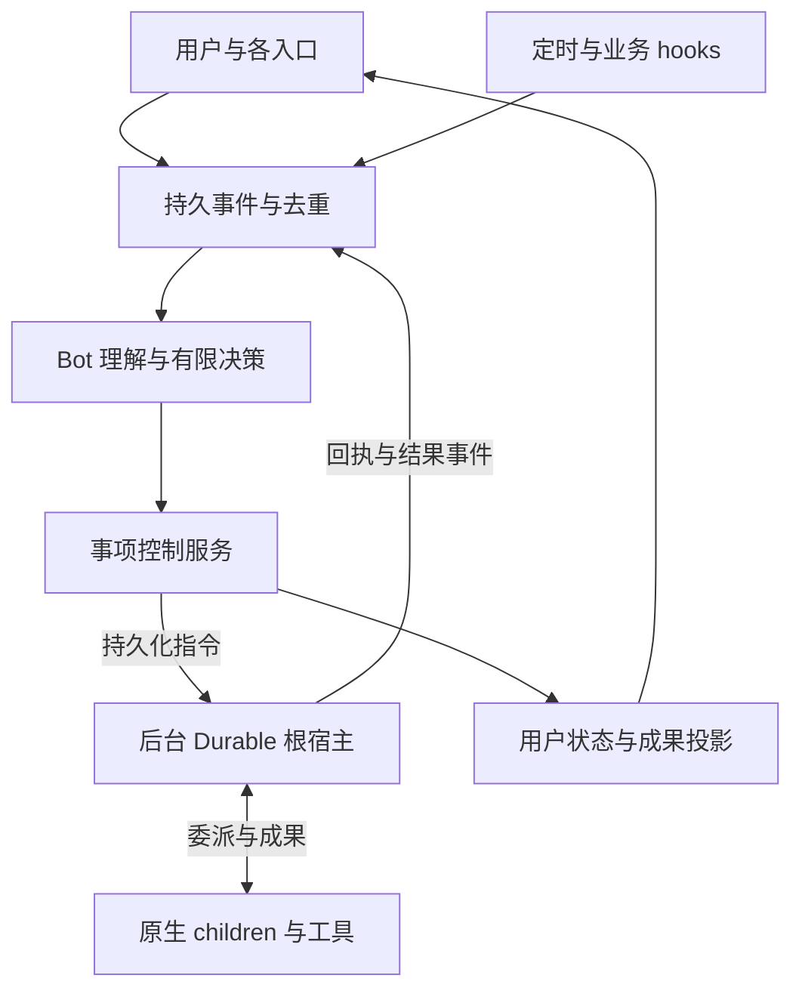

# Bot / Work 架构冻结设计

> 2026-11-09 产品变更：Work 额度/预算模块已删除。本文旧有的共享预算、额度预留、用量结算阻塞、续期与预算控制要求均已被 [无预算运行约定](bot-work-no-quota.md) 取代，不应按旧条款重新实现。原生用量遥测、授权/审批、未知外部效果防重与上下文容量限制仍保留；已有数据库中的预算历史仅保留为惰性记录，不自动删除或清库。

| 项目 | 冻结值 |
| --- | --- |
| 设计编号 | BOT-WORK-1.0 |
| 状态 | Frozen：产品语义、权威归属与验收契约已冻结；实现待完成 |
| 日期 | 2026-11-06，Asia/Shanghai |
| 上次讨论基线 | `c931d1e9870272c746beb3991a14e6fc92f337fa` |
| 本次复核基线 | `a473a59efb80f16c81c031d237be2896a37c325b` |
| 配套验收 | [Bot / Work 验收规范](bot-work-acceptance.md) |
| 范围 | MyBuddy 长期 bot、独立事项、前后台分离、主动跟进、专家与团队协作 |

本文件将用户讨论中的设计确定为实现基线。冻结表示后续实现应遵守这里的行为契约，不表示现有产品已经实现或通过相关验收。本次复核为固定提交的源码和差异阅读；提交说明中的测试结果不是本次运行证据。

本设计按当前版本的新对象和新执行验收，不要求旧数据兼容。沿用 TypeScript、现有 SQLite 与 Pi Durable 执行基础，不增加第二套执行恢复内核。以下模块名和字段名用于明确职责；等价的内部命名可以调整，实体语义、状态归属和验收条件不得随命名改变。

## 1. 冻结决策

| 编号 | 必须成立的决策 |
| --- | --- |
| F01 | Bot 是长期身份与责任主体；`botId` 独立于渠道、对话、task 和 Durable conversation。 |
| F02 | 用户委托以独立 Work 保存；复用并提升现有 Goal 语义，避免同时维护含义相同的 Goal / Work 两份主记录。 |
| F03 | 前台 bot 处理交流、理解、已有状态查询和工作安排；业务执行进入独立后台宿主，前台不等待整个工作完成。 |
| F04 | 每个未结束 Work 恰有一个当前主负责人；协作者可以有多个，执行者不自行宣布整件事完成。 |
| F05 | 模型提出结构化操作；宿主检查身份、授权、版本和状态迁移后提交。自然语言声明不改变权威状态。 |
| F06 | 要求版本、并发状态版本、负责人代次分开；执行绑定不可变输入快照和有效执行引用。 |
| F07 | 指令、回执、结果、通知可恢复且可去重；不承诺任意外部副作用严格只发生一次。 |
| F08 | 暂停、取消、交接、过期结果与未知副作用有明确语义，不能依赖模型理解一条 steer 消息来保证正确性。 |
| F09 | 并行按实际资源边界控制；已有单次 dispatch 的写保护不等于跨执行、跨 bot、跨设备的全局互斥。 |
| F10 | 定时和业务 hooks 统一进入持久事件入口；过滤、行动、通知分别判断，持续关注有停止条件和预算。 |
| F11 | 专家配置、长期 bot、委派中的 subagent 角色分开；团队围绕 Work 交换有来源的事实和成果。 |
| F12 | Memory、工作事实与临时执行上下文分层；协作不自动共享全部个人记忆。 |
| F13 | 面向人的状态由事实投影；运行完成、验收完成、事项结束、通知送达、用户已读分别记录。 |
| F14 | 单个权威宿主负责事项控制；客户端关闭不取消工作，宿主离线不虚报运行，恢复策略明确。 |

## 2. 最新更新复核

从讨论基线到本次基线共有 11 个提交，比较入口见 [固定差异](https://github.com/qq824045252-ship-it/wavealstra_harness/compare/c931d1e9870272c746beb3991a14e6fc92f337fa...a473a59efb80f16c81c031d237be2896a37c325b)。复核期间新增的 `a473a59` 也已纳入，下面的结果口径以该提交为准。

| 变化 | 对冻结设计的影响 |
| --- | --- |
| 子代理滚动池、结果汇总、隔离预检、明确超时诊断 | 已有执行基础增强，继续复用；没有建立独立 Bot / Work 所有权。 |
| `auto` 隔离在计划阶段明确解析；批次逐项拒绝 | 使用已解析的工作区和证据，不把 `auto` 标签等同独立 worktree；并行有效项继续运行，chain 遇到拒绝项停止，不能把部分产出当整件事完成。 |
| 并行 `write` / `edit` 冲突保护 | 已有局部保护，必须保留；其作用范围不能描述成通用资源锁。 |
| 统一 `completed / failed / blocked / rejected` 结果口径 | 被拦截写入不计入 clean succeeded，`isError` 为 true；业务适配必须保留 `writeConflicts` / `rejected` 等结构化事实，再独立验收 Work。 |
| 非 chain 派发中，指定并发额度拒绝的有界串行补试 | 仅在原执行未发起工具调用且仍在原期限内补试一次；继续复用该执行策略，产品层不再套无条件执行重试。 |
| token / 缓存 / MCP 上下文 / 生成速度统计 | 继续保留诊断与用量能力；不得把遥测变化混入要求版本或业务完成状态。 |
| Durable 模型请求与压缩请求的缓存边界追踪 | 保留观测链；不影响长期身份与后台运行分离。 |
| 默认开发与发布流程更新 | 遵守仓库当前 AGENTS.md；设计冻结不触发运行代码改动、版本升级、构建或发布。 |

因此，设计结论不变。需要更新的是已具备能力的描述，不是推翻身份与事项分离的决定。

复核入口包括 [DurableBotService](../src/main/agent/durable/DurableBotService.ts)、[DurableBotRuntime](../src/main/agent/durable/DurableBotRuntime.ts)、[DurableSubagents](../src/main/agent/durable/DurableSubagents.ts)、[写冲突守卫](../src/main/capabilities/subagent/write-conflict.ts)、[Goal](../src/shared/conversation-goal.ts)、[专家快照](../src/shared/expert-binding.ts)、[CronService](../src/main/cron/CronService.ts)、[GatewayService](../src/main/gateway/GatewayService.ts) 和 [WorkGraph](../src/shared/work-graph.ts)。相对链接方便后续维护；本节事实固定于表首的复核提交。

本次同时记录一个现有实现边界：`normalizePlanItem` 会把没有新计划字段的旧 `auto` memo 归为 shared；若旧 child 已保存 worktree 身份，随后工作区 kind 核对可能失败，尚未创建的旧 child 则可能按 shared 准备。这是静态代码推导，未做升级复现。本设计不要求旧数据兼容，不把该兼容注释当作已验证的跨版本恢复保证，也不据此改变新执行的不可变绑定契约。

## 3. 对象与权威归属

### 3.1 持久对象

| 对象 | 必需内容 | 权威来源 |
| --- | --- | --- |
| Bot | 稳定 ID、用户归属、展示身份、职责、专家配置引用、记忆范围、能力与通知策略、启停状态 | MyBuddy 业务数据库 |
| Work | 目标、约束、验收条件、主负责人、参与者、要求版本、生命周期、授权范围、预算、阻碍、结果引用、关注规则 | MyBuddy 业务数据库；提升现有 Goal |
| Conversation / 消息关联 | 交流入口、渠道身份、当前语境、消息指向的 Work / 成果 / 执行引用 | 既有消息存储与业务关联 |
| ExecutionBinding | Work、逻辑操作 ID、既有 task、Durable 回执、不可变输入快照、是否仍有效、成果引用 | MyBuddy 保存绑定；执行进度以 Durable 为准 |
| 领域事件 / 待投递指令 | 来源身份、顺序、关联对象、去重键、处理结果、投递状态 | 同一业务数据库中的 inbox / outbox |
| 成果 / 证据 / 通知 | 可寻址成果、版本与来源、验收记录、通知记录、渠道回执 | 既有成果与证据存储加业务记录 |

以上是逻辑对象，不要求每行单独建立一套服务或数据库。WorkGraph 继续只表达实体间关联，不把负责人、要求和权威状态塞进任意边 metadata。

### 3.2 必须维护的关系

- 一个 Bot 可以负责多个 Work；每个未结束 Work 恰有一个 `ownerBotId`。
- Work 与 Conversation 为多对多；具体消息可以绑定一个明确 Work，也可以只是普通交流。
- Work 可以引用多个 task / execution；既有 task 继续承载执行配置、工作区和运行上下文。
- Bot、专家模板、task、Durable conversation 的 ID 不能互相代用。
- 渠道会话通过持久映射指向 Bot；渠道和 chat ID 不再兼任 Bot 的稳定身份。
- 对话归档只影响交流入口；Work 的暂停、取消和关闭由独立操作完成。
- Bot 停用不删除其 Work。未转交事项停止新增调度并显示停用原因，允许在途操作结算。仍有责任或未结算操作的 Bot / Work 不能被级联硬删除。

### 3.3 Work 必需字段组

| 字段组 | 内容 |
| --- | --- |
| 身份与关联 | `workId`、用户、可选 project / workspace、来源消息、关联对话 |
| 责任 | `ownerBotId`、`ownerEpoch`、参与者及各自委派范围 |
| 当前要求 | `intentRevision`、目标、约束、验收条件、有效授权、不可变要求快照引用 |
| 生命周期 | `mode`（once、watch）、`lifecycle`（active、paused、closing、closed）、关闭结论 |
| 当前事实 | 已接受成果、阻碍、等待项、有效执行引用、未确认外部效果 |
| 主动跟进 | 订阅条件、时间规则、停止条件、补处理策略、下一唤醒条件 |
| 控制与审计 | `stateVersion`、预算及已使用/已预留额度、变更事件 |

`ownerEpoch` 只在负责人交接时增加；`intentRevision` 在目标、约束、验收条件或有效授权发生实质变化时增加；`stateVersion` 在影响控制决定的事实提交时增加。token 流、心跳和展示计时不能不断推进控制版本。

每个 ExecutionBinding 至少冻结：`workId`、`intentRevision`、`operationId`、输入来源及版本、工作区绑定、专家配置快照、委派范围、权限与预算引用、Durable 回执。首次提交业务输入前固定 `taskId`、Durable 存储绑定和接收 conversation 身份；需要先 prepare/open 宿主取得原生 ID 时，先持久保存绑定，再提交业务输入。取得 submission 后保存完整回执。重试不能重新分配 task、切换去重命名空间，或改用另一个活动 conversation。另以有效执行引用判断某次重新规划后哪些旧执行已被替代。负责人代次可记录为来源，但不能用旧代次单独否决交接后仍有效的 worker 成果。

## 4. 生命周期与完成语义

### 4.1 生命周期

| 操作 | 状态变化 | 约束 |
| --- | --- | --- |
| 接受委托 | 创建 active Work | 目标、负责人、授权边界和结束/持续条件可寻址；受理落库后再声明已安排 |
| 暂停 | active → paused | 阻止新增后台工作和新业务副作用；请求已有执行进入安全等待，在途效果仍需结算 |
| 恢复 | paused → active | 重新核对当前要求、资源、授权和待处理事件；按明确策略处理积压 |
| 请求取消 | active / paused → closing | 先阻止新动作，再发停止指令并结算在途操作 |
| 取消已结算 | closing → closed，结论 cancelled | 未确认外部效果不能被偷偷当作未发生；未解决时保留 closing 与阻碍 |
| 有限目标完成 | active → closed，结论 succeeded | 当前要求的必要验收条件满足，相关业务效果已确认，后续无必需工作 |
| 明确结束但未达成 | active / paused → closing → closed，结论 ended_unsuccessfully | 记录停止依据与缺口，不能把一次 worker 失败直接映射为此状态 |

paused 是控制目标，不等于所有在途调用瞬时停止。界面根据回执区分“正在暂停”和“已暂停”。取消同理。closed 不因普通 hook 自动重开；用户的新委托建立后继 Work 并关联旧成果。

### 4.2 watch 语义

once 的目标达成后可以关闭。watch 每次运行独立验收，职责保持 active；只有明确停止条件、到期或用户取消才关闭。类似“盯到实机通过”的持续跟进可以建为有终点的 once Work 加事件订阅，不需要额外再造长期目标实体。

watch 履行完约定监测期且必要交付已满足时，可用 succeeded 结论关闭；用户取消使用 cancelled。届满时仍有必需工作或未结算效果，先进入 closing 处理，不能仅因到期就填为已成功履行。

“关注中、正在执行、等待用户、存在阻碍”可以同时成立，因此作为活动与等待事实投影，不合并进一个互斥的 lifecycle 枚举。

## 5. 前台与后台宿主

前台通过能力白名单执行：交流、检索已保存且获准读取的资料、读取事项状态、提交控制操作。需要业务工具、网络调查、代码/文件修改或较长运行的工作，提交到后台；简单工作可由后台工具直接完成，不强制再调用一个模型。

前台只等待受理回执，不等待全部后台成果。后续用户消息可以查询或修改已有 Work，也可以开启另一件事；不存在“一个 bot 只能被一个长任务占用”的全局忙锁。

当前原生子代理明确禁止再次委派。冻结实现为：前台交互宿主与后台协调宿主独立；后台协调宿主作为 Durable 根执行，再调用现有一层 owned children。产品上的委派关系不强制映射成内核的递归 child 关系。后台专家 bot 的受委派工作也可以使用独立根宿主，但仍受同一 Work 的范围、预算和责任控制。

现有 Durable 负责执行、checkpoint、恢复与原生重试。业务层只重试指令投递和结果接收，不因为观察连接断开、页面关闭、通知失败或内存中找不到 worker 就重新执行工作。

## 6. 控制接口、事件与上下文

### 6.1 有限控制操作

接口应覆盖 `createWork`、`amendWork`、`dispatchExecution`、`pauseWork`、`resumeWork`、`cancelWork`、`delegateWork`、`acceptResult`、`handoffOwner` 和只读查询。名称可以调整，但不能让模型直接任意改数据库。

控制请求必须包含稳定操作 ID、目标对象、所依据的版本和参数。调用者身份来自已认证用户入口或宿主绑定，不能相信模型自行填写的 actor。复用同一操作 ID 和同一请求应返回原处理结果；同一操作 ID 携带不同有效请求体必须拒绝，不得静默覆盖。

用户普通问答不必创建 Work。对事项的指向优先使用回复引用、结果卡片、当前选中的 Work 和明确上下文；多个候选事项仍有实质歧义时只澄清目标，不能把“停一下”扩展成全局取消。

### 6.2 事件信封

事件至少记录：`eventId`、来源及来源事件 ID、事件类型、Work / 执行引用、来源版本、关联请求、因果事件、时间与 payload 引用。worker、渠道、定时器和人工输入都通过同一可恢复入口进入业务控制；可以有不同适配器。

同一来源事件可以命中多个 Work。来源级去重后，各有效订阅仍有自己的持久处理身份，包含目标 Work / 订阅；不能因为一位 bot 已处理该来源事件，就吞掉其他合法订阅的工作。

内部执行 hook 与外部业务 hook 含义不同：前者产生工具/执行事实，后者产生仓库、文件或连接器的业务变化。不能因为已有工具 hook 就声称已具备通用业务订阅。

外部事件是事实输入，不是用户授权。事件里的自然语言不能提升权限、改变用户目标或擅自给其他人发消息。已有授权由 Work 引用并在执行时核对；正常子任务不重复要求用户批准同一范围。

### 6.3 上下文组装

每次 bot 决策读取身份与专家配置、相关个人记忆、当前 Work 快照、必要近期交流和成果引用。只在需要时加载底层证据。worker 接收自己工作范围的输入快照，不默认继承全部历史、其他 Work 或全部个人记忆。

用户长期偏好使用现有 Memory 机制；目标、当前负责人、要求版本、未完成承诺是结构化业务事实；worker 推测和临时材料先留在执行范围。经确认的事实按既有来源与晋升规则进入共享记忆。

## 7. 可靠派发与结果接收

### 7.1 业务库到 Durable

1. 接收事件，使用唯一来源键将 inbox 记录持久化为 pending；可直接按确定性规则处理时，可以在同一短事务中提交结果、事项变更和 outbox 指令。
2. 需要模型判断时，读取 pending 事件和事项快照后在事务外推理；随后以一次条件更新事务提交决定、事项变更、outbox 指令与事件处理标记。不得先标记已处理再单独发送工作。
3. outbox 投递器使用原逻辑操作 ID 向 Durable 提交，保存具体 submission 回执。
4. 若提交响应丢失，按原操作 ID 查询或重复投递；不得产生新的逻辑工作 ID。
5. 尚未投递的启动指令在实际投递前重新核对有效性。Work 已暂停/取消或授权已变化时，可以作废尚未投递的启动；停止、核对回执和结算指令仍然允许处理。

投递状态至少区分未投递、已尝试但回执未知、已确认。开始外部投递前持久记录尝试身份；出现未知回执后，即使 Work 随后暂停或取消，也必须在原 `taskId + storeBinding` 命名空间核对原提交。已受理的工作需要接管并停止/等待；权威查询确认尚未受理时才按当前要求作废或继续；无法确认时保留阻碍。禁止因当前状态不允许启动，就跳过对可能已经启动工作的核对，也禁止换一个宿主后重新提交来制造第二份工作。

这里的原子性局限于同一业务库事务；SQLite 与 Durable 独立存储之间不假装存在跨库原子提交。稳定身份、原生回执及恢复核对承担这个边界。

### 7.2 Durable 到业务库

结果以持久执行日志/回执为依据，接收方保存消费游标与去重键。收到结果后先保存成果和证据引用，再判断其版本、来源与有效执行绑定，最后提交验收变化。

恢复时从持久游标补读并核对未结算回执。`onSettled` 等进程内通知可以唤醒处理，但不能是关键结果唯一的保存和送达途径。内存中的 active worker 列表是视图，不能成为恢复是否存在工作的唯一依据。

消费游标只能与对应持久接收记录原子提交，或在结果已可靠进入 inbox / 业务存储之后推进。不能先推进游标，再保存尚无可靠记录的成果或处理结果。后续业务接纳仍按事务提交其处理标记、验收变化和通知意图；允许重复读取，不允许跳过未持久接收的结果。

来源 event ID、业务 operation ID、Durable submission ID 和外部副作用 ID 分别承担不同层次的身份，必须保留映射，不能简单全部复用成一个随机 task ID。

## 8. 并发、版本与取消

### 8.1 控制并发

同一 Work 的要求修改、取消、成果接纳和负责人交接有明确的提交顺序。模型推理不占用数据库事务；提交时比较相关 `stateVersion`、`intentRevision` 和必要的 `ownerEpoch`。旧快照的决定被拒绝或重新评估，不能覆盖较新的决定。

不同 Work 可并行，同一 Work 的独立执行可并行。CPU、供应商并发、工具资源和总预算需要分别受控；产品配置的并发上限不代表供应商配额。

### 8.2 要求变化与迟到结果

执行依据不可变要求快照与输入版本。要求变化时先提交新 revision 并失效受影响执行，再通过持久指令引导或停止旧执行。保守默认是受影响的未完成工作重新安排；旧成果只保留为历史材料。要复用旧成果，必须重新核对它对当前验收条件是否适用，并记录采纳依据。

新来源版本不等于用户要求变更。对于“检查最新版本”，持久保存当前目标快照及有效执行引用；旧提交的检查结果不能覆盖新目标的结果。输入事件的到达顺序不能直接当作仓库提交的新旧顺序；必要时读取来源的权威当前指向。

版本检查同时发生在派发、业务工具准入、结果接纳和通知创建/投递边界。steer 是沟通能力，不是版本与授权校验的替代。

### 8.3 副作用准入与取消边界

新的业务副作用先通过当前 Work 的有效执行、要求、授权和资源检查，持久记录准入身份，再交给工具。此准入与取消/修改要求在同一 Work 控制顺序中裁定，避免只在最终回答时才发现要求过期。

取消已提交之后，尚未获准的新动作被拒绝。此前已获准或已经发出的请求可能仍然产生效果，必须等待停止回执或读回核对；已有文件修改、已发送消息或已发布资源不会因状态改为 cancelled 自动撤销。

所有实际入口，包括适用的 MCP、Codemode 嵌套调用和主机工具，必须纳入准入检查。已启动 shell/脚本内部的动作按在途执行处理，不能声称后续每条子命令都已被撤回。无法控制的路径不得被包装成强停止保证。

未知外部结果使用供应商回执、幂等键或受控读回核对；没有足够证据时保留 unknown。核验有次数和期限上限，达到上限后展示阻碍并等待适当处理，不盲目再次执行，也不无限循环。复用 [现有工具恢复契约](durable-tool-recovery.md)。

## 9. 共享资源与写冲突

本次基线已增加并行 dispatch 内的 `write` / `edit` 文件归属守卫，并有工作区隔离、滚动并发池和有限额度重试。这些都保留。

当前 `auto` 在计划阶段按调用模式、该项工具是否可写、配置并发上限和通过角色/模型/工具解析的候选数决定是否使用 worktree。single、chain、只读工具集、单候选或并发上限为 1 时使用 supplied cwd 并解释原因；显式 worktree 仍需满足预检。后续隔离预检拒绝其他项，不保证重新计算已规划项的隔离。调度和验收必须读取实际计划、工作区身份与回执，不能只根据请求中的 `auto` 或最终成功项数量推断是否隔离。

新增守卫在并发度大于 1 的 parallel 派发中，为登记 child 建立进程内路径认领，作用于 `write` / `edit`。它不是跨 dispatch、跨根宿主或跨 bot 的资源租约；shell 等其他写入路径不因此被覆盖；它也不能保护同一浏览器会话或桌面输入。路径使用 resolve 规范化而不核对 realpath，不能据此承诺符号链接别名保护。认领保存在内存，不能由当前代码推导出完整跨重启认领恢复。它在工具实际完成之前认领，因此属于保守的路径占用保护，不是成功写入后的事务锁。具体范围以 [守卫实现](../src/main/capabilities/subagent/write-conflict.ts) 和 [工具接线](../src/main/agent/AgentService.ts) 为准。

Work 调度必须补上宿主管理的资源准入：独立读取可并行，同一可变资源的操作排他或使用允许的隔离工作区。无法精确识别写入范围的命令使用更粗的工作区/宿主排他范围；不能凭提示词宣称任意 shell 写入已经实现文件级互斥。

排他范围必须覆盖一次有限的读改写或观察后操作过程；另一种等价方式是在读取时保存资源版本，写入/操作前取得排他权并重新校验前提。仅把两个单独的 write 或 click 排队不能防止基于旧内容覆盖或基于旧窗口观测点击。需要模型长推理或等待用户时释放资源，在实际动作前重读/校验；同时请求多个资源使用确定的获取顺序或一次原子准入，避免相互等待。此规则约束受管执行，不扩大为对外部用户操作的排他保证。

资源租约与执行代次持久关联，恢复时先核对旧执行及未结算动作。租约超时本身不证明旧进程已停止。浏览器/桌面控制以实际会话或设备为资源，不能只按文件路径加锁。

资源控制只能约束经过宿主的操作；用户或其他程序的外部修改通过输入版本、哈希/回执核对发现，不能宣称被本地应用锁阻止。工作区策略服从用户及仓库约束；不允许创建分支/worktree 时，采用受控串行共享写，不能暗中切换隔离策略。

## 10. 主动性与离线补处理

### 10.1 订阅规则

每个订阅关联 Work，保存来源、过滤条件、时间与时区、合并策略、停止条件、预算和通知条件。定时记录必须有唯一的触发实例身份；业务 hook 使用来源稳定事件 ID，缺失时由适配器定义有依据的去重方式。

收到事件后分别判断是否相关、是否需要执行、是否需要通知。没有实质变化可以只更新检查记录。不得把每个 token、工具重试或内部状态变化都变成通知。

事件合并不是全局丢弃中间值：

- `latest`：只需当前状态的监测，保留积压事实和最新目标快照，合并执行，设置最长合并等待以免持续事件造成饿死。
- `each`：每个业务事件都要求处理，持久保留并有界排队；达到容量或配额时明确报告积压/阻碍，不能静默丢弃。
- `skip`：用户选择不补历史触发，记录漏过范围，恢复后仅等待下一次。

skip 描述漏过触发的恢复策略，不表示忽略正常在线到达的新事件。

触发策略需要显式保存。新建“持续关注当前状态”的默认补处理为 latest；逐事件审计采用 each；已存在底层 Cron 的 skip/no-catch-up 行为不能被误写成已具备 latest 或 each。

### 10.2 防循环与预算

保留事件因果关系与已处理输入版本。自身操作产生的新事件按订阅判断是否需要下一步，不能简单全部忽略，也不能无限自触发。Work 总预算覆盖协调者与全部协作者；每轮的并发、步骤/回合、模型用量、时间与重试有界。采用现有配置中的限制，不在多个层级重复扩充配额。

预算必须注明适用范围：整项委托或明确的时间窗口。长期 watch 可以按已保存策略进入下一预算窗口；重试、重启和更换负责人不能重置当前窗口的已消费/已预留额度。额度耗尽时等待合法的下一窗口、明确调整或结束条件，不能自行无限增加额度。

未知用量或费用保持未知，不能作为零消费释放预算。费用精度不足时使用可核对的请求/token/时间上限，展示预算核对范围。

### 10.3 宿主现实边界

本设计的权威 Work 服务运行在一个可用宿主；桌面窗口、手机和网关是入口。多个客户端不能各自运行一份权威调度器争抢同一 Work。进程重启复用状态与回执，不把 bot 身份绑定到进程存活期。

当前本地宿主需要应用后台仍运行。完全退出、休眠、断网或关机期间的能力按事实展示：离线待恢复，不声称正在持续执行。恢复后按订阅策略补处理；若来源没有事件保留或回查能力，应报告缺口。

要求离线电脑之外仍持续响应时，需要始终在线的服务和明确执行环境。仅有云端 webhook 收件箱只能保存事件，不能代替离线桌面操作。本次冻结不把云端常驻作为当前已实现能力。

## 11. 专家、团队与交接

专家是可版本化的能力配置；Bot 是稳定身份；subagent 是一次委派中的角色。同一专家配置可被多个 bot 或短期 worker 使用。Bot 保存专家配置关联，执行保存当时快照。复用现有 desired / active / pending 与显式采纳语义，模板更新不静默改变在途执行。

团队以 Work 的参与者、范围和接收方落地，可另存可复用的团队模板。建立每个临时 worker 的长期 bot 身份不是必要条件。成员不能自动获得其他成员的全部上下文、工具或个人记忆。

协作消息至少支持 delegate、accepted、question、result、blocked、change、cancel、handoff，并包含稳定 ID、Work、执行引用、要求版本、回复关系与成果引用。成员可在授权范围内直接互通信息；影响目标、验收和结论的事实回到事项记录。循环委派受范围、因果链和总预算限制，不能因为跨 bot 根宿主绕过原生子代理的递归限制。

交接过程：新负责人在授权范围内接收事项快照和有效执行清单；随后在一次业务事务内更新 `ownerBotId` 与 `ownerEpoch` 并保存交接事件。提交前旧负责人负责，提交后旧负责人的控制决定与新通知创建失效。

执行结果始终回到 Work。新负责人可以明确接管仍有效的委派执行；负责人变化不自动增加 intentRevision，也不自动重跑成果。执行工具准入按当前 Work 授权和有效委派检查；旧负责人不能凭历史身份继续创建新计划。正在发送的旧通知按在途投递结算，不能承诺已发送内容被撤回。

## 12. 验收、通知与用户界面

### 12.1 成果验收

成果保存输入版本、执行来源、证据引用、未覆盖范围和状态。自动条件使用实际工具/测试证据；环境实测使用对应环境与版本的真实反馈；开放式质量采用有记录的专家判断。要求用户确认的必要条件不能由模型自行填为满足。修改或豁免验收条件必须形成明确的要求变更并保留依据。

`run succeeded` 不能直接写成 Work succeeded。事项的必要条件符合当前要求、必需副作用已确认且无未完成必需工作，才允许结束有限 Work。用户已读不推进验收，通知失败不撤销已确认成果。

最新 [子代理集成测试](../scripts/durable-subagent-test.ts) 已将同文件冲突场景改为 `Parallel: 1/2 succeeded`，受影响项显示 blocked，`isError` 为 true，并断言 `writeConflicts` 标记。两个 child 仍可正常结束，但执行汇总已明确反映未落盘的写入；此前 `2/2 succeeded` 的旧口径不再作为当前事实。这是源码与断言的复核，不代表本次执行了该测试。

底层 Durable 的 `SingleResult.status` 仍可能是 completed；派发口径由 `resultOutcome` 结合失败、`writeConflicts` 和 `rejected` 得出。适配器读取 `details.results[*]` 中的结构化字段，不解析展示标题猜状态，也不丢弃 blocked / rejected。即使所有项都是 clean completed，仍须核对当前 Work 的验收条件、实际成果和未完成义务。

批次 `isError=true` 不使同批已确认的有效成果作废，也不触发整批重跑。负责人保留可采纳成果，核对依赖与验收缺口，再只安排仍有必要的工作；不得重复已确认的业务效果。

### 12.2 通知投递

接受成果、更新事项和创建通知意图在同一业务事务中提交。应用内结果卡片以稳定语义事件 ID 去重；发送到外部渠道的投递单独记录，重启只恢复未完成投递，不重跑工作。

通知在创建和实际发送前核对当前要求、有效成果与责任关系。已被新要求取代的“完成”通知应作废或改写成有版本说明的历史进展；不能在很久以后把旧成果当成当前成果推送。

若只发生负责人交接而成果仍有效，交付义务保留，由当前负责人重新核对发送者和表达；不因旧发送者失去控制权就丢弃尚未交付的结果。应用内同一语义结果保持稳定身份。

外部渠道支持幂等键或回查时使用其真实契约；不支持且发送结果未知时保持 unknown 并核对，不承诺严格 exactly-once 或盲目重发。应用内可寻址结果是主要可靠交付面，渠道送达和用户已读分别记录。

### 12.3 前台内容

默认展示成果、影响用户的变化、需要决定的事项、未完成部分与下一步。状态和卡片来自事实投影；模型可以解释这些事实，但不能更改它们。专业用户可展开执行、证据、版本、用量和缓存追踪。多个协作者的内部进度由当前负责人组织成面向人的信息，避免每个 worker 分别宣布整体完成。

## 13. 当前代码的实现落点

| 范围 | 复用基础 | 必须完成的接线 |
| --- | --- | --- |
| Bot 身份与渠道 | Gateway、Remote、现有消息和权限入口 | 新增长期身份与渠道映射，消息指向具体 Work；不能由 channel/chat 派生 task 身份代替 Bot |
| Work / Goal | ConversationGoal 的目标、criteria、证据、进展 | 提升 Goal 的独立所有权、负责人、版本与生命周期；原 task 只保留来源/执行关联 |
| 执行适配 | DurableBotService 的 submit、findSubmission、submissionStatus 和绑定 | 关联 Work 与不可变执行快照，前台受理与后台执行分离，持久恢复双向消息 |
| 原生子代理 | owned children、滚动池、模型限制、期限、隔离与局部写保护 | 保持当前边界，补跨执行的资源与授权准入；不另造 worker 恢复系统 |
| 专家 | ExpertService、TaskExpertBindingService 的快照与显式采纳 | 独立 Bot 绑定，执行快照沿用；更新配置不改变在途工作 |
| 定时与业务事件 | Cron 的 run/input 事务、稳定提交身份；现有渠道与项目事件入口 | 订阅所有权提升到 Work；持久事件、过滤与补处理；忙时明确排队/合并策略 |
| 结果与交付 | 现有 artifact、执行证据、任务诊断、交互卡片 | 按 Work 验收；持久通知意图和投递状态；停止把每次运行完成等同事项完成 |
| 记忆与关联 | Memory、项目/工作区上下文、WorkGraph | 保留作用域和晋升规则，新增必要关联，权威状态不放在临时摘要或图边中 |

建议的业务模块职责为 BotRegistry、WorkService、WorkEventInbox / Outbox、WorkExecutionAdapter、WorkResourceGate、WorkResultProjection / Delivery。可以合并为更少文件；执行内核、checkpoint 与重试仍归已有 Durable。

## 14. 完整交付与变更规则

本设计作为一个完整功能目标验收；文档章节是职责划分，不是分阶段删减范围。实现可以拆分内部提交，但不能以某个局部完成声称 BOT-WORK-1.0 已完成。

必须通过 [配套验收](bot-work-acceptance.md)，特别是跨会话、崩溃窗口、需求改版、团队交接、未知副作用、持续关注与宿主离线场景。保留现有项目、Memory、权限、工作区、交互卡片、执行证据和缓存追踪能力，不为接入 Bot / Work 再造并行真源。

改变 F01–F14、对象所有权、生命周期、版本/授权或外部效果保证边界，必须更新设计修订记录与对应验收，不得在实现中静默重新解释。纯内部命名、等价模块布局、性能优化和不改变行为的修复不需要重新讨论产品方向。

| 版本 | 日期 | 决定 |
| --- | --- | --- |
| 1.0 | 2026-11-06 | 复核最新 11 个提交后冻结，含 a473a59 的隔离、逐项拒绝与 blocked 口径；长期 Bot / Work 分离结论不变。 |
