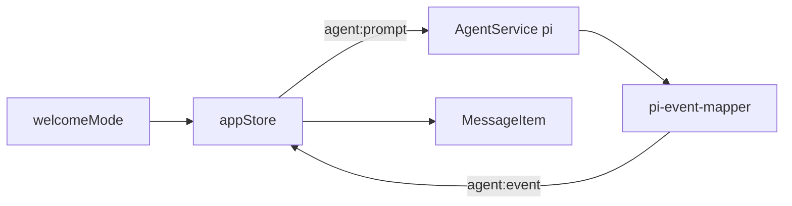
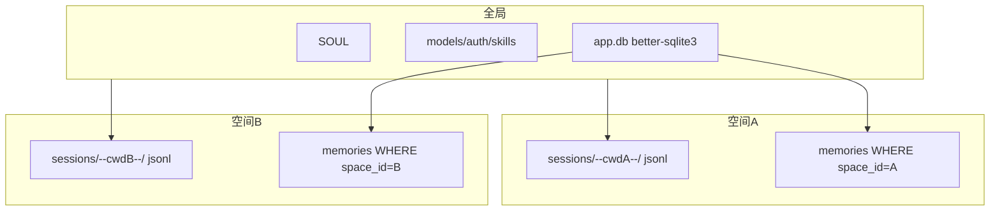
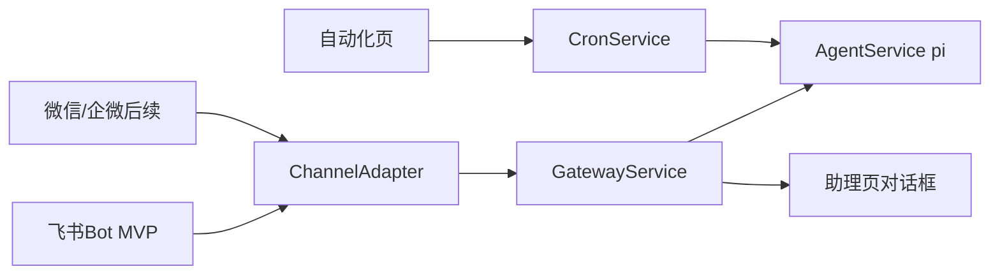

# pi 技术与 UI 对齐（单后端）

## 依据

- pi：[earendil-works/pi](https://github.com/earendil-works/pi)（npm：`@earendil-works/pi-coding-agent`）
- SDK：`createAgentSession` + `session.subscribe` + `prompt` / `abort`（[docs/sdk.md](https://github.com/earendil-works/pi/blob/main/packages/coding-agent/docs/sdk.md)）
- UI：`[types.ts](src/renderer/src/types.ts)`、`[appStore](src/renderer/src/store/appStore.ts)`、`[ChatView](src/renderer/src/components/chat/ChatView.tsx)`
- 与旧总规划分离；**已否决** Hermes 双后端（可行性/运维成本过高）

## 定案：只用 pi


| UI   | welcomeMode | 后端     | 区分方式                      |
| ---- | ----------- | ------ | ------------------------- |
| 日常办公 | `working`   | **pi** | prompt template + 办公向技能过滤 |
| 代码开发 | `coding`    | **pi** | 默认编码工具与模板                 |
| 设计创意 | `design`    | **pi** | prompt template（可收紧工具白名单） |


官方 MyBuddy 的 welcomeMode 本就是换 `.tpl`；本产品保持该语义，**不**升级为多运行时路由。

pi 无一等 profile（[#3966](https://github.com/earendil-works/pi/issues/3966) 未成产品）；三模式不拆 `agentDir`。




## 任务 / 空间 / 记忆隔离（定案 · 难点）

依据：[pi SessionManager](https://github.com/earendil-works/pi/blob/main/packages/coding-agent/src/core/session-manager.ts) 按 `cwd` 隔离**会话 jsonl**；官方 MyBuddy 仍有 MEMORY.md 注入路径，但**本产品记忆存储定案为 better-sqlite3**（与旧总规划 `app.db`、依赖列表一致），用 `space_id` 做隔离键，而不是每空间一份 md。

**结论：会话跟 cwd（pi 原生）；记忆跟 space_id（SQLite）；SOUL/人设全局。**

### 实体映射


| UI             | 实际                                                      | 存储                                                     |
| -------------- | ------------------------------------------------------- | ------------------------------------------------------ |
| 空间 / 项目 / 工作空间 | `Space { id, name, rootPath }`（跑 Agent 时 `rootPath` 必填） | `spaces` 表                                             |
| 任务             | 一次对话                                                    | `tasks` 表 + pi `SessionManager.create(rootPath)` jsonl |
| 长期记忆           | 按空间隔离的条目                                                | `memories` / `memory_notes` 表（`space_id`）              |
| 人设 SOUL        | 全局                                                      | `soul` 表或 `~/.mybuddy/SOUL.md`（不按空间拆）                  |


### 隔离分层




| 层               | 隔离单位                | 机制                                                                                              |
| --------------- | ------------------- | ----------------------------------------------------------------------------------------------- |
| 对话历史            | 任务 ⊂ 空间(cwd)        | pi：`SessionManager.create(cwd)`                                                                 |
| 项目上下文           | 空间                  | cwd 下 AGENTS.md / 项目 `instructions`                                                             |
| **长期记忆**        | **空间**              | **better-sqlite3**：`WHERE space_id = ?`；启动时查出文本注入 prompt（`agentsFilesOverride` 虚拟块或 system 附加段） |
| 跨空间用户偏好         | 可选 `scope=global` 行 | 与空间记忆分表或 `space_id NULL`；默认谨慎少注入                                                                |
| 人设 / 模型 / 技能包文件 | 全局                  | agentDir                                                                                        |


禁止：无 `space_id` 过滤的全表记忆注入；禁止用单一全局 MEMORY.md 作为唯一源。

### SQLite schema（定案）

```sql
-- ~/.mybuddy/app.db  (better-sqlite3，主进程单写)
CREATE TABLE spaces (
  id TEXT PRIMARY KEY,
  name TEXT NOT NULL,
  root_path TEXT NOT NULL UNIQUE,
  created_at INTEGER, updated_at INTEGER
);

CREATE TABLE tasks (
  id TEXT PRIMARY KEY,
  space_id TEXT REFERENCES spaces(id),
  title TEXT,
  welcome_mode TEXT,
  session_file TEXT,          -- pi jsonl 路径
  created_at INTEGER, updated_at INTEGER
);

CREATE TABLE memories (
  id TEXT PRIMARY KEY,
  space_id TEXT NOT NULL REFERENCES spaces(id),  -- 隔离键
  kind TEXT NOT NULL,         -- 'curated' | ...
  content TEXT NOT NULL,
  updated_at INTEGER
);

CREATE TABLE memory_notes (
  id TEXT PRIMARY KEY,
  space_id TEXT NOT NULL REFERENCES spaces(id),
  day TEXT NOT NULL,          -- YYYY-MM-DD
  content TEXT NOT NULL,
  created_at INTEGER
);

CREATE INDEX idx_memories_space ON memories(space_id);
CREATE INDEX idx_notes_space_day ON memory_notes(space_id, day);
```

会话 jsonl 仍由 pi 写在 `~/.mybuddy/sessions/--encoded-cwd--/`；**SQLite 不替代 jsonl**，只做任务索引 + 记忆。

### 读写路径

1. **注入（读）**：`MemoryService.loadSpace(spaceId)` → 拼 curated + 近两日 notes → 截断预算 → `createAgentSession` 时注入（虚拟 context，不写进别的空间目录）。
2. **写入**：提供主进程 `memory:upsert` / `memory:appendNote` IPC；用 pi **自定义 tool**（或 extension）让模型写入 SQLite，**不要**默认让模型 `edit` 全局 md。
3. **设置 → 记忆页**：按当前任务 `space_id` 查表展示/编辑；标明 SOUL 全局。
4. **侧栏空间**：读 `spaces` 表；选工作空间 = upsert `root_path` + 绑 `tasks.space_id`。

### 默认空间与锁定

- 首次 prompt 前必须有 `root_path` / `space_id`；否则用沙箱空间 `~/.mybuddy/spaces/default`（独立 `space_id`，独立记忆行）。  
- 任务首条消息后锁定 `space_id`；换空间 = 新建任务。

### Agent 创建要点

```ts
const memText = memoryService.renderForPrompt(spaceId); // SQL WHERE space_id
const { session } = await createAgentSession({
  cwd: space.rootPath,
  agentDir: mybuddyDir,
  sessionManager: SessionManager.create(space.rootPath),
  resourceLoader: loaderWithVirtualMemory(memText),
  // customTools: [memoryUpsertTool]  // 写回 SQLite
});
```

### 验收（隔离）

1. 空间 A/B 各写入 SQLite 记忆；切换任务后不得串读。
2. `SELECT ... WHERE space_id` 可审计；无 path 空间不能跑 Agent（或仅 default 桶）。
3. 会话文件仍在对应 cwd 的 sessions 目录。
4. SOUL 全局可见；`better-sqlite3` 仅主进程打开 `app.db`。

## 怎么管理（补充）

**一套 Electron + 一个 agentDir；会话按 cwd 分目录；记忆在 app.db 按 space_id 隔离。**

- Main `SessionRegistry` + SQLite `tasks`/`spaces`
- `MemoryService`（better-sqlite3）读写/注入；自定义 memory tool 写回
- 欢迎三模式只换 prompt；模型/权限/技能库全局

## 欢迎三模式：隔离层级

1. **模式**：只换 prompt / 技能侧重（不换 cwd、不换 SQLite 记忆分区）
2. **空间**：换 cwd + 会话目录 + `memories.space_id`
3. **不**为模式拆进程 / agentDir / 模型库

## 新建任务 UI（定案：暂时不动）

截图中的「新建任务」首页（标题、三模式 pill、场景 chip、输入框、工作空间/权限）**布局与交互先冻结**，本切片不改视觉。

仅接线时补：

- 三模式 → `welcomeMode` 进 store / 随 `agent:prompt` 下发
- 场景 chip、专家入口等仍可 mock/延后

不因「只用 pi」重做这一屏。

## 对话框 / 输入栏（定案）

涉及 `[ChatInput.tsx](src/renderer/src/components/chat/ChatInput.tsx)`、`[InputAddMenu.tsx](src/renderer/src/components/chat/InputAddMenu.tsx)`、设置「模型」页。

### 1. 「+」添加菜单：技能与连接器之间插入 MCP

当前顺序：… → 专家 → 技能 → 连接器。  
改为：… → 专家 → 技能 → **MCP** → 连接器。

- 子菜单：列出已启用/可添加的 MCP（同源 Hub `mcp` 页 mock → 日后 SQLite/配置）
- 「召唤更多」跳转 `setPage("mcp")`（与技能跳 Hub 一致）

### 2. 对话框任意文件拖入

- 在输入区（含 home / 会话两种 variant）监听 `dragenter` / `dragover` / `drop`
- **任意文件**均可：读路径（Electron）或内容；落入当前消息 `attachments`，发送时随 `agent:prompt` 带上（图片走 pi `PromptOptions.images`，其它作路径/附件上下文）
- 与「+ → 添加文件 → 本地文件」共用同一附件管道；拖入时显示落点高亮

### 3. 上下文用量：按模型真实情况

现状为写死 `23.2% · 1000.0K已用`。定案：

- 上限 = 当前模型的 `contextWindow`（来自 pi `ModelRuntime` / `models.json` 的 `contextWindow` 字段，见 [pi models.md](https://github.com/earendil-works/pi/blob/main/packages/coding-agent/docs/models.md)）
- 已用 = 本会话估算 token（优先 session/agent 上报；MVP 可用消息+系统注入的字符估算，接线后换真实 usage）
- 展示：`{pct}% · {used}K已用`（或按模型单位），进度条 = used/contextWindow
- 切换模型立即用新 `contextWindow` 重算

### 4. 配置自定义模型：对齐 pi agent

- 唯一配置面：`~/.mybuddy/models.json`（`ModelRuntime.create({ modelsPath })`）
- 设置「模型」页 / 「配置自定义模型」：增删改 **pi 格式** provider（`baseUrl`、`api`、`apiKey`/`auth.json`、`models[].id|name|contextWindow|maxTokens|…`），禁止另造不兼容 schema
- 下拉列表：`modelRuntime.getAvailable()` 投影为 UI `ModelConfig`；无鉴权的模型可显示但不可选或标灰（与 pi 行为一致）
- 保存后刷新 runtime，无需手改 mock

## 自动化页（定案：视觉照旧 · 调度走真）

`[AutomationPage](src/renderer/src/components/pages/AutomationPage.tsx)` **布局照旧**（顶栏定时任务/运行记录、空态、模板网格），数据与动作接 **CronService**（见下「自动化真实调度」）。不另起第二套 Agent 运行时：到点仍走 `AgentService.prompt`。

## 助理页 = Gateway（定案：走真）

侧栏「助理」**不是**第二套「新建任务」Agent 聊天，而是 **外部连接（Gateway）表面**：


| 区域            | 职责                                                     |
| ------------- | ------------------------------------------------------ |
| 配置（设置 → 助理设置） | 连接/管理外部通道（扫码/token、启停、账号绑定）                            |
| 对话框           | 展示**该外部连接相关的信息与同步消息**（通道状态、远端指令镜像、连接诊断），不是普通本地编码会话的主线程 |
| 与主聊天关系        | 远端经 Gateway 进来的任务仍落到 pi 执行；助理页负责通道侧可见性                 |


现状：`[AssistantPage](src/renderer/src/components/pages/AssistantPage.tsx)` 与设置里微信/企微入口已是 mock。本切片实现 **GatewayService**（见下），禁止把助理页误接成第二个本地主会话 `sendMessage`。

Hub「连接器」≠ 助理 Gateway：连接器 = 工具/MCP；Gateway = IM 进出站。

## 项目页规划（定案）

**不要多人协同。** 项目 = 本机「带配置的工作上下文」：模板预填的指令 + 可选连接器 / 专家 / 技能 / MCP + 可选本地目录。

### 两条入口，同一实体


| 入口               | 行为                                           |
| ---------------- | -------------------------------------------- |
| 新建任务 → 选择工作空间    | 轻量：选文件夹 → upsert 空间（`rootPath` 必填）→ 任务绑定     |
| 项目页 → 新建项目 / 从模板 | 完整：弹窗写指令与能力；**确定时须绑定/创建 rootPath** 才能跑 Agent |
| 侧栏「空间」           | 同一列表分组投影                                     |


项目页不做第二套聊天壳；开聊仍回「新建任务」/聊天页。

### 新建项目弹窗（对齐截图）

**空白默认态**（未选模板、未填内容）即如图：

- 标题「新建项目」+ 关闭
- 项目名称：占位「请输入项目名称」+ `0/15`；空名时「确定」禁用
- 指令：右侧「选择模板」；正文占位说明可填项目背景/规范/目标/习惯/风格/输出约束等
- 四行可选能力（均空，仅「+ 添加」）：**连接器、专家、技能、MCP**
- 底栏：「切换模板会覆盖当前编辑内容」+ 取消 / 确定

选模板后才预填指令，并可带出推荐标签；用户仍可改、可删。MCP 为独立一行，不并入连接器。

跑任务时注入 pi：`instructions` + skills + 专家适配 + 连接器 + MCP + `cwd`（若有）。

### 数据

```text
Project {
  id, name
  rootPath?              # 选工作空间补上
  instructions           # 指令正文
  templateId?
  expertIds[], skillIds[], connectorIds[], mcpIds[]
  createdAt, updatedAt
}
Task.spaceId → Project.id
```

废弃文案「多人协同 / 超级团队」。

### 主路径

```text
模板弹窗 ──► Project（指令+连接器+专家+技能+MCP）
选工作空间 ──► rootPath
任务发送   ──► pi（注入项目配置）
```

### 分期


| 阶段  | 内容                         |
| --- | -------------------------- |
| 现切片 | 定语义；接线优先 `cwd`；新建弹窗空白四栏 UI |
| 随后  | 模板预填 + 持久化；与侧栏同源           |
| 再后  | 指令/技能/专家注入；连接器与 MCP 按项目启用  |


**本切片保留项目页结构；新建弹窗已按空白四栏落地。**

## 总确认：假后台 → 真后台

**大方向对：壳与组件已在，主线是把 mock/store 换成 pi + SQLite + 真实 IPC。** 真/假边界见下表。


| 表面                   | 现在                         | 真后台是什么                                    | 本切片                        |
| -------------------- | -------------------------- | ----------------------------------------- | -------------------------- |
| 聊天发送 / 流式 / 工具卡 / 审批 | `sendMessage` 本地假回复        | pi `prompt` + 事件映射                        | **必做**                     |
| 任务列表 / 空间分组          | `mockTasks` / `mockSpaces` | `app.db` tasks/spaces + session 文件        | **必做**                     |
| 工作空间选择 / cwd         | 有 path 绑定，未进 agent         | `SessionManager.create(cwd)`              | **必做**                     |
| 记忆                   | 设置页读 mock soul             | better-sqlite3 按 `space_id`               | **必做**                     |
| 模型列表 / 自定义模型         | `mockModels`               | `ModelRuntime` + `~/.mybuddy/models.json` | **必做**                     |
| 上下文用量条               | 写死 23.2%                   | 模型 `contextWindow` + 真实/估算 used           | **必做**                     |
| 欢迎三模式                | 仅 UI state                 | prompt template                           | **必做**（轻）                  |
| 技能 Hub / +菜单技能       | mock + store 开关            | 读 `skills/` + pi ResourceLoader           | 接线可跟；完整市场后置                |
| 专家 / 连接器 / MCP Hub   | 纯 mock 卡片                  | 配置/启用进 session 工具集                        | **列表先接真配置**；远程连接器能力后置      |
| Artifact / 工作区文件树    | mock 树与内容                  | 真实 cwd 扫描 + write/edit 产物                 | **跟 agent 接线**             |
| 对话框拖文件、+ 加 MCP       | 未齐 / 菜单缺项                  | 附件 IPC + MCP 项                            | **小改 UI + 真附件**            |
| 新建任务首页布局             | 已对齐                        | 不变                                        | **冻结**                     |
| 自动化页                 | mock 模板                    | CronService→pi                            | **视觉冻结**；**调度走真**          |
| 助理 Gateway           | 演示文案                       | GatewayService + ChannelAdapter           | **走真**（MVP 飞书）             |
| 资料库 / 灵感等            | Placeholder                | —                                         | **先假**                     |
| Hub 完整市场安装流          | mock 卡片                    | 远程市场下载/安装                                 | **先假**（本地 skills/MCP 配置可真） |
| 项目弹窗四栏               | UI 已落地空白态                  | 持久化 + 注入                                  | 语义已定；**持久化可跟切片或紧随**        |


一句话：**聊天 / 任务空间 / 记忆 / 模型 / 上下文 / 附件 / 自动化调度 / 助理 Gateway** = 假变真；**资料库·灵感、Hub 完整市场安装流** = 先假；**新建任务与自动化页视觉** = 不动。

## 结论（先对齐什么）

主进程跑 pi，将 `AgentSessionEvent` 映射为 `ChatMessage.blocks` / `ToolCall`，经 IPC 推给 renderer；替换 mock 的 `sendMessage` / `resolveToolApproval`。

## pi → UI 映射


| pi 事件                                | UI 写入                                  |
| ------------------------------------ | -------------------------------------- |
| `agent_start`                        | assistant `streaming:true`             |
| `message_update` text/thinking delta | `finalBlocks` text / `blocks` thinking |
| `tool_execution_*`                   | `type:"tool"` + status/output          |
| `tool_call` 扩展（审批）                   | `pending_approval`                     |
| `agent_end` / abort                  | 清 streaming、durationLabel              |
| `write`/`edit` 成功                    | artifacts / fileChanges                |


延后：**资料库 / 灵感**、**Hub 完整市场安装流**、打包。  

**自动化真实调度**与**助理 IM Gateway** 改为走真后台（见下两节），对齐 pi 生态已有能力/扩展，而非无限期后置。

## 自动化真实调度（定案：走真 · 对齐 pi 生态）

pi **核心没有**独立 cron daemon，但生态里已有同类能力：


| 来源                                                                                                           | 能力                                      |
| ------------------------------------------------------------------------------------------------------------ | --------------------------------------- |
| 扩展 `/loop`（[#2368](https://github.com/earendil-works/pi/issues/2368)）                                        | 会话内周期 `sendMessage` 注入 prompt（开着会话才跑）   |
| [pi-gateway](https://github.com/Dwsy/pi-gateway) / [pi-telegram](https://github.com/kariemSeiam/pi-telegram) | 进程级 cron：`at` / `every` / cron 表达式，隔离执行 |
| 扩展 async-tasks                                                                                               | 后台子任务队列（非日历调度）                          |


**本产品定案：** 主进程实现 **CronService**（参考 pi-gateway cron 模型），任务落 **better-sqlite3**；到点调用既有 `AgentService.prompt`（带 `space_id`/cwd）。  

- UI `[AutomationPage](src/renderer/src/components/pages/AutomationPage.tsx)` **布局照旧**，接真：定时任务列表 / 添加 / 启停 / 运行记录  
- 调度在 Electron 主进程常驻（不必依赖会话开着）；可选再挂 pi `/loop` 扩展作「会话内巡检」补充  
- 模板卡 = 预填 prompt + 默认 cron 表达式，写入 jobs 表

## 助理 IM Gateway（定案：走真 · 对齐 pi 生态）

pi 侧同类能力（官方 + 社区）：


| 来源                                                                   | 能力                                                                        |
| -------------------------------------------------------------------- | ------------------------------------------------------------------------- |
| [pi-chat](https://github.com/earendil-works/pi-chat)（官方）             | Discord / Telegram ↔ 沙箱 pi 会话（Gondolin+tmux，偏 CLI，不宜整包塞进 Electron）        |
| 历史 mom（Slack）                                                        | 宿主进程 Socket Mode → 每频道独立 session                                          |
| [pi-gateway](https://github.com/Dwsy/pi-gateway)                     | Telegram / Discord / **飞书** / WebChat + 自带 Cron；Session Router + RPC Pool |
| Channel 提案 [#1253](https://github.com/earendil-works/pi/issues/1253) | `registerChannel` 抽象（未成核心一等功能）                                            |


**本产品定案：** 主进程自研 **GatewayService** + `ChannelAdapter`（模式对齐 pi-gateway / mom，**不**整包依赖 Gondolin/pi-chat）：

`收消息 → 鉴权 → AgentService.prompt → 流式回传 IM`；助理页镜像通道事件。

- **MVP 首发通道：飞书 Bot**（开放 API、pi-gateway 有现成分层、国内可验收）
- 设置页「微信 / 企微」入口接**同一 GatewayService 接口**；微信/企微适配器在飞书 E2E 通过后立刻补（可参考 `.wb-ref` wechat 路径），不改助理页语义
- 通道配置落 SQLite / `~/.mybuddy/gateway/`；与 Hub 连接器表分离




## IPC（最小集）

- `agent:prompt` / `agent:abort` / `agent:approveTool` / `agent:event`
- `cron:list|upsert|setEnabled|runNow|runs` + 运行记录事件
- `gateway:status|connect|disconnect|listChannels` + `gateway:event`（助理页镜像）

## 落地文件


| 层               | 路径                                                                   |
| --------------- | -------------------------------------------------------------------- |
| 依赖              | `package.json` + `@earendil-works/pi-coding-agent`                   |
| 契约/映射           | `src/shared/agent-ipc.ts`、`src/shared/pi-event-mapper.ts`            |
| Main            | `AgentService`、`CronService`、`GatewayService` + `channels/feishu.ts` |
| preload / store | agent/cron/gateway API；AutomationPage / AssistantPage / 助理设置接真       |


## 验收

1. 三模式均走 pi，切换只换模板/技能侧重
2. 流式文本 + tool 卡片 + abort + 审批
3. write/edit → Artifact/变更
4. 自动化：创建 cron → 到点触发 pi → 运行记录可见
5. 飞书：收一条消息 → pi 回复回传 → 助理页可见镜像
6. 资料库/灵感、Hub 市场安装流仍可 mock

## 结案（2026-08-05）

**本 plan 关闭。** 主切片已交付，后续项不阻塞结案。

### 已落地

- pi：`AgentService` / `SessionRegistry` / 事件映射 / 工具审批扩展；`agentDir=~/.mybuddy`
- SQLite：`app.db`（spaces/tasks/memories/soul/cron/gateway）；mock space 外键已修
- UI：`sendMessage`/`resolveToolApproval` 真 IPC；欢迎三模式；自动化页与助理页接 Cron/Gateway
- Electron：pi 打进 main bundle；`node:sqlite` stub；`better-sqlite3` rebuild
- 提交：`09b75c9`（分支 `cursor/mybuddy-ui-parity`；当时无 `origin` 未推远程）

### 明确不在本切片（另开）

- 资料库 / 灵感、Hub 完整市场安装流
- 项目弹窗完整持久化与能力注入
- 附件拖入、上下文 token 精确计量、微信/企微适配器
- 打包；配置 `origin` 后推送

### 使用提醒

- 配 `~/.mybuddy/models.json` + `auth.json` 后聊天才有模型
- 飞书需公网可达 Webhook（或内网穿透）到 `127.0.0.1:52140/feishu`

