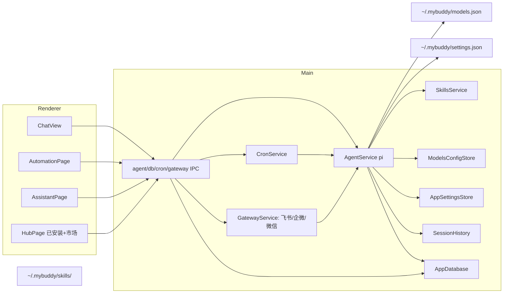

# 基于 pi 的 MyBuddy 形态桌面 Agent

## 背景与依据

- MyBuddy 本体是 **Electron + Vite + React**；数据目录对标 `~/.mybuddy`。
- pi SDK：`@earendil-works/pi-coding-agent`（`createAgentSession` / `ModelRuntime` / `SessionManager`）。
- 路径：`C:\Users\servi\Desktop\mybuddy`，分支 **`cursor/mybuddy-ui-parity`**。
- 详细接线切片见 [`π_ui_对齐_da333210`](π_ui_对齐_da333210.plan.md) / 仓库 `plan.md`（已结案）；**余量以本总规划跟踪**。
- 工作区已提交：`11a2824`（skills marketplace / wecom·wechat gateway / config writeback / session restore）。

## 当前进度（2026-08-06 三次核对代码）

### 已完成

| 项 | 说明 |
|----|------|
| 开发环境 | Node 24 + pnpm 11、VS Build Tools、`pnpm dev` / `build` / `typecheck` |
| Electron 壳 + UI | 三栏壳、聊天、Artifact、侧栏、设置、Hub、项目弹窗 UI 等 |
| 依赖 | `@earendil-works/pi-coding-agent`、`better-sqlite3`、`croner`、`electron-builder`；Electron 下 `node:sqlite` stub |
| 数据目录 | `~/.mybuddy`（`paths.ts`）：`app.db` / `models.json` / `auth.json` / `settings.json` / `SOUL.md` / `skills/` / `gateway/` |
| IPC 契约 | `src/shared/agent-ipc.ts`；preload `api.agent` / `db` / `cron` / `gateway` |
| Agent | `AgentService` + `SessionRegistry` + `permission-extension`；`sendMessage` → 真 prompt；附件随 prompt 下发 |
| 流式 UI | `pi-event-mapper` → `agent:event` → `applyAgentPatch`（文本/思考/tool/产物/上下文） |
| 会话文件 | pi `SessionManager.create(cwd)` jsonl；task 行写入 SQLite（含 space 外键占位修复） |
| **消息恢复** | `session-history.ts` 从 jsonl 还原消息（`loadTaskHistory`）；重启后 `SessionManager.open` 续同一会话；ChatView 恢复 loading |
| 模型 | `ModelRuntime` + `listModels`；欢迎三模式 `welcomeMode` |
| **模型写回** | `ModelsConfigStore`：models.json 读写 + 旧数组格式自动迁移；设置「模型」页表单增删改 provider → `saveModelsConfig` → 重载 runtime |
| **设置写回** | `AppSettingsStore`：`~/.mybuddy/settings.json`（language/permissionMode/defaultModelId/proxyUrl/memoryEnabled/theme）；启动应用；切换模型/权限自动落盘 |
| 记忆/人设 | SOUL 表；`memories` 按 `space_id` + prompt 注入 digest；**写入 API 已补**（`upsertMemory`/`deleteMemory`）；设置→记忆页空间记忆增删改 + 全局记忆摘要 |
| 自动化 | `CronService` + `AutomationPage` 真列表/启停/立即跑/运行记录 |
| 助理 Gateway | 飞书 Webhook MVP + **企微（`WecomChannelAdapter`）** + **微信（`WechatMpChannelAdapter`）**：AES-256-CBC 加解密（`wx-crypt.ts`）、签名验证、token、收发消息；路由 `/feishu` `/wecom` `/wechat`（52140 端口）；助理页镜像 + 设置页三通道配置 |
| **Hub 市场安装流** | `SkillsService`：listInstalled / listMarket（内置市场 + 扫描 `~/.mybuddy/skills`）/ installFromMarket / installByPath / uninstall / setEnabled（写 SKILL.md frontmatter）；HubPage「已安装/市场」双 tab + 本地导入；+菜单可导入技能 |
| 上下文条 | `getContextUsage` 推送（usedTokens/contextWindow/percent）+ 查询 IPC；`{pct}% · {used}K/{win}K` |
| **演示 mock 清空** | `mock/data.ts` 全空；store 空启动；工作区文件内容缓存空；InputAddMenu 引用树空 |
| **侧栏 DB** | `initRuntime` 拉 `listSpaces`/`listTasks`/`getSoul`/`listModels`/`listSkills`/`listMarketSkills`/`getAppSettings`；新建/删改 upsert |
| **侧栏 DB** | `initRuntime` 拉 `listSpaces`/`listTasks`/`getSoul`/`listModels`/`listSkills`/`listMarketSkills`/`getAppSettings`；新建/删改 upsert |
| **工作区文件树** | `WorkspaceService`：真实扫描（忽略 node_modules/.git/.venv/out/release）+ 点击预览——文本/csv/图片/PDF(pdfjs worker)/docx/xlsx/pptx(JSZip 解包)；`workspace:listFiles/readFile`；write/edit 产物经 `artifact-index.json` 回填定位 |
| **记忆自动沉淀** | `MemoryService`：assistant_end 后（memoryEnabled 开）AI 抽取全局/空间记忆——automatic 来源、replaces/deletes 冲突处理、`db:memoryChanged` 事件实时刷新设置记忆页 |
| **产物预览** | ArtifactKind 扩展 pdf/docx/xlsx/pptx；PdfPreview（worker 分页）、CodeView、Office 文本抽取；FilesPage「我的文件」按空间分组浏览任务产物 |
| **打包配置** | electron-builder ^26.15.3 接入（nsis + asarUnpack better-sqlite3 + `pack`/`dist` 脚本）；未实跑 |

### 部分完成

| 项 | 现状 |
|----|------|
| Artifact | write/edit 可推产物补丁 + 变更计数；预览已覆盖 pdf/Office（docx/xlsx/pptx 为文本抽取，复杂版式未渲染）；文件树已真扫 |
| 公网 E2E | 三通道适配器代码完整，但飞书/企微/微信均需公网回调验收（本地 webhook + 内网穿透） |
| 打包 | 配置与脚本就绪，`release/` 无产物（未跑 `pnpm dist`） |
| 邮箱/资料库/记忆页 | MailboxPage 静态开通页；资料库与跨任务记忆页 Placeholder |

### 未做

| 项 | 说明 |
|----|------|
| NewProject 持久化 | 弹窗 UI 有，写库后置（ProjectsPage 仅模板空态） |
| 资料库 / 记忆页 / 邮箱 | 资料库、跨任务记忆页 Placeholder；智能体邮箱静态开通页，均无真实能力 |

## 架构（现状）

## 分阶段（修订）

### 阶段 0–A — 环境 + UI ✅

已完成。

### 阶段 1 — 后端骨架 ✅

pi / sqlite / IPC / `~/.mybuddy` 已落地。

### 阶段 2 — Agent runtime ✅

单会话端到端、流式、审批、欢迎模式已通（需本机配好 models/auth）。

### 阶段 3 — 会话与侧栏 ✅ 主路径

- ✅ jsonl + tasks 表写入
- ✅ 侧栏改读 DB、新建/删除/重命名与 UI 列表同源
- ✅ 重载恢复 messages（`loadTaskHistory` + 续会话）
- ✅ 工作区文件树真实化（WorkspaceService 扫描 + 预览 + artifact-index 回填）

### 阶段 4 — 技能与市场 ✅

- ✅ Hub 磁盘技能 `listSkills` + store/Hub 双 tab
- ✅ 市场安装流（内置市场 + 旧 MyBuddy 技能迁移 + 本地导入 + 卸载 + 启停写 SKILL.md）
- ⬜ `/` 命令增强（可后续）

### 阶段 5 — 设置与打包 ⬜ 收尾

- ✅ 模型写回 `models.json`（含旧格式迁移）；设置写回 `settings.json`
- ✅ SOUL/记忆编辑深化（空间记忆增删改 + 全局摘要）
- ⬜ electron-builder 实跑 `dist` 产出安装包

### 阶段 6 — Gateway ✅ 三通道

- ✅ Cron + 飞书 MVP
- ✅ 企微（自建应用）/ 微信（公众号）适配器 + `/wecom` `/wechat` 路由 + 设置页配置
- ⬜ 公网 E2E 验收（内网穿透）

## 接线清单

| UI / Store | 状态 | 服务 |
|------------|------|------|
| `ChatInput` 发送 / 流式 / 审批 / 拖文件 | **真** | `AgentService` |
| `welcomeMode` | **真** | prompt append |
| `AutomationPage` | **真** | `CronService` |
| `AssistantPage` / 飞书·企微·微信设置 | **真**（三通道） | `GatewayService` |
| `appStore.models` | **可真**（有模型时 listModels + 写回） | `ModelRuntime` / `ModelsConfigStore` |
| `appStore.soul` / 记忆页 | **真**（读 + 写） | `AppDatabase`（soul/memories） |
| `appStore.tasks` 侧栏 | **真**（空库空列表） | `listTasks` / upsert |
| 消息恢复 | **真**（jsonl → UI；续会话） | `loadTaskHistory` / `SessionManager.open` |
| `HubPage` 技能 | **真**（已安装 + 市场双 tab） | `SkillsService` |
| 设置写回 | **真**（settings.json / models.json） | `AppSettingsStore` / `ModelsConfigStore` |
| `SettingsModal` 模型编辑 | **真**（表单增删改） | `saveModelsConfig` |
| Artifact / 工作区树 | **真**（扫描+预览+产物索引；docx/xlsx/pptx 为文本抽取） | `WorkspaceService` / `artifact-index` |
| NewProject 持久化 | **未做** | — |
| 资料库 / 记忆页 / 邮箱 | Placeholder / 静态页 | — |

## 建议下一步

1. ~~提交当前工作区~~ ✅ 已提交 `11a2824`；工作区树/记忆沉淀/产物预览批次 `82fc4be`（docs 同步 `caa4cd2`）
2. NewProject 持久化与能力注入（弹窗已有，写库 + 跑任务注入）
3. `pnpm dist` 实跑打包；`~/.mybuddy/models.json` + `auth.json` 配好后全链路 E2E
4. 三通道公网回调验收（内网穿透到 `127.0.0.1:52140`）
5. 资料库/记忆页/智能体邮箱、Hub 专家/MCP/连接器市场、`/` 命令增强（可后置）

## 相关提交

- `09b75c9` feat: wire pi agent, SQLite, cron, and Feishu gateway
- `11a2824` feat: skills marketplace, wecom/wechat gateway, config writeback, and session restore（含 plan.md/plan2.md 入库、gitignore 更新）
- `82fc4be` feat: workspace file tree, memory auto-digest, and artifact preview（WorkspaceService/MemoryService/artifact-index/PdfPreview，jszip+pdfjs-dist）
- `caa4cd2` docs: sync STATUS.md（工作区树/记忆沉淀/产物预览批次后同步）
- 外键修复：`upsertTask` 自动占位 space + 启动同步空间
