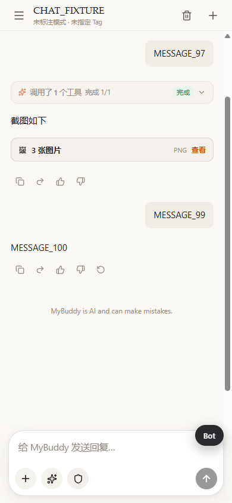
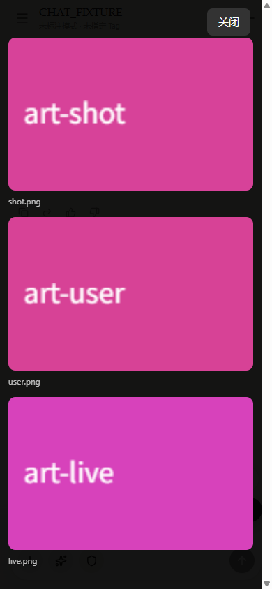

# 安卓端「图片显示」与「上下对话加载」修复报告

范围：`app/remote`（打进 APK 的那份 UI）+ 契约 `shared/src/remote-contract.ts` + 电脑端远程只读投影 `src/main/remote/RemoteImageService.ts`、`src/main/agent/AgentService.ts`。

验证方式：真实 App 组件在 offscreen Electron 里跑（真实 `App` / `RemoteMarkdown` / `RemoteImages` / `useHistoryPagination` / `zustand` store / 真实手势与滚动），客户端换成确定性内存桩。新用例 `test:remote-chat-history-images`（25 项）在改前失败、改后通过。

## 图片呈现：一条回复一行汇总

口径（已确认）：图片只挂在所属回复下，**一条回复最多一行**；多张时只显示「N 张图片」，点开看图廊；时间轴末尾不再有「其他图片」区块。

| 场景 | 之前 | 现在 |
| --- | --- | --- |
| 一条回复 1 张图 | 链接条（名字 + 格式 + 查看） | 不变 |
| 一条回复多张图 | 逐张链接条堆叠 + 末尾再列一遍 | 一行「N 张图片」→ 图廊（一次加载整批，关闭即释放） |
| 正文里的 `` | 在正文位置再插一张卡片（同一张图两个入口） | 正文不再插卡片，由本回复的汇总统一给出 |
| 归属不明的图 | 集中在时间轴末尾「其他图片」 | 该区块取消；归属落在未加载的更早历史里时，那一页上屏时自动出现（不丢） |





顺带的减法：`RemoteMessageImageScope`（图片归属上下文）、`mentionedImageIds`（正文引用集合）、`RemoteImageChipList`、末尾 `timeline-image-links` 样式全部删除——「正文引用 vs 末尾补列」两套口径合并成一套。

真机验收（AAK-AN00，`com.mybuddy.remote` debug 包）：真实任务每轮回复各显示一行图片汇总（「2 张图片」「15 张图片」）。图廊打开后 15 张图片全部解码。

## 现场：三个可复现的缺陷

| 现象 | 根因 | 触发条件 | 证据 |
| --- | --- | --- | --- |
| 上拉加载更早历史后正文整体跳动约 132px，约 0.4s 后才被拽回；用户在这段时间内自己滑动则永久错位 | 前插补偿按「整条时间轴高度差」算，把锚点**下方**同时发生的布局变化（本次渲染消失的「其他图片」块、流式 token、图片解码）一并算成上方长高 | 加载页到来时，下面有任何元素增减高度 | 旧实现首帧锚点偏移 16px → 147.94px；新实现 15.94px（±1px 内） |
| 图片从回复里消失，堆到对话最底部的「其他图片」 | 产物的 `createdByMessageId` 存的是本轮流式/工具身份（`durable-live-*`、`durable-tool-*`），回合落盘后行 id 变成 `durable-<entryId>`，旧 id 永久对不上；客户端的兜底规则只认 `durable-<数字>` | 图片生成发生在流式行仍存在时，或产物由工具链外的异步路径登记 | 桩数据 `createdByMessageId: durable-live-t-chat` → 旧代码进「其他图片」，新代码归到 `durable-98` 回复下 |
| 图片彻底不显示（既不在消息里，也不在「其他图片」里） | 归属规则允许返回 **user** 消息 id，而用户气泡不渲染图片列表，`orphanImages` 又只收 `ownerId === null` | 产物的 producer id 落在某条用户 entry 上 | 桩数据 `createdByMessageId: durable-97`（user）→ 旧代码 chips 与 orphans 都没有它 |

## 改了什么

| 文件 | 改动 | 理由 |
| --- | --- | --- |
| `app/remote/src/lib/historyWindow.ts` | 删除 `prependScrollTop`（高度差口径），新增 `anchorPrependScrollTop(当前top, 旧偏移, 新偏移)` | 只有锚点自身位移等于读者看到的位移；锚点下方增减不该进补偿量 |
| `app/remote/src/lib/historyPagination.ts` | `PrependAnchor` 去掉 `top` / `scrollHeight`（新口径用现场实时 `scrollTop`），只留 `prevFirstId` / `prevFirstOffset` / `blockIds` | 减去一整套口径与两个字段；请求飞行期间用户自己滚过也不会被旧 `scrollTop` 拽回 |
| `app/remote/src/App.tsx` | 前插补偿改为锚点口径；新增 `messageOffset()` 读锚点矩形 | 补偿在提交当帧就对齐，不再依赖 40 帧守卫事后纠正（守卫仍在，只兜图片/字体延迟长高） |
| `shared/src/remote-contract.ts` | `RemoteImageArtifact.createdAt?: number` | 图片与消息唯一的公共坐标是时刻；旧电脑端不传时退化为原序号口径 |
| `src/main/remote/RemoteImageService.ts` | 投影里带上 `createdAt: d.createdAt` | 契约字段来源，产物域本来就有该字段 |
| `app/remote/src/components/RemoteImages.tsx` | 归属优先级改为：工具调用 id → assistant 消息 id → 创建时刻 → durable 序号；**只返回 assistant 消息 id**；新增 `RemoteImageSummary`（1 张 → 名字；多张 → 「N 张图片」+ 图廊）；`RemoteMarkdownImage` 不再为产物图插卡片 | 用户气泡不渲染图片，归属落在用户消息上等于图和消息一起蒸发；逐张挂链接把回复撞得很高，且同一张图会在正文与末尾各出现一次 |
| `app/remote/src/components/RemoteMarkdown.tsx` | 只负责文字：去掉 scope / `messageImages` / `mentionedImageIds`，产物图解析交给 `urlTransform` | 一份数据只留一个渲染入口 |
| `app/remote/src/App.tsx` | 气泡改为 `<RemoteMarkdown text>` + `<RemoteImageSummary images>`；删除末尾「其他图片」区块与 `orphanImages` | 图片位置由「所属回复」一个概念决定 |
| `app/remote/src/styles/app.css` | 删除 `remote-message-image-links` / `timeline-image-links`，新增图廊样式 | 死样式不留给下一个人猜 |
| `src/main/agent/AgentService.ts` | `getProducerMessageId` 只接受 `durable-<数字>` | 不再往产物溯源里写 `durable-live-*` / `durable-tool-*` 这类回合结束后必然失效的身份（旧数据由客户端时刻口径兜住） |

行为不变的部分：图片依旧是「不内联 ``、默认一行链接」——内联会在解码前后改高度，正是当初跳动问题的来源；更早历史依旧是无缝前插，没有分页按钮。

## 验收

| 命令 | 结果 |
| --- | --- |
| `pnpm -s test:remote-chat-history-images`（新增） | 25/25 通过 |
| `pnpm -s test:remote-history-window` | 通过 |
| `pnpm -s test:remote-timeline` | 通过 |
| `pnpm -s test:remote-db` | passed=15 failed=0 |
| `pnpm -s test:remote-access` | 通过 |
| `pnpm -s test:bot-report-images` | 通过 |
| `pnpm -s test:tool-image-aging` | 通过 |
| `pnpm -s test:chat-scroll-anchor` | 20/20 通过 |
| `pnpm -s remote:typecheck` | 通过 |
| `pnpm -s typecheck` | 通过（scripts 新增错误 0） |

新增用例覆盖：一条回复只有一行图片 UI（多张收成「N 张图片」）、图廊列出全部图片并解码、图廊打开期间后台同步不重拉、单张图片点开看原图、正文引用不再单独插卡片、末尾图片区不存在、图片归属（工具 id / 流式身份落盘 / user 归属 / 只在更早块里的图，及未加载页时暂不渲染）、上拉第一页与第二页游标、前插首帧锚点不变、请求飞行期间下方长高不跳、到底不重复请求、后台同步不清空已加载历史也不改滚动位置、窗口前滚后丢弃过期块、触摸手势触发分页、上拉到顶后不再被视为「在底部」。

改前反向验证：只回退 `app/remote/src/App.tsx` 后，锚点两条断言按预期失败（首帧 147.94px），证明用例确实卡住了这个缺陷。

## 已知边界（本轮未改）

- **实时窗口前滚会丢弃已加载的更早块**：`seedCursor`（`durable.historyBefore`）变化时整组作废，宁可重新按页加载也不静默缺消息。任务长时间运行时，一边翻旧记录一边有新 token 落盘，会被拉回实时窗口顶部。桌面端同一套语义；要不要改成「保留块 + 中间未读分隔条」是交互决策，需要产品口径。
- **`test:remote-image-owner` 在本机跑不起来**：脚本以 ESM + `--packages=external` 打包，Node 24 解析 `shared/src/index.ts` 的无扩展名导入失败（`ERR_MODULE_NOT_FOUND: shared/src/activity-time`）。回退本文件后同样失败，属于既有环境问题；本轮用同源 CJS + alias 打包验证了同一批断言（通过）。
- 图片仍以「一行汇总」呈现，不内联缩略图。若希望汇总行本身带一张缩略图，需要固定比例的容器（否则解码前后高度变化会把刚修好的锚点又弄脏），未擅自改。
- 夹具在 offscreen 窗口里发现：程序化写 `scrollTop` 不触发原生 `scroll` 事件（真机与可见窗口会触发），所以夹具的 `setScroll` 显式补发一次 `scroll`，否则「读者在不在底部」这类判断会被测成假象。
- 未在真机 APK 上跑：验收基于真实组件 + 真实滚动/手势事件的 offscreen Electron，不是真机 WebView。

## 复跑

```powershell
pnpm -s test:remote-chat-history-images
pnpm -s test:remote-history-window
pnpm -s test:chat-scroll-anchor
pnpm -s remote:typecheck
pnpm -s typecheck
```

产物：`out/remote-tests/chat-history-images/`（夹具 bundle + 截图目录）。

## thermos（已触发：diff > 200 行）

做了什么：

- 减实体优先：删掉高度差口径的 `prependScrollTop`，`PrependAnchor` 从 5 个字段减到 3 个，少一条分支、少一套口径。两种补偿并存会让读者永远猜「这次是哪种」。
- 逻辑放在纯函数里：归属阶梯在 `RemoteImages.tsx`（可单测，已有 `test:remote-image-owner`），补偿算术在 `historyWindow.ts`（已有 `test:remote-history-window`），组件只做 DOM 读写。
- 类型边界：契约加可选 `createdAt` 而不是让客户端去猜 id 形状；旧电脑端缺字段时退化为原口径，不是静默瞎挂。

仍存债（未在本轮处理，按优先级）：

1. `app/remote/src/App.tsx` 已 2150+ 行，前插补偿编排 + `guardPrependAnchor` + `messageOffset` 仍住在这个组件里。应该抽到 `lib/prependAnchor.ts`，但 `scripts/chat-scroll-anchor-test.ts` 用源码字符串 grep `consumePrependAnchor(timelineFirstMessageId(el))` 把实现形状锁死在 App 里；要动就先把这条断言改成行为断言，再搬代码。
2. 图廊一次加载整批图（受 `loadRemoteImage` 的 24 张 / 32MB 内存缓存约束）。单张图大于体验预期时（例如 30 张截图）应该改为进入可视区再加载；目前没有这种规模的真实用例，不提前引入虚拟列表。
3. `resolveImageOwnerId` 现在是四级阶梯（工具 id → assistant id → 时刻 → 序号）。如果哪天再要加一条规则，应该换成「候选集合 + 打分」的显式模型，而不是第五个分支。
