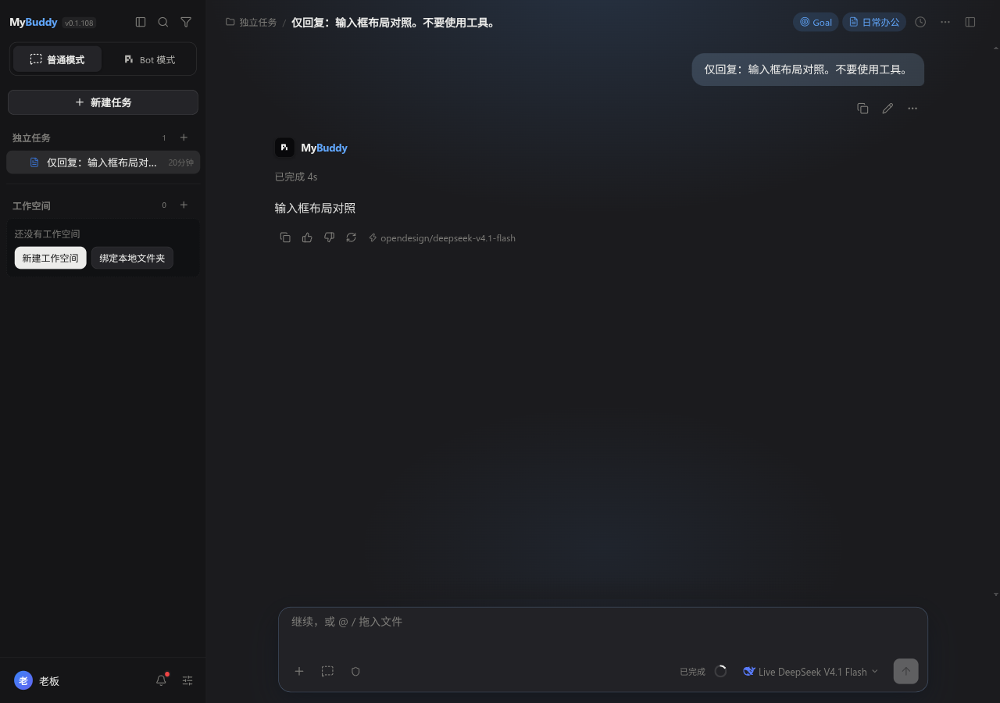
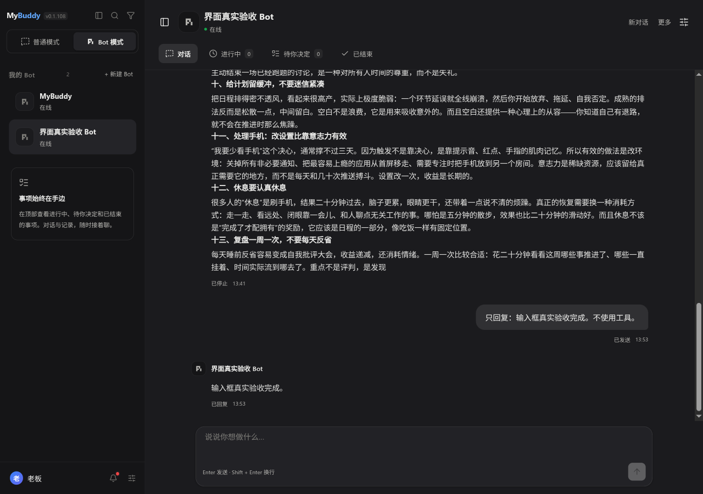
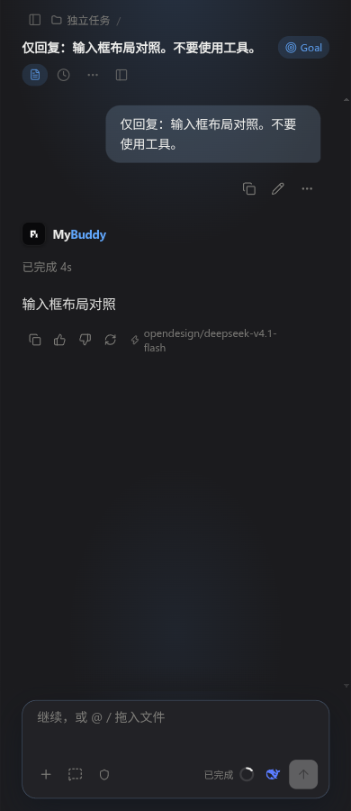
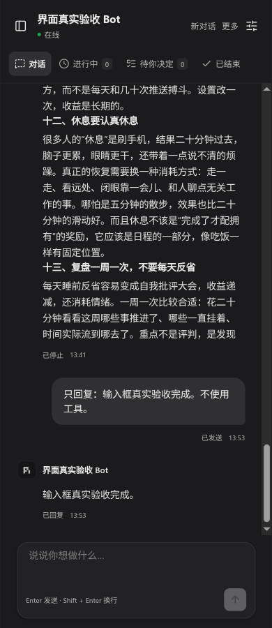

# Bot composer layout alignment (2026-11-09)

Initial baseline: `ca92fb011cf7f70a30009af2d58848157a33c01a`. Before publication this UI-only commit was rebased cleanly onto upstream `972bbee1296d9f12668501ac8c4909044af598ac`, retaining all seven intervening upstream commits including Issue #21 retirement. Typecheck, all three targeted UI suites and the four-size real Electron geometry checks passed again on that integrated version; the screenshots and raw geometry below are from that final integrated run.

## Confirmed defect

The previous change shared `ChatComposer`, but Bot still overrode the outer container, textarea padding/minimum height, toolbar, border radius and send button. In the actual Electron app at 1280×900 the old Bot surface was 764px wide and had an extra footer above the window bottom, while ordinary task chat used an 832px surface. Sharing a textarea did not produce the same UI.

## Change

- Bot now uses ordinary chat's `input-area`, `input-box`, `input-textarea`, `input-toolbar` and `send-btn` styles, including outer width/gutters, bottom positioning, rounded surface, padding and 32px icon send/stop controls.
- Removed competing Bot geometry, including the mobile override and extra footer; the selected-Work context still appears above the composer.
- Bot message column follows the same content width/gutter tokens.
- “回到最新消息” is anchored to the actual composer height, so multiline drafts do not cover it. It renders only in the conversation view.
- Kept Bot draft/send/cancel identity separate from task chat. Ordinary attachment/model/permission controls were not transplanted into a text-only Bot API or altered. Ordinary task scene tint remains scene-specific; the Bot surface remains neutral.
- This UI-only commit does not alter Issue #21 resource, authorization, approval or execution code. Upstream retirement is preserved intact.

## Real desktop evidence

Omarchy/Wayland, real Electron via `pnpm dev`, temporary test HOME/profile, existing online Magpie DeepSeek V4.1 Flash. No production profile or services changed. Both screenshots below show an existing conversation, not the ordinary welcome screen.

At the same 1280×900 viewport, both normal and Bot composer boxes measured:

| Measurement | Normal | Bot |
|---|---:|---:|
| x | 356.299 | 356.299 |
| y | 777.021 | 777.021 |
| Width | 832.012 | 832.012 |
| Height | 108.984 | 108.984 |
| Distance from bottom | 13.994 | 13.994 |
| Radius | 16 | 16 |
| Send button | 31.992×31.992 | 31.992×31.992 |

At 390/640/800px, after collapsing ordinary navigation to match Bot’s content area, both composer boxes have identical x/y/width/height/bottom measurements (all differences <1px). All Bot screenshots have no horizontal document overflow. [Raw geometry](assets/bot-composer-2026-11-09/geometry.json). Bot automatically hides its navigation at narrow widths; ordinary mode keeps its sidebar unless explicitly collapsed, so comparisons must use equal available content width rather than mistake that existing navigation behavior for a composer width regression.

Real Electron interaction checks: ordinary attachment menu remains accessible; native Shift+Enter inserts newline; composition-event Enter does not submit; normal and Bot drafts survive switching independently; 30-line draft stays capped and does not cover the latest-message button; icon send produces a real online-model reply. The IME check injects browser composition events, not a physical OS candidate-window session. Full attachment upload and OS-native IME selection were not rerun; shared mounted-composer regression also verifies paste dispatch.

## Validation

- `pnpm -s typecheck`: passed.
- `test:chat-composer-ui`, `test:bot-workspace`, `test:bot-conversation-ui`: passed.
- Initial `test:all`: 400 passed, 0 failed. Later runs exposed intermittent failures in unchanged media DOM and gateway-journal fixtures. Both passed individually; a single-worker complete run on the pre-rebase UI version was 399/400 with media DOM still failing on the custom image-model element. No timeout/assertion/baseline was relaxed; this is an outstanding test reliability issue, not a clean final aggregate pass.
- Independent static review found the latest-message button incorrectly remaining visible on Work tabs after relocation; fixed with a conversation-view guard before final verification.
- The complete aggregate was not rerun after the 85-file upstream integration; only the named integrated checks are claimed. No packaged artifact, Windows GUI or remote CI pass is claimed.
