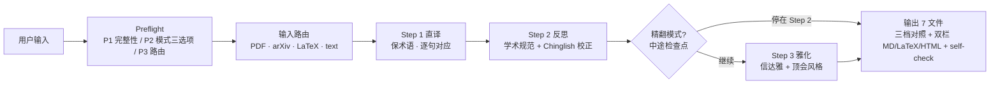

# 学术翻译 Skill

**直译 → 反思 → 雅化** · 公式零损伤 · 顶会术语库 · 双栏对照

## 工作流概览



## 输入参数（结构化契约）

主流程的所有可控参数集中在 Preflight P1（输入完整性）和 P2（三选项）。下表是机器可读的契约规格——用户没显式说时按"默认"列处理，并以「⚙️ 已应用配置」展示给用户一次回退机会。

| 参数 | 类型 | 必填 | 默认 | 取值 / 说明 |
|---|---|:-:|---|---|
| `input_kind` | enum | ✅ | 自动检测 | `pdf` / `arxiv_id` / `latex` / `markdown` / `text`；P1 完整性检查决定 |
| `direction` | enum | 否 | 按输入语言推断 | `zh2en` 中→英（投稿）/ `en2zh` 英→中（理解）/ `bilingual` 双向对照 |
| `depth` | enum | 否 | `standard` | `quick`（仅 Step 1，~1× 时间）/ `standard`（Step 1+2，~2.5×，**日常推荐**）/ `full`（Step 1+2+3，~4×，投稿必选）|
| `glossary_mode` | enum | 否 | `builtin` | `builtin` 仅内置顶会术语库 / `user` 仅用户上传术语库 / `merged` 双方合并（推荐有领域术语时）|
| `target_venue` | string | 否 | 自动推断或 `ml` | `ml` / `nlp` / `cv` / `ir` 之一；决定 Step 1 加载哪份 `glossary/{venue}.md` |
| `output_dir` | path | 否 | `translation-output/{ISO-time}-{paper-slug}/` | 用户可指定，但**绝不**写入用户原始文件路径 |

**输出契约**（参考下方 §「输出 — 三档对照 + 双栏对照」详细 schema）：

| 字段 | 类型 | 默认存在的模式 |
|---|---|---|
| `output_files` | list[str] | quick→{01,06} / standard→{01,02,04,06,07} / full→{01,02,03,04,05,06,07} |
| `provenance.coverage_pct` | float [0,1] | 全模式存在；理想 ≥ 0.95 |
| `preserve_latex.verify_passed` | bool | 含 LaTeX 输入时存在；false → 阻断输出 |
| `terms_hit_rate` | float [0,1] | 全模式存在；术语库命中率 |

**异常时的输出形态**：见下方 §「异常与边界条件」表格。所有阻断场景都会额外生成 `ERROR.md`，把原始输入 + 失败原因写入 `output_dir`，**绝不**静默退出。

---

## 不在范围内（请改用其他工具）

学术翻译追求"术语精确 + 公式零损伤 + 投稿规范"，因此对以下场景**故意做得不好**——它们各自有更合适的工具。**遇到下表场景时立即拒绝并推荐对应工具，不要尝试翻译**：

| 场景类型 | 典型输入 | 推荐替代工具 | 拒绝原因 |
|---|---|---|---|
| **通用文本 / 邮件 / 新闻** | "尊敬的 X 总" / "Today's headline" | **DeepL** / **沉浸式翻译** | 学术 Skill 会强行套用顶会风格表达（如 "We propose"），破坏商务/口语语气 |
| **代码注释 / Commit msg / i18n** | `// Calculate sum of array` | 通用机翻或代码翻译工具 | 短上下文，本 Skill 的 Provenance 三维度 + 6 文件输出是过度设计 |
| **产品 UI / 营销文案** | "Buy now! Save 50%" | 通用 i18n 工作流工具 | 需要 i18n 工作流 + 文化适配 |
| **视频字幕** | 含时间码 `00:01:23` | 字幕专用工具 | 时间码处理 + 口语风格 |
| **扫描件 PDF**（无文本层）| 纯图片论文 PDF | 先用 OCR 工具，再回本 Skill | OCR 在公式/数字上幻觉率高，输出会"看似合理但数据错乱" |
| **法律 / 医学专业级** | 合同 / 病例 / 处方 | AI + 人工 verify 工具 | 法律医学错译有真实代价，需人工校对 |
| **诗词 / 文学押韵** | 王维"空山新雨后" | 诗词专用工具 | 本 Skill 的"信达雅"针对论文，不针对意境 / 押韵 |

**关键自检**：用户输入命中上表任一行时，**绝不**进入 Preflight P2 / 三步翻译流程，直接展示"这属于 X 类场景，建议用 Y 工具，原因是 Z"。

## ⛔ Preflight（任何翻译前的开场白）

读取本 Skill 后，按以下顺序完成 Preflight。这一段看起来繁琐，但跳过其中任何一步都意味着接下来 4 倍时间的精翻可能跑偏方向，得不偿失。

### Step P1：输入完整性

| 输入类型 | 检查项 | 失败处理 |
|---|---|---|
| PDF 文件 | 路径存在 + 文本层可提取（非扫描件） | 跑 `scripts/extract_pdf.py --check {path}` 提示用户 |
| arXiv ID | 格式 `YYMM.NNNNN` 或旧式 `arch-ive/YYMMNNN` | 失败 → 询问用户重新提供 |
| LaTeX 源 | 含 `\documentclass` 或 `\begin{document}` | 失败 → 当作普通文本处理但提示 |
| 粘贴文本 | 字符数 ≥ 50 | 失败 → 询问是否要翻译这么短的内容 |
| Markdown | 文件存在或粘贴 | — |

### Step P2：模式 + 方向 + 术语库三选项澄清

学术翻译的成本差异很大——快速模式只跑直译（≈1× 时间），精翻模式三步全跑（≈4× 时间）。模型不能替用户决定花多少时间。所以这里必须让用户自己选；用户没说时给出默认值并展示「⚙️ 已应用配置」让对方有一次回退机会。

```
✋ 翻译前请确认 3 个选项：

1. 翻译方向：
   [a] 中 → 英（投稿 / 国际期刊）
   [b] 英 → 中（理解 / 文献综述）
   [c] 双向（生成中英对照版）

2. 输出深度：
   [a] 快速（仅 Step 1 直译，约耗 1×时间，适合快速理解原意）
   [b] 标准（Step 1+2 直译+反思，约耗 2.5×时间，**推荐日常使用**）
   [c] 精翻（Step 1+2+3 直译+反思+雅化，约耗 4×时间，投稿/发表必选）

3. 术语库：
   [a] 仅用内置顶会术语库（refs/glossary/）
   [b] 用户上传自定义术语库（粘贴 / 文件）
   [c] 内置 + 自定义合并（推荐有领域术语时）
```

> 用户不指定时默认 1=按输入语言推断 / 2=标准 / 3=仅内置，但要在输出前以「⚙️ 已应用配置」展示给用户。
>
> 如果用户选 `2c 精翻`，额外提示一句："精翻会在 Step 2 → Step 3 之间暂停一次，让你确认术语和直译质量"——这呼应下文的中途检查点。

### Step P3：路由

> **⚠️ 路由 = 加载触发器**：进入对应分支前，**必须**通过 Read 工具读取标 `📖 MANDATORY` 的文件再开始执行；标 `📖 按需` 的仅在该子情境出现时加载。
> 不读 = 走的是空壳分支，下游所有"按 references 规则"的判断都没有依据。

| 用户意图 | 路由模块 + 加载触发器 |
|---|---|
| "翻译这个 PDF / arxiv 论文" | 📖 **MANDATORY**: [modules/input-router.md](modules/input-router.md) → 三步翻译 |
| "把这段中文翻成英文" / "translate to English" | 📖 **MANDATORY**: [modules/input-router.md](modules/input-router.md) `text` 分支 |
| "翻译并保留公式" / "保留 latex 翻译" | 📖 **MANDATORY**: [modules/input-router.md](modules/input-router.md) `latex` 分支 + 📖 **MANDATORY**: [refs/formula-preservation.md](refs/formula-preservation.md) |
| "中英对照" / "bilingual" | 三步翻译 + 📖 **MANDATORY**: [modules/bilingual-export.md](modules/bilingual-export.md) |
| "精翻" / "投稿翻译" / "雅化" | 三步翻译全开 + 📖 **MANDATORY**: [modules/academic-polish.md](modules/academic-polish.md) + 📖 按需: [refs/anti-ai-patterns.md](refs/anti-ai-patterns.md) |
| "快翻" / "快速翻译" / "粗翻" | 仅 Step 1（不加载 polish / chinglish-patterns） |
| "用我的术语库翻" / "自定义术语" | 📖 按需: [config/user-glossary.template.yaml](config/user-glossary.template.yaml) |
| "校对译文" / "review my translation" | 跳 Step 1，从 Step 2 进入 + 📖 **MANDATORY**: [refs/chinglish-patterns.md](refs/chinglish-patterns.md) |

---

## Translation steps

Read the selected mode’s direct-translation/reflection/polish rules when that step starts: [references/translation-steps.md](references/translation-steps.md).

## 🛑 中途检查点（精翻模式必经，标准/快速模式跳过）

**触发**：用户在 Preflight P2 选了 `2c 精翻`。
**位置**：Step 2 完成后、Step 3 开始前。
**为什么需要它**：精翻三步成本接近快速模式 4 倍。如果 Step 2 的术语和直译方向已经偏了，再花 1.5× 的成本跑 Step 3 雅化只会把错误"包装得更精美"。前移检查点的代价远小于事后重跑。

### 必做动作

1. **阻断流程**——不要自动进入 Step 3，等待用户输入。
2. **展示三件物**给用户：
   - 📊 **Step 1 → Step 2 diff 摘要**：被反思阶段改写的段落数 / 术语统一替换数 / Chinglish 修正数 / 去 AI 味命中条数
   - 📋 **抽样段对照**：随机抽 2-3 段，展示 `step1_literal` vs `step2_academic` 并排对照
   - 📚 **术语命中表**：本文出现的术语 × 当前选用译法 × 来源（内置 glossary / 用户术语库 / 模型推断）
3. **三选项询问**（措辞统一）：
   ```
   ✋ Step 2 完成。是否进入 Step 3 雅化？
      [a] 继续雅化（采用当前术语和直译）
      [b] 修订后再雅化（你给我术语/段落级修改意见，我应用后再问你一次）
      [c] 就停在 Step 2（不雅化，只输出 01 + 02 两份文件）
   ```
4. **选项 b 的回环**：应用用户修改 → 重新跑 Step 2 反思一致性 → 再回到本检查点询问，最多 3 轮，超出后让用户在 a/c 之间二选一（防止无限改）。
5. **选项 c 的输出收敛**：标记 `output_files = [01, 02, 04, 06, 07]`（跳过 03 雅化和 05 LaTeX 投稿版；07 HTML 仍生成，顶栏标 "学术规范版（未雅化）"），并在 `06-self-check.md` 注明"用户在 Step 2 后停止"。

### 这里不要做的事（理由）

- ❌ 不要把"是否继续"问题与 P2 的三选项合并提问——P2 在翻译前问，本检查点在 Step 2 后问，时机不同，合并会让用户在没看到译文的情况下被迫决策
- ❌ 不要静默跳过该检查点（哪怕用户在 P2 时勾过"全自动"）——本检查点优先级高于自动化偏好，因为它是发现"翻译跑飞"的最后机会
- ❌ 不要在该检查点修改公式 / `\\cite{}` / Provenance（这些是不变量，下文会展开）

> 标准模式（2b）不强制本检查点，但建议在 Step 2 完成后**主动**展示一次 diff 摘要供用户参考；快速模式（2a）不进入本检查点。

---

## Detailed output contract

Before producing files, read the selected mode’s required outputs and bilingual export contract: [references/output-contract.md](references/output-contract.md).

## 核心原则

### 1. 不修改用户原文件

读取原文 + 写到独立目录是基本契约。即使用户说"在原文上改"，也要写到 `translation-output/` 后告知用户——他们随时可能想回头比较译稿和原文，原地改会让这个动作不可逆。

### 2. Provenance 三维度（防幻觉护城河）

每段译文必须可追溯到：
1. **页码 / 行号**（PDF 来源）
2. **章节标题**（`§3.2 Method`）
3. **原文 excerpt**（≥ 30 字，便于 ngram 校验）

为什么三维度都要：单靠"页码"会被分页错位干扰、单靠"章节"无法定位到段、单靠 excerpt 在长论文里可能多次匹配。三维度组合让 hallucination 几乎无处遁形。

### 3. 公式与引用是不变量（IDEMPOTENT）

公式、`\\cite{}`、`\\ref{}`、`\\eqref{}`、算法块、数据集名、数字——这些是论文中"不存在译法"的元素。输出前执行 `uv run --no-project python scripts/preserve_latex.py verify --original 原文路径 --translated 译文路径`；校验失败 → 阻断输出，回退到 Step 2 重跑。实际子命令为 mask / restore / verify / check-input，不是 --verify；其它资源里的旧示例以此为准。公式和引用变动会破坏 LaTeX 编译与交叉引用。

### 4. 渐进式披露（按需加载）

本文件只做路由 + 原则 + 三步法概述。详细工作流在 `modules/*.md`，术语库 / 模式表在 `refs/`，通用脚本在 `scripts/`。

### 5. 多 provider 切换（鲁棒性）

支持多个 LLM provider 互为兜底，并保留对外部"AI + 人工 verify"工具的转交路径：

| Provider | 用法 | 强项 |
|---|---|---|
| **Claude（默认）** | 当前 Skill 的执行环境 | 长文本 + 学术语境 |
| OpenAI GPT | 用户指定时 fallback | 通用翻译 |
| Gemini | 用户指定时 fallback | 多模态（PDF 图） |
| DeepL API | 用户提供 key 时 | 欧洲语言对 |
| AI + 人工校对工具 | 用户指定时 | 法律 / 医学 / 投稿前最终把关 |

本包未提供 provider-fallback 模块；不在翻译任务中临时创建模块。供应商不可用时报告原因，沿当前会话已配置且获授权的能力继续。

### 6. 容易做错的几件事（写出来是为了让模型避开陷阱）

- **跳 Step**：精翻三步缺一会让术语不一致和 Chinglish 残留——Step 2 是术语全文统一的唯一时机
- **翻译公式**：LaTeX 公式、`\\cite{}`、数字、算法名属于"非自然语言"——动它们 = 编译失败
- **翻译表格 / 把表格弄丢**：管道符表格 `| ... |` 经过翻译模型会被改写成纯文本段落、表头变成中文、行列对不齐——必须按 Step 1 强制规则第 6 条**整段占位符化**，仅 caption 走翻译；输出阶段还原
- **HTML 不生成 / 静默跳过 07**：standard/full 模式下 `07-bilingual.html` 是默认主交付物，模型常误以为"只产 Markdown 就够了"——跳过 = 视为输出失败，必须在 06-self-check 中显式标注或补出
- **自行决定模式**：精翻和快速模式成本差 4 倍，模型替用户猜错会浪费用户时间或漏译质量，所以 P2 不能跳
- **改写用户原文件**：所有产出走 `translation-output/`——保留原文是事后审计和回退的前提
- **术语库未加载就声称"已应用顶会术语"**：加载失败必须明确提示，否则用户被误导
- **Step 3 改动 Step 2 已对齐的 Provenance**：会破坏 diff 可追溯性，雅化只调措辞不改锚点
- **扫描件 PDF 当文本层处理**：OCR 在公式和数字上幻觉率高，必须先 OCR 校验再交给本 skill

### Examples

Read when resolving formula, citation, Chinglish or out-of-scope examples: [references/translation-examples.md](references/translation-examples.md).

## Failure handling

Stop output on formula/citation corruption, unresolved paragraph correspondence or missing required bilingual output. Preserve the source and report the failure. For input, glossary, context or export failure, read the matching recovery branch: [references/failure-handling.md](references/failure-handling.md).

## 模块概览

| 模块 | 职责 | 文件 |
|---|---|---|
| **输入路由** | 分流 PDF / arXiv / LaTeX / text，章节切片 + Provenance | [modules/input-router.md](modules/input-router.md) |
| **三步翻译** | 直译 → 反思 → 雅化的算法实现 | [modules/three-step-translation.md](modules/three-step-translation.md) |
| **学术润色** | 顶会风格 + Chinglish 校正 + 去 AI 味 | [modules/academic-polish.md](modules/academic-polish.md) |
| **双栏导出** | 中英对照 / 三档对照 / LaTeX 渲染 | [modules/bilingual-export.md](modules/bilingual-export.md) |

## 参考资料

| 类别 | 文件 |
|---|---|
| 顶会术语库 | [refs/glossary/](refs/glossary/) |
| Chinglish 模式 | [refs/chinglish-patterns.md](refs/chinglish-patterns.md) |
| Word Choice 替换表 | [refs/word-choice-table.md](refs/word-choice-table.md) |
| 去 AI 味规则 | [refs/anti-ai-patterns.md](refs/anti-ai-patterns.md) |
| 公式 / 引用保留 | [refs/formula-preservation.md](refs/formula-preservation.md) |
| 章节惯例 | [refs/section-conventions.md](refs/section-conventions.md) |

## 配置与扩展

- 用户自定义术语库：[config/user-glossary.template.yaml](config/user-glossary.template.yaml)
- 输出目录：`translation-output/{ISO-time}-{paper-slug}/`（自动创建）
- LaTeX 字体：默认 xeCJK + STSong / SimSun fallback
- PDF 字体：默认 PingFang SC / Noto Sans CJK fallback

---

> ⛔ **Do NOT pre-load all refs/ files** —— `refs/` 下共 5 份规则库 + 5 份会议术语库（合计 ~26K Token），全部预读会让 Skill 启动 Token 翻倍且与本次任务无关。
>
> **加载顺序铁律**：
> 1. 仅本文件（SKILL.md，~360 行）默认读入；
> 2. 进入 Preflight P3 路由后，按 📖 MANDATORY 标记**逐条**触发加载（最多 3 个文件即可覆盖任何输入类型）；
> 3. Step 1/2/3 中的 inline 加载触发器**仅在该 Step 启动时**激活（标准模式 2b 永远不读 word-choice-table.md / anti-ai-patterns.md，因为不进 Step 3）。

Trigger/boundary regression prompts: `evals/trigger.json` (load during evaluation, not ordinary execution).
